# BỘ THÔNG TIN VÀ TRUYỀN THÔNG
## HỌC VIỆN CÔNG NGHỆ BƯU CHÍNH VIỄN THÔNG
### KHOA KỸ THUẬT ĐIỆN TỬ 1
***

# BÁO CÁO KẾT QUẢ NGHIÊN CỨU KHOA HỌC CỦA SINH VIÊN

## ĐỀ TÀI: NGHIÊN CỨU VÀ XÂY DỰNG HỆ THỐNG TRÍ TUỆ NHÂN TẠO CÓ TRI THỨC (RAG)
### MÃ SỐ ĐỀ TÀI: 07-SV-2026-ĐT1

---

### THÔNG TIN ĐỀ TÀI VÀ HỘI ĐỒNG NGHIÊN CỨU
- **Đơn vị chủ trì**: Khoa Kỹ thuật Điện tử 1 (Khoa KTĐT1) — Học viện Công nghệ Bưu chính Viễn thông
- **Chủ trì đề tài (Sinh viên thực hiện)**: Nguyễn Đình Hồng Phúc — Mã sinh viên: B23DCDT191 — Lớp: D23CQDT01-B
- **Giáo viên hướng dẫn khoa học**: ThS. Chu Văn Cường
- **Lãnh đạo đơn vị phê duyệt**: TS. Nguyễn Trung Hiếu — Trưởng Khoa Kỹ thuật Điện tử 1
- **Lĩnh vực khoa học công nghệ**: Trí tuệ Nhân tạo, Xử lý Ngôn ngữ Tự nhiên, Hệ thống Thông tin & Kỹ thuật Viễn thông
- **Căn cứ pháp lý**: Đề cương Nghiên cứu Khoa học Sinh viên số 07-SV-2026-ĐT1 phê duyệt ngày 03 tháng 4 năm 2026
- **Thời gian thực hiện**: Tháng 04/2026 – Tháng 11/2026
- **Sản phẩm giao nộp theo đề cương**:
  1. 03 quyển Báo cáo kết quả nghiên cứu khoa học của sinh viên
  2. Mã nguồn phần mềm của hệ thống RAG hoạt động hoàn chỉnh trên môi trường Linux và Windows
  3. Tài liệu hướng dẫn cụ thể các bước cài đặt và vận hành hệ thống RAG (Phụ lục C)
- **Hệ thống tham chiếu thực nghiệm**: Nền tảng Sunflower RAG Platform
- **Địa điểm & Thời gian hoàn thành**: Hà Nội, Tháng 11 năm 2026

---

### LỜI CAM ĐOAN

Tôi xin cam đoan báo cáo nghiên cứu khoa học *"Nghiên cứu và xây dựng hệ thống trí tuệ nhân tạo có tri thức (RAG)"* là công trình nghiên cứu khoa học độc lập của bản thân, được thực hiện dưới sự hướng dẫn khoa học tận tình của ThS. Chu Văn Cường và sự tạo điều kiện của Khoa Kỹ thuật Điện tử 1, Học viện Công nghệ Bưu chính Viễn thông.

Toàn bộ các số liệu thực nghiệm, kết quả đo lường định lượng và mã nguồn trình bày trong báo cáo là trung thực, khách quan và được thu thập trực tiếp từ các thử nghiệm có thể tái lập trên ngữ liệu khoa học thực tế. Các kết quả nghiên cứu, khảo cứu y văn và trích dẫn lý thuyết từ các tác giả khác trong và ngoài nước đều được ghi chú xuất xứ và liệt kê tường minh trong danh mục Tài liệu tham khảo theo đúng chuẩn mực học thuật quốc tế.

*Hà Nội, ngày 10 tháng 11 năm 2026*  
**Sinh viên thực hiện đề tài**  
*Nguyễn Đình Hồng Phúc*

---

### LỜI CẢM ƠN

Để hoàn thành công trình nghiên cứu khoa học này, tôi xin bày tỏ lòng biết ơn chân thành và sâu sắc nhất tới **ThS. Chu Văn Cường** — Giảng viên hướng dẫn khoa học. Thầy đã dành nhiều thời gian định hướng học thuật, chỉ dẫn phương pháp luận nghiên cứu chặt chẽ và tận tình động viên tôi trong suốt quá trình triển khai đề tài.

Tôi xin trân trọng gửi lời cảm ơn tới Ban Chủ nhiệm Khoa Kỹ thuật Điện tử 1, các thầy cô giáo trong Bộ môn và Học viện Công nghệ Bưu chính Viễn thông đã tạo môi trường học thuật thuận lợi, hỗ trợ cơ sở vật chất và phê duyệt đề cương nghiên cứu khoa học sinh viên số 07-SV-2026-ĐT1.

Cuối cùng, tôi xin chân thành cảm ơn gia đình, bạn bè và các bạn sinh viên cùng khóa D23 đã luôn đồng hành, chia sẻ và khích lệ tôi hoàn thành tốt nhiệm vụ nghiên cứu này.

---

### MỤC LỤC

- **THÔNG TIN ĐỀ TÀI VÀ HỘI ĐỒNG NGHIÊN CỨU**
- **LỜI CAM ĐOAN**
- **LỜI CẢM ƠN**
- **MỤC LỤC**
- **DANH MỤC TỪ VIẾT TẮT VÀ THUẬT NGỮ KHOA HỌC**
- **DANH MỤC CÁC BẢNG BIỂU**
- **DANH MỤC CÁC HÌNH VẼ VÀ SƠ ĐỒ**
- **TÓM TẮT NGHIÊN CỨU (TIẾNG VIỆT & ENGLISH ABSTRACT)**
- **CHƯƠNG 1: ĐẶT VẤN ĐỀ**
  - 1.1. Bối cảnh và tính cấp thiết của đề tài
  - 1.2. Khoảng trống nghiên cứu
  - 1.3. Mục tiêu nghiên cứu
  - 1.4. Câu hỏi nghiên cứu
  - 1.5. Phạm vi và đối tượng nghiên cứu
  - 1.6. Cấu trúc báo cáo và ánh xạ đề cương
- **CHƯƠNG 2: CƠ SỞ LÝ THUYẾT VÀ TỔNG QUAN NGHIÊN CỨU**
  - 2.1. Bản chất của Hệ thống Trí tuệ Nhân tạo có Tri thức và Chuẩn mực Đánh giá KILT
  - 2.2. Bài báo Khởi nguyên và Mô hình Hóa Toán học của RAG (Lewis et al., 2020)
  - 2.3. Khảo sát và Phân loại Tiến trình Tiến hóa của Kiến trúc RAG
  - 2.4. Kiến trúc RAG Đa phương thức và Cơ chế Truy xuất Đa vector
  - 2.5. Khung Đánh giá Hiệu năng và Tiêu chuẩn Đo lường Khoa học
  - 2.6. Các Hướng Tiếp cận Đột phá Mới: GraphRAG và Agentic RAG
  - 2.7. Phân tích So sánh Chiến lược: RAG Đối chiếu với Long-Context LLMs
- **CHƯƠNG 3: PHƯƠNG PHÁP NGHIÊN CỨU VÀ THIẾT KẾ THỰC NGHIỆM**
  - 3.1. Loại hình nghiên cứu
  - 3.2. Quy trình tổng quan tài liệu có chọn lọc theo chủ đề
  - 3.3. Thiết kế thực nghiệm
  - 3.4. Dữ liệu thực nghiệm trên 5 bài báo khoa học chuẩn
  - 3.5. Công cụ và môi trường thực nghiệm
  - 3.6. Tiêu chí đo lường định lượng
  - 3.7. Thiết kế các thực nghiệm đối sánh
- **CHƯƠNG 4: KẾT QUẢ THỰC NGHIỆM VÀ THẢO LUẬN**
  - 4.1. Kết quả Tổng quan Tài liệu có Chọn lọc theo Chủ đề
  - 4.2. Kết quả Xây dựng Đường ống RAG Thực nghiệm
  - 4.3. Kết quả Thực nghiệm Định lượng Toàn trình trên Bộ dữ liệu 40 Câu hỏi
  - 4.4. Phân tích Chi tiết Truy vấn Mẫu từ Dữ liệu Log Thực tế
  - 4.5. Phân tích Hiện tượng Trượt Hit@1 và Giới hạn của Ngưỡng Cosine
  - 4.6. Khảo sát và Đối sánh Đặc tả Kỹ thuật Bốn Hệ Quản trị CSDL Vector
  - 4.7. Thảo luận
- **CHƯƠNG 5: KẾT LUẬN, HẠN CHẾ VÀ HƯỚNG NGHIÊN CỨU TIẾP THEO**
  - 5.1. Kết luận
  - 5.2. Hạn chế của nghiên cứu
  - 5.3. Hướng nghiên cứu tiếp theo
- **TÀI LIỆU THAM KHẢO**
- **PHỤ LỤC**
  - Phụ lục A: Bộ Template Prompt Chuẩn mực cho Hệ thống RAG
  - Phụ lục B: Mã nguồn Cốt lõi của Hệ thống RAG Thực nghiệm
  - Phụ lục C: Tài liệu Hướng dẫn Cài đặt và Vận hành Hệ thống trên Linux và Windows
  - Phụ lục D: Kịch bản Đánh giá Đối chứng và Bộ 40 Câu hỏi Ground-Truth

---

### DANH MỤC TỪ VIẾT TẮT VÀ THUẬT NGỮ KHOA HỌC

| Viết tắt | Thuật ngữ Tiếng Anh đầy đủ | Định nghĩa / Ý nghĩa khoa học |
| :--- | :--- | :--- |
| **RAG** | Retrieval-Augmented Generation | Mô hình sinh ngôn ngữ được tăng cường bằng cơ chế truy xuất thông tin |
| **LLM** | Large Language Model | Mô hình ngôn ngữ lớn dựa trên kiến trúc Transformer với hàng tỷ tham số |
| **DPR** | Dense Passage Retrieval | Kỹ thuật truy xuất đoạn văn bản dày đặc sử dụng mạng nơ-ron bi-encoder |
| **MIPS** | Maximum Inner Product Search | Thuật toán tìm kiếm tích vô hướng cực đại trong không gian vector đa chiều |
| **FAISS** | Facebook AI Similarity Search | Thư viện tối ưu hóa tìm kiếm độ tương đồng vector hiệu năng cao |
| **HNSW** | Hierarchical Navigable Small World | Cấu trúc đồ thị phân tầng dùng cho tìm kiếm láng giềng gần nhất (ANN) |
| **KILT** | Knowledge Intensive Language Tasks | Bộ chuẩn đánh giá chuẩn hóa cho các tác vụ ngôn ngữ đòi hỏi tri thức |
| **AIGC** | AI-Generated Content | Nội dung được tạo ra bởi trí tuệ nhân tạo (văn bản, ảnh, mã nguồn, video) |
| **HyDE** | Hypothetical Document Embeddings | Kỹ thuật tạo văn bản giả định để cải thiện độ tương đồng vector truy xuất |
| **RAGAS** | Retrieval Augmented Generation Assessment | Bộ khung đo lường tự động chất lượng hệ thống RAG qua 4 chỉ số cốt lõi |
| **ARES** | Automated RAG Evaluation System | Hệ thống đánh giá RAG tự động dựa trên học máy và khoảng tin cậy thống kê |
| **CRAG** | Corrective Retrieval-Augmented Generation | RAG có cơ chế tự hiệu chỉnh và kích hoạt tìm kiếm ngoài khi phát hiện sai lệch |
| **BM25** | Best Matching 25 | Thuật toán xếp hạng truy xuất thông tin cổ điển dựa trên tần suất từ thưa |
| **MRR** | Mean Reciprocal Rank | Nghịch đảo thứ hạng trung bình của tài liệu đúng đầu tiên trong danh sách kết quả |
| **nDCG** | Normalized Discounted Cumulative Gain | Thước đo chất lượng xếp hạng có chiết khấu độ lợi theo vị trí |

---

### DANH MỤC CÁC BẢNG BIỂU

- Bảng 1.1: Tổng hợp các khoảng trống nghiên cứu và đóng góp của đề tài
- Bảng 1.2: Bảng đối chiếu giữa 4 Nội dung nghiên cứu của Đề cương NCKH số 07-SV-2026-ĐT1 với Cấu trúc 5 Chương của Báo cáo
- Bảng 2.1: So sánh chi tiết đặc tính kỹ thuật giữa hai loại bộ nhớ
- Bảng 2.2: So sánh kỹ thuật đa chiều giữa Long-Context LLMs và Kiến trúc RAG
- Bảng 3.1: Thống kê chi tiết các công trình khoa học trong tập ngữ liệu thực nghiệm (121 trang)
- Bảng 3.2: Ma trận thiết kế thực nghiệm đo đạc đối sánh 3x3 giữa ba chiến lược cắt đoạn và ba thuật toán truy xuất
- Bảng 3.3: Đối sánh đặc tả kỹ thuật toàn diện giữa bốn hệ quản trị cơ sở dữ liệu vector
- Bảng 3.4: Bảng đặc tả mẫu bộ câu hỏi kiểm thử thực nghiệm toàn trình (trích 8 câu hỏi đại diện)
- Bảng 4.1: Tổng hợp phân loại 15 công trình khoa học tiêu biểu theo thế hệ kiến trúc RAG
- Bảng 4.2: Thống kê định lượng quá trình trích xuất và phân đoạn tập dữ liệu khoa học
- Bảng 4.3: Kết quả thực nghiệm đối sánh định lượng toàn trình trên bộ dữ liệu 40 câu hỏi kiểm thử
- Bảng 4.4: Dữ liệu thực nghiệm chi tiết cho ba câu hỏi đại diện (trích xuất trực tiếp từ log hệ thống)
- Bảng 4.5: So sánh toàn diện đặc tính kỹ thuật của bốn hệ quản trị cơ sở dữ liệu vector
- Bảng 4.6: Bảng đối chiếu kết quả nghiên cứu với các công bố khoa học tiền đề

---

### DANH MỤC CÁC HÌNH VẼ VÀ SƠ ĐỒ

- Hình 1.1: Sơ đồ so sánh cơ chế vận hành giữa mô hình ngôn ngữ thuần tham số và kiến trúc RAG
- Hình 1.2: Sơ đồ xác định phạm vi nghiên cứu trọng tâm và các giới hạn loại trừ
- Hình 1.3: Cấu trúc năm chương và luồng triển khai của đề tài nghiên cứu
- Hình 2.1: Sơ đồ phân tách bộ nhớ trong hệ thống trí tuệ nhân tạo có tri thức
- Hình 2.2: Sơ đồ kiến trúc RAG khởi nguyên của Lewis et al. (NeurIPS 2020)
- Hình 2.3: Sơ đồ tiến trình tiến hóa của các thế hệ kiến trúc RAG
- Hình 2.4: Sơ đồ quy trình hệ thống hỏi đáp RAG hai giai đoạn: Nạp dữ liệu và Truy vấn trực tiếp
- Hình 2.5: Sơ đồ kiến trúc Advanced RAG toàn diện ba tầng
- Hình 2.6: Kiến trúc RAG Đa phương thức và cơ chế Truy xuất Đa vector cho dữ liệu bán cấu trúc
- Hình 2.7: Sơ đồ bốn trụ cột đo lường đánh giá của khung RAGAS
- Hình 2.8: Sơ đồ quy trình kết hợp GraphRAG giữa đồ thị tri thức và vector
- Hình 2.9: Sơ đồ chu trình tự phản chiếu trong kiến trúc Self-RAG
- Hình 3.1: Sơ đồ luồng quy trình tổng quan tài liệu có chọn lọc và lựa chọn ngữ liệu thực nghiệm
- Hình 3.2: Quy trình năm bước của đường ống thực nghiệm RAG
- Hình 4.1: Sơ đồ kiến trúc cộng sinh giữa RAG và Long-Context LLM
- Hình 5.1: Sơ đồ lộ trình các định hướng nghiên cứu và phát triển tiếp theo của đề tài

---

### TÓM TẮT NGHIÊN CỨU

#### Tóm tắt tiếng Việt
Sự phát triển của các Mô hình Ngôn ngữ Lớn (LLM) mở ra bước đột phá cho trí tuệ nhân tạo tạo sinh, nhưng cũng bộc lộ những ranh giới nội tại của bộ nhớ tham số: hiện tượng ảo giác tri thức, sự lạc hậu dữ liệu do điểm dừng huấn luyện, và rào cản tiếp cận kho tài liệu nội bộ bảo mật. Nhằm khắc phục các hạn chế này, kiến trúc Sinh Tăng cường Truy xuất (RAG) được đề xuất như một bước chuyển dịch mô hình căn bản, kết hợp năng lực suy luận của mô hình ngôn ngữ với kho tri thức cập nhật động của bộ nhớ phi tham số bên ngoài.

Báo cáo nghiên cứu khoa học này cung cấp khảo cứu có hệ thống về hệ thống AI có tri thức và các thế hệ kiến trúc RAG, đồng thời hiện thực hóa thực nghiệm một đường ống truy xuất vector ngữ nghĩa cục bộ hoàn chỉnh theo cấu trúc năm chương chuẩn mực: (1) Đặt vấn đề, phân tích khoảng trống và xác lập bốn câu hỏi nghiên cứu; (2) Cơ sở lý thuyết, mô hình hóa xác suất biên của Lewis et al. (2020) và phân loại ba thế hệ RAG: Naive RAG, Advanced RAG, Modular RAG cùng RAG Đa phương thức; (3) Phương pháp nghiên cứu kết hợp tổng quan tài liệu có chọn lọc theo chủ đề và thiết kế thực nghiệm đường ống; (4) Kết quả thực nghiệm đối chứng trên ngữ liệu 5 bài báo khoa học chuẩn (121 trang PDF, 398 đoạn trích) với bộ 40 câu hỏi truy vấn có gán nhãn ground-truth, đo lường các chỉ số Hit@k, MRR@k, nDCG@k và độ trễ trên CPU Intel Core i7-7700HQ; (5) Kết luận, đối chiếu mục tiêu đề cương NCKH số 07-SV-2026-ĐT1, chỉ rõ các hạn chế và đề xuất lộ trình phát triển tiếp theo. Kết quả thực nghiệm khẳng định chiến lược phân đoạn trượt có vùng gối đầu kết hợp mô hình BGE-small-en-v1.5 đạt Hit@5 = 95.0% và nDCG@5 = 0.810; đồng thời hiện tượng tài liệu khảo sát thứ cấp vượt hạng tài liệu gốc phản ánh rõ ràng sự cần thiết của các tầng xử lý nâng cao.

*Từ khóa*: Retrieval-Augmented Generation, RAG, Hệ thống Trí tuệ Nhân tạo có Tri thức, Mô hình Ngôn ngữ Lớn, Vector Database, ChromaDB, FastEmbed, Hit@k, MRR, nDCG.

---

#### English Abstract
The rapid emergence of Large Language Models (LLMs) has revolutionized generative artificial intelligence, yet reliance solely on parametric memory introduces persistent challenges: factual hallucinations, knowledge obsolescence, and inaccessibility to private, domain-specific documents. Retrieval-Augmented Generation (RAG) addresses these bottlenecks by synergizing the neural reasoning capacity of LLMs with dynamic, verifiable external non-parametric knowledge stores.

This scientific research report presents a systematic investigation of Knowledge-Intensive AI Systems and RAG architectures alongside an end-to-end local empirical pipeline structured into five standard academic chapters: (1) Problem statement, research gap identification, and formulation of four core research questions; (2) Theoretical foundations, mathematical marginal probability formulations of Lewis et al. (2020), and classification across three RAG generations (Naive, Advanced, Modular) and Multimodal RAG; (3) Methodology combining selective narrative literature review and experimental pipeline design; (4) Controlled empirical evaluation on a benchmark corpus of five seminal papers (121 pages, 398 chunks) using 40 ground-truth academic queries, reporting Hit@k, MRR@k, nDCG@k, and inference latency on an Intel Core i7-7700HQ CPU; (5) Conclusions, validation against research proposal 07-SV-2026-ĐT1, disclosure of limitations, and future roadmaps. Empirical findings demonstrate that sliding window chunking with overlap paired with BGE-small-en-v1.5 achieves Hit@5 = 95.0% and nDCG@5 = 0.810, while source attribution nuances underscore the critical need for advanced post-retrieval reranking.

*Keywords*: Retrieval-Augmented Generation, RAG, Knowledge-Intensive AI, Large Language Models, Vector Database, ChromaDB, FastEmbed, Hit@k, MRR, nDCG.

---


## CHƯƠNG 1: ĐẶT VẤN ĐỀ

### 1.1. Bối cảnh và tính cấp thiết của đề tài

#### 1.1.1. Sự bùng nổ của mô hình ngôn ngữ lớn và kiến trúc Transformer
Trong thập kỷ qua, lĩnh vực Trí tuệ Nhân tạo và Xử lý Ngôn ngữ Tự nhiên đã chứng kiến bước chuyển mình mang tính cách mạng, khởi nguồn từ sự đột phá của kiến trúc mạng Transformer (Vaswani et al., 2017). Nhờ cơ chế tự chú ý đa chỏm loại bỏ các hạn chế tính toán tuần tự của các mạng nơ-ron hồi quy truyền thống, Transformer mở đường cho việc tiền huấn luyện tự giám sát trên quy mô dữ liệu khổng lồ. Sự phát triển này thúc đẩy sự ra đời của hàng loạt mô hình ngôn ngữ lớn (LLM) tiêu biểu như GPT-4 (OpenAI, 2023), PaLM (Chowdhery et al., 2023), LLaMA (Touvron et al., 2023) và Gemini (Google, 2023). Khi quy mô tham số vượt ngưỡng hàng chục tỷ, các mô hình bộc lộ năng lực đột sinh vượt bậc: hiểu và sinh ngôn ngữ tự nhiên trôi chảy, suy luận nhiều bước theo ngữ cảnh và giải quyết các tác vụ phức tạp mà không cần cập nhật trọng số. Các mô hình ngôn ngữ lớn nhanh chóng trở thành giao diện tương tác tri thức chủ đạo trong đời sống học thuật và công nghiệp.

#### 1.1.2. Nghịch lý căn bản của bộ nhớ tham số
Tuy nhiên, đằng sau sự thành công đó là một nghịch lý căn bản: các mô hình ngôn ngữ thuần túy lưu trữ toàn bộ tri thức nhân loại dưới dạng các ma trận trọng số thực liên tục phân tán trên hàng trăm lớp mạng nơ-ron, được gọi là **bộ nhớ tham số**. Quá trình học của mô hình dựa trên hàm mục tiêu cực đại hóa xác suất hợp lý có điều kiện của chuỗi từ:

$$\mathcal{L}_{LM}(\theta) = \sum_{t=1}^{T} \log P(w_t \mid w_{<t}; \theta)$$

Trong đó $w_t$ biểu diễn token tại bước $t$, $w_{<t}$ là ngữ cảnh đứng trước, và $\theta$ là không gian tham số của mô hình.

Hàm mất mát này tối ưu hóa độ hợp lý thống kê về mặt ngôn ngữ học thay vì bảo đảm tính xác thực của dữ kiện khách quan. Khi đối mặt với các tác vụ đòi hỏi tri thức chuyên sâu (Petroni et al., 2020; Petroni et al., 2021) — nơi câu trả lời phụ thuộc chặt chẽ vào các sự kiện, số liệu hay định lý khoa học cụ thể — bộ nhớ tham số bộc lộ bốn điểm nghẽn nghiêm trọng:

1. **Hiện tượng ảo giác tri thức**: Do tối ưu hóa phân phối $P(w_t \mid w_{<t})$ nhằm đạt sự trôi chảy ngôn ngữ, mô hình hoàn toàn không có cơ chế vật lý nào bắt buộc chuỗi sinh ra phải đúng đắn về mặt dữ kiện thực tế. Khi gặp câu hỏi về thực thể hiếm hoặc nằm ngoài miền dữ liệu huấn luyện, mô hình thường tự tin bịa đặt thông tin sai lệch nhưng diễn đạt rất thuyết phục. Trong các lĩnh vực y tế, pháp lý hay nghiên cứu khoa học, ảo giác là rủi ro nguy hiểm không thể chấp nhận.

2. **Sự lạc hậu của tri thức do điểm dừng dữ liệu**: Việc tiền huấn luyện tiêu tốn hàng triệu đô la điện toán, khiến tri thức trong bộ nhớ tham số bị đóng băng tại thời điểm chốt dữ liệu. Sau mốc này, mô hình hoàn toàn mù thông tin trước các sự kiện thời sự, phát minh khoa học mới hay các sửa đổi pháp lý vừa ban hành.

3. **Rào cản tiếp cận dữ liệu bảo mật và nội bộ doanh nghiệp**: Dữ liệu tiền huấn luyện chỉ gồm dữ liệu công cộng mở. Mô hình không thể truy cập tài liệu kỹ thuật nội bộ, hồ sơ bệnh án hay cơ sở dữ liệu chuyên ngành của tổ chức. Việc đưa dữ liệu riêng tư vào mô hình công cộng tiềm ẩn nguy cơ vi phạm quyền riêng tư và rò rỉ dữ liệu qua tấn công trích xuất tham số.

4. **Hiện tượng quên thảm khốc khi tinh chỉnh tham số**: Khi thực hiện vi chỉnh mô hình trên tập dữ liệu mới, quá trình lan truyền ngược gradient thường làm suy giảm cấu trúc trọng số đã học trước đó, làm mất đi các năng lực tổng quát hóa và gây tốn kém chi phí tính toán không bền vững.

#### 1.1.3. Sự trỗi dậy của kiến trúc RAG như một bước chuyển dịch mô hình
Trước những giới hạn nội tại của bộ nhớ tham số, cộng đồng khoa học nhận thấy không nên bắt ép mô hình ngôn ngữ lớn đóng vai trò kho lưu trữ dữ kiện tĩnh, mà nên xem nó là một **bộ não suy luận** kết hợp cùng một **bộ nhớ phi tham số bên ngoài**. Nghiên cứu khởi nguyên của Lewis et al. (2020) tại NeurIPS đã chính thức đề xuất kiến trúc **Sinh Tăng cường Truy xuất** (RAG). RAG thiết lập sự kết hợp cộng sinh giữa hai thành phần:
- Mô hình ngôn ngữ đóng vai trò bộ não suy luận tham số, đọc hiểu ngữ cảnh và tổng hợp câu trả lời.
- Cơ sở dữ liệu bên ngoài đóng vai trò bộ nhớ phi tham số, lưu trữ kho tài liệu cập nhật động và cho phép truy xuất dữ kiện minh bạch.

Mô hình xác suất biên của RAG liên kết hai thành phần qua biến ẩn tài liệu $z$:

$$P(y \mid x) = \sum_{z \in \text{top-}k} P(z \mid x) \cdot P(y \mid x, z)$$

Trong đó $x$ là truy vấn đầu vào, $z$ là đoạn văn bản được truy xuất với xác suất $P(z \mid x)$, và $y$ là câu trả lời được sinh ra có căn cứ rõ ràng từ ngữ cảnh $P(y \mid x, z)$ (Gao et al., 2023).

| Tiêu chí So sánh | Mô hình Thuần Tham số | Kiến trúc RAG |
| :--- | :--- | :--- |
| **Cơ chế lưu trữ** | Toàn bộ dữ kiện nén trong ma trận trọng số $\theta$ | Tách biệt: Trọng số suy luận + Kho tài liệu ngoài |
| **Độ chính xác dữ kiện** | Dễ xuất hiện ảo giác do tối ưu $P(w_t \mid w_{<t})$ | Ràng buộc trực tiếp trên ngữ cảnh được truy xuất |
| **Khả năng cập nhật** | Phải tái huấn luyện hoặc tinh chỉnh tốn kém | Cập nhật tức thời thông qua việc nạp tài liệu mới |
| **Khả năng kiểm chứng** | Hộp đen, khó truy nguyên nguồn gốc suy luận | Cung cấp trích dẫn nguồn gốc đoạn văn minh bạch |
| **Bảo mật dữ liệu** | Nguy cơ rò rỉ tri thức qua tấn công trích xuất | Kiểm soát quyền truy cập trực tiếp tại tầng truy xuất |
| **Chi phí vận hành** | Đắt đỏ khi phải tái huấn luyện định kỳ | Tiết kiệm chi phí, sử dụng mô hình cố định |

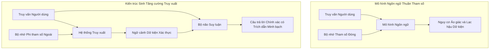

*Hình 1.1: Sơ đồ so sánh cơ chế vận hành giữa mô hình ngôn ngữ thuần tham số và kiến trúc RAG*

#### 1.1.4. Tình hình nghiên cứu trong nước, ngoài nước và nhu cầu thực tiễn theo Đề cương nghiên cứu
Theo tinh thần xác lập trong Đề cương Nghiên cứu Khoa học Sinh viên số 07-SV-2026-ĐT1 do Khoa Kỹ thuật Điện tử 1 (Học viện Công nghệ Bưu chính Viễn thông) phê duyệt, bối cảnh thực tiễn của đề tài được định vị rõ nét:

- **Tình hình nghiên cứu và ứng dụng trong nước**: Trong những năm gần đây, trí tuệ nhân tạo và các mô hình ngôn ngữ lớn nhận được sự quan tâm sâu rộng tại Việt Nam trên nhiều lĩnh vực trọng yếu như giáo dục, hành chính công, y tế, tài chính và quản lý tri thức. Hàng loạt ứng dụng trợ lý ảo và chatbot hỏi đáp đã được triển khai. Tuy nhiên, rào cản lớn nhất hiện nay là mô hình ngôn ngữ thông thường không thể giải đáp chính xác dữ liệu nội bộ, giáo trình, văn bản hành chính hay tài liệu kỹ thuật chuyên ngành do dữ liệu biến động theo thời gian hoặc chưa từng xuất hiện trong tập tiền huấn luyện, dẫn tới nguy cơ sinh câu trả lời sai lệch không có trích dẫn kiểm chứng. Nhu cầu xây dựng các hệ thống AI có khả năng khai thác kho tài liệu nội bộ tại các trường đại học và cơ quan là vô cùng cấp bách.
- **Ý nghĩa đào tạo đối với sinh viên khối ngành Kỹ thuật**: Đối với sinh viên chuyên ngành Kỹ thuật Điện tử, Viễn thông, IoT và Công nghệ Thông tin tại Học viện Công nghệ Bưu chính Viễn thông, việc nghiên cứu kiến trúc RAG mang lại cơ hội tiếp cận trực tiếp các kỹ nghệ AI hiện đại nhất: từ xử lý ngôn ngữ tự nhiên, biểu diễn vector nhúng, cơ sở dữ liệu vector, kỹ thuật truy xuất ngữ nghĩa đến tích hợp mô hình ngôn ngữ vào môi trường ứng dụng thực tế.
- **Tình hình nghiên cứu trên thế giới**: RAG đã phát triển thành một hướng nghiên cứu mũi nhọn với sự hỗ trợ của các khung công cụ tiên tiến như LangChain, LlamaIndex, FAISS, ChromaDB và Qdrant. Xu thế hiện đại không chỉ dừng ở việc giải đáp văn bản đơn thuần mà chuyển dịch mạnh mẽ sang kiểm soát độ tin cậy, truy xuất trích dẫn đa vector, xử lý dữ liệu bán cấu trúc (bảng biểu, sơ đồ) và bảo đảm tính tương thích cao trên các môi trường máy chủ Linux.
- **Nhu cầu thực tế**: Trong thực tiễn, việc tra cứu thủ công đòi hỏi người dùng tốn hàng giờ đọc nhiều tài liệu, trong khi các công cụ tìm kiếm từ khóa cổ điển chỉ trả về tài liệu liên quan mà không có khả năng tổng hợp câu trả lời theo đúng ngữ cảnh. Đề tài giải quyết vấn đề này bằng cách cho phép người dùng đặt câu hỏi bằng ngôn ngữ tự nhiên và nhận được câu trả lời tổng hợp súc tích, có cơ sở dữ liệu dựa trên nguồn tri thức tin cậy được nạp vào hệ thống.

### 1.2. Khoảng trống nghiên cứu

Mặc dù kiến trúc RAG đã phát triển mạnh mẽ trên trường quốc tế (Gao et al., 2023; Zhao et al., 2024; Huang et al., 2024), việc áp dụng vào khai phá tài liệu khoa học chuyên sâu vẫn bộc lộ năm khoảng trống nghiên cứu cốt lõi:

**Khoảng trống 1: Thiếu vắng các tổng quan học thuật tiếng Việt có hệ thống về ba thế hệ RAG.** Hầu hết các công trình tổng quan hiện nay được công bố bằng tiếng Anh (Gao et al., 2023; Zhao et al., 2024). Tại Việt Nam, tài liệu kỹ thuật về RAG chủ yếu mang tính thực hành ngắn hạn, thiếu đi các công trình học thuật chuẩn mực có khả năng tổng hợp, giải phẫu toán học và phân loại chuyên sâu sự tiến hóa qua ba thế hệ: Naive RAG, Advanced RAG và Modular RAG dưới một khung phân tích lý thuyết nhất quán.

**Khoảng trống 2: Thiếu thực nghiệm đối chứng trực tiếp giữa các chiến lược phân đoạn văn bản trên cùng tập ngữ liệu chuẩn.** Các khảo sát hiện hữu (Gao et al., 2023; Zhao et al., 2024) chủ yếu đưa ra hệ thống phân loại lý thuyết diện rộng, thiếu các thực nghiệm kiểm chứng có kiểm soát đối sánh các chiến lược phân đoạn văn bản và giải pháp cơ sở dữ liệu vector trên cùng một tập dữ liệu chuẩn. Trong khi đó, tài liệu khoa học có cấu trúc logic đa tầng phức tạp gồm công thức toán học, bảng biểu và cây phân cấp đề mục, đòi hỏi phải có đánh giá thực chứng độc lập.

**Khoảng trống 3: Chưa có nghiên cứu định lượng về mô hình nhúng siêu nhẹ cục bộ trên văn bản khoa học.** Phần lớn các triển khai thực tế phụ thuộc vào API nhúng từ xa của các nhà cung cấp thương mại đám mây hoặc mô hình nhúng khổng lồ đòi hỏi máy chủ GPU đắt đỏ. Sự xuất hiện của các mô hình nhúng siêu nhẹ vận hành trên nền tảng FastEmbed và ONNX Runtime mang lại tiềm năng triển khai cục bộ an toàn và tiết kiệm. Tuy nhiên, hiệu năng truy xuất ngữ nghĩa của các mô hình nhúng nhẹ như BAAI/bge-small-en-v1.5 trên tài liệu khoa học chuyên sâu vẫn chưa được lượng hóa thực nghiệm đầy đủ.

**Khoảng trống 4: Thiếu định lượng thực chứng về sự đánh đổi kỹ thuật giữa RAG và các mô hình có cửa sổ ngữ cảnh siêu dài.** Sự ra đời của các mô hình ngôn ngữ hỗ trợ cửa sổ ngữ cảnh lên tới hàng triệu token làm dấy lên giả thuyết rằng RAG có thể bị thay thế. Tuy nhiên, các luận điểm hiện có chủ yếu mang tính định tính, chưa có các đo lường chi tiết về độ trễ, chi phí tính toán theo bước sinh và hiện tượng suy giảm chú ý ở vùng giữa ngữ cảnh đối với các tác vụ tra cứu tài liệu khoa học.

**Khoảng trống 5: Thách thức xử lý dữ liệu đa phương thức và bán cấu trúc trong tài liệu khoa học.** Tài liệu nghiên cứu khoa học thực tế luôn kết hợp văn bản với các bảng biểu số liệu thí nghiệm, đồ thị so sánh và hình vẽ sơ đồ. Hầu hết các hệ thống RAG thực nghiệm hiện hành mới chỉ xử lý văn bản thô, làm mất hoàn toàn ngữ cảnh thị giác và phá vỡ cấu trúc bảng biểu. Các giải pháp RAG đa phương thức hiện đại với mô hình nhúng không gian đồng nhất 1408 chiều và cơ chế Truy xuất Đa vector (Multi-Vector Retriever) chưa được hệ thống hóa và phân tích tường minh trong y văn tiếng Việt.

*Bảng 1.1: Tổng hợp các khoảng trống nghiên cứu và đóng góp của đề tài*:

| Khoảng trống Nghiên cứu | Giới hạn của Y văn Hiện tại | Đóng góp của Đề tài Này |
| :--- | :--- | :--- |
| **Tổng quan hệ thống** | Phân tán, thiếu công trình tiếng Việt chuẩn mực | Xây dựng khung phân tích thống nhất 3 thế hệ RAG |
| **Chiến lược phân đoạn** | Thử nghiệm rời rạc, chưa khống chế dưới 512 token | Thực nghiệm đối chứng 3 chiến lược trên ngữ liệu khoa học (318–398 chunks) |
| **Mô hình nhúng nhẹ** | Phụ thuộc dịch vụ đám mây, thiếu đo lường cục bộ | Đo lường hiệu năng FastEmbed BGE-small qua Hit@k, MRR, nDCG trên CPU |
| **Đánh đổi ngữ cảnh** | Thảo luận định tính, thiếu căn cứ số liệu | Phân tích toàn diện dựa trên tài liệu thực chứng, độ phức tạp và chi phí |
| **RAG Đa phương thức** | Bỏ qua dữ liệu thị giác và bảng biểu bán cấu trúc | Phân tích 2 trường phái kiến trúc và Multi-Vector Retriever |

### 1.3. Mục tiêu nghiên cứu

Xuất phát từ Đề cương Nghiên cứu Khoa học Sinh viên số 07-SV-2026-ĐT1 được Khoa Kỹ thuật Điện tử 1 (Học viện Công nghệ Bưu chính Viễn thông) chính thức thông qua ngày 03 tháng 4 năm 2026, mục tiêu tổng quát của đề tài được xác định: **Nghiên cứu và xây dựng một hệ thống trí tuệ nhân tạo có khả năng hỏi đáp dựa trên nguồn tri thức được cung cấp, sử dụng phương pháp Retrieval-Augmented Generation — RAG nhằm nâng cao độ chính xác, khả năng kiểm chứng thông tin và tính phù hợp của câu trả lời, đồng thời cung cấp luận cứ định lượng tin cậy cho cộng đồng nghiên cứu.**

Năm mục tiêu cụ thể được lượng hóa rõ ràng như sau:

1. **Tổng quan và phân loại hệ thống ba thế hệ kiến trúc RAG**: Hệ thống hóa tiến trình tiến hóa của RAG qua ba thế hệ: Naive RAG, Advanced RAG và Modular RAG dựa trên tập 5 công trình khoa học nền tảng: Lewis et al. (2020), Gao et al. (2023b), Zhao et al. (2024), Huang & Huang (2024) và Petroni et al. (2021).

2. **Hiện thực hóa và kiểm chứng đường ống RAG trên ngữ liệu khoa học chuẩn**: Xây dựng hoàn chỉnh đường ống RAG cục bộ hiệu năng cao kết hợp cơ sở dữ liệu vector ChromaDB, mô hình nhúng FastEmbed dựa trên ONNX Runtime và thư viện PyMuPDF, thực nghiệm khép kín trên ngữ liệu 5 bài báo khoa học chuẩn (121 trang), bảo đảm khả năng vận hành ổn định trên cả môi trường Linux và Windows.

3. **Thực nghiệm đối sánh ba chiến lược phân đoạn văn bản và phương pháp truy xuất**: Thực hiện các thử nghiệm có kiểm soát nhằm đo lường và đánh giá so sánh tác động của 3 chiến lược phân đoạn văn bản (độ dài cố định 250 từ, trượt có độ gối đầu 50 từ, và đệ quy theo cấu trúc) khống chế dưới 512 token kết hợp đối chứng với baseline BM25 và mô hình all-MiniLM-L6-v2 trên bộ 40 câu hỏi ground-truth.

4. **Phân tích và vận dụng các khung tiêu chuẩn đánh giá RAG hiện đại**: Nghiên cứu bản chất giải thuật của các bộ tiêu chuẩn đo lường tiên tiến (RAGAS, ARES, RGB), thiết lập quy trình đánh giá dựa trên các chỉ số: độ trung thực, độ liên quan, độ chính xác ngữ cảnh và độ bao phủ trích dẫn.

5. **Nghiên cứu chuyên sâu kiến trúc RAG Đa phương thức và kỹ thuật Truy xuất Đa vector**: Phân tích hai trường phái kiến trúc RAG Đa phương thức (mô hình nhúng đa phương thức đồng nhất 1408 chiều và nhúng văn bản qua tóm tắt) kết hợp cơ chế Multi-Vector Retriever của LangChain, làm rõ giải pháp kỹ thuật bảo toàn cấu trúc bảng biểu và hình ảnh thị giác trong tài liệu khoa học.

### 1.4. Câu hỏi nghiên cứu

Đề tài tập trung giải quyết bốn câu hỏi nghiên cứu cốt lõi:

- **RQ1: Kiến trúc RAG đã tiến hóa qua những giai đoạn nào và đâu là bước đột phá cốt lõi ở mỗi thế hệ?**
  *Trọng tâm*: Phân tích sự chuyển dịch từ đường ống tuần tự của Naive RAG sang mô hình ba pha tối ưu hóa của Advanced RAG và cấu trúc module hóa linh hoạt của Modular RAG.

- **RQ2: Khả năng truy xuất và xếp hạng của mô hình nhúng siêu nhẹ BAAI/bge-small-en-v1.5 trên tài liệu khoa học đạt mức nào khi đo bằng các chỉ số retrieval chuẩn mực (Hit@k, MRR@k, nDCG@k) so sánh với baseline từ vựng BM25 và mô hình all-MiniLM-L6-v2?**
  *Trọng tâm*: Xác định tính khả thi và độ chính xác toán học của mô hình nhúng siêu nhẹ khi triển khai cục bộ với FastEmbed và ONNX Runtime trong việc phân tách các khái niệm học thuật chuyên sâu.

- **RQ3: Chiến lược phân đoạn văn bản nào trong ba cấu hình (phân đoạn cố định, phân đoạn trượt có gối đầu, phân đoạn đệ quy theo cấu trúc) mang lại hiệu quả cân bằng nhất giữa tính toàn vẹn ngữ cảnh và độ chính xác xếp hạng truy xuất khi khống chế độ dài chunk dưới giới hạn 512 token?**
  *Trọng tâm*: Kiểm chứng giả thuyết rằng chiến lược phân đoạn trượt có vùng gối đầu ngữ cảnh bảo toàn các thuật ngữ và công thức ở ranh giới cắt, giúp nâng cao thứ hạng tài liệu mục tiêu so với phân đoạn tĩnh.

- **RQ4: Kiến trúc RAG có bị thay thế bởi các LLM có cửa sổ ngữ cảnh siêu dài hay chúng bổ trợ lẫn nhau?**
  *Trọng tâm*: Phân tích sự đánh đổi kỹ thuật giữa hai tiếp cận dưới góc độ lý thuyết độ phức tạp tính toán, hiện tượng mất tập trung ở vùng giữa ngữ cảnh, cơ chế Prompt Caching, độ trễ và chi phí vận hành.

| Câu hỏi | Giả thuyết Khoa học | Phương pháp Tiếp cận | Tiêu chí Đánh giá |
| :--- | :--- | :--- | :--- |
| **RQ1** | Mỗi thế hệ RAG khắc phục trực tiếp điểm nghẽn kiến trúc của thế hệ tiền nhiệm | Khảo cứu y văn và giải phẫu mô hình toán học | Tính bao quát và chiều sâu lý thuyết |
| **RQ2** | Mô hình nhúng siêu nhẹ kết hợp query instruction đạt hiệu năng truy xuất cạnh tranh | Xây dựng chỉ mục ChromaDB và chạy thực nghiệm đối chứng | Hit@1, Hit@5, MRR@5, nDCG@5 và độ trễ (ms) |
| **RQ3** | Phân đoạn trượt có độ gối đầu bảo toàn ngữ cảnh khoa học tốt nhất | Thực nghiệm đối chứng 3 chiến lược trên 40 câu hỏi ground-truth | Hit@k, MRR@5 và nDCG@5 |
| **RQ4** | RAG và Cửa sổ dài không triệt tiêu mà bổ trợ hiệp đồng trong kiến trúc phân tầng | Khảo sát nghiên cứu thực nghiệm và phân tích lý thuyết | Độ trễ suy luận, chi phí token và độ chính xác dữ kiện |

### 1.5. Phạm vi và đối tượng nghiên cứu

#### 1.5.1. Đối tượng nghiên cứu
Đối tượng nghiên cứu trọng tâm của đề tài là bản chất cấu trúc và cơ chế toán học của kiến trúc RAG, phương pháp biểu diễn vector nhúng ngữ nghĩa dày đặc, giải thuật tìm kiếm láng giềng gần nhất xấp xỉ HNSW, kỹ thuật phân đoạn tài liệu khoa học và các tiêu chuẩn đánh giá định lượng hệ thống RAG.

#### 1.5.2. Ngữ liệu thực nghiệm
Nghiên cứu tập trung vào văn bản học thuật tiếng Anh chuyên ngành Trí tuệ Nhân tạo. Tập ngữ liệu bao gồm toàn văn 5 bài báo khoa học nền tảng với tổng cộng **121 trang PDF**:
1. Lewis et al. (2020) - *Retrieval-Augmented Generation for Knowledge-Intensive NLP Tasks* (NeurIPS 2020, 19 trang).
2. Gao et al. (2023b) - *Retrieval-Augmented Generation for Large Language Models: A Survey* (arXiv:2312.10997, 21 trang).
3. Zhao et al. (2024) - *Retrieval-Augmented Generation for AI-Generated Content: A Survey* (arXiv:2402.19473, 22 trang).
4. Huang & Huang (2024) - *A Survey on Retrieval-Augmented Text Generation for Large Language Models* (arXiv:2404.10981, 37 trang).
5. Petroni et al. (2021) - *KILT: a Benchmark for Knowledge Intensive Language Tasks* (NAACL-HLT 2021, 22 trang).

#### 1.5.3. Ngăn xếp công nghệ thực nghiệm
- **Ngôn ngữ và môi trường**: Python 3.11 với kiến trúc module hóa.
- **Cơ sở dữ liệu vector**: ChromaDB, sử dụng chỉ mục đồ thị Hierarchical Navigable Small World (HNSW).
- **Mô hình nhúng**: FastEmbed tích hợp mô hình BAAI/bge-small-en-v1.5 tối ưu hóa bằng ONNX Runtime.
- **Trích xuất dữ liệu**: Thư viện PyMuPDF cho văn bản PDF khoa học.
- **Tham chiếu ứng dụng**: Dự án thực tế vibecoding-sunflower.

#### 1.5.4. Ranh giới loại trừ của đề tài
Đề tài xác định rõ các ranh giới loại trừ nhằm tập trung nguồn lực:
- Không hiện thực hóa mô hình RAG đa phương thức cho dữ liệu video, âm thanh phức tạp; chỉ tập trung vào văn bản khoa học có cấu trúc.
- Không tích hợp và không phụ thuộc vào các API mô hình tạo sinh thương mại trả phí (như GPT-4) cho khâu tạo văn bản cuối cùng, bảo đảm tính khách quan, khả năng tái lập độc lập và bảo mật nội bộ trong môi trường học thuật.

| Ranh giới Phạm vi | Thuộc Phạm vi Nghiên cứu | Nằm Ngoài Phạm vi (Loại trừ) |
| :--- | :--- | :--- |
| **Loại hình dữ liệu** | Tài liệu khoa học có cấu trúc dạng văn bản | Dữ liệu đa phương thức video, âm thanh thời gian thực |
| **Tập dữ liệu kiểm thử** | 5 bài báo khoa học kinh điển về RAG | Dữ liệu đàm thoại mở, mạng xã hội hoặc tin tức |
| **Tầng công nghệ** | ChromaDB, FastEmbed, ONNX, PyMuPDF | Dịch vụ cơ sở dữ liệu vector đám mây thương mại |
| **Khâu tạo sinh** | Phân tích cơ chế giải mã và đánh giá ngữ cảnh | Gọi API mô hình ngôn ngữ thương mại có trả phí |

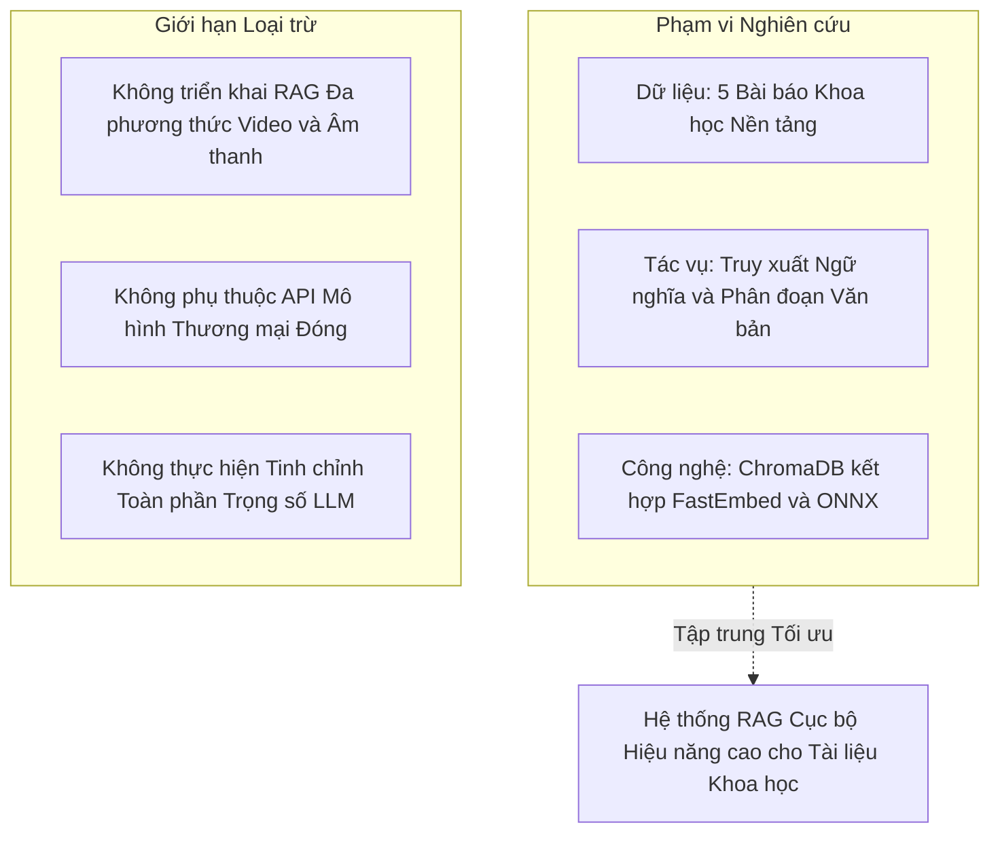

*Hình 1.2: Sơ đồ xác định phạm vi nghiên cứu trọng tâm và các giới hạn loại trừ*

### 1.6. Cấu trúc báo cáo

Báo cáo nghiên cứu khoa học được cấu trúc thành 5 chương chính, thiết lập mạch lập luận xuyên suốt từ cơ sở lý thuyết đến thực nghiệm kiểm chứng:

- **Chương 1: Đặt vấn đề**: Thiết lập bối cảnh bùng nổ của mô hình ngôn ngữ lớn, chỉ ra bốn điểm nghẽn nội tại của bộ nhớ tham số, giới thiệu bước chuyển dịch mô hình của RAG, xác định năm khoảng trống nghiên cứu, năm mục tiêu cụ thể, bốn câu hỏi nghiên cứu, phạm vi và ranh giới đề tài.

- **Chương 2: Cơ sở lý thuyết và Tổng quan tài liệu**: Phân tích lý thuyết về hệ thống AI có tri thức và chuẩn KILT. Giải phẫu toán học bài báo khởi nguyên của Lewis et al. (2020) với hai biến thể mô hình RAG-Sequence và RAG-Token. Khảo sát toàn diện ba thế hệ kiến trúc RAG: Naive RAG, Advanced RAG và Modular RAG; phân tích chuyên sâu hai trường phái kiến trúc RAG Đa phương thức và kỹ thuật Truy xuất Đa vector (Multi-Vector Retriever); khảo cứu các khung đo lường (RAGAS, ARES, RGB), GraphRAG và Agentic RAG.

- **Chương 3: Phương pháp nghiên cứu và Thiết kế hệ thống RAG**: Chi tiết hóa kiến trúc đường ống RAG thực nghiệm dựa trên ChromaDB, FastEmbed và ONNX Runtime. Trình bày phương pháp tiền xử lý văn bản liên tục xuyên trang bằng PyMuPDF, giải thuật chỉ mục HNSW, quy trình chuyển đổi vector nhúng của mô hình BGE và thiết kế chi tiết 3 chiến lược phân đoạn văn bản thực nghiệm khống chế dưới 512 token.

- **Chương 4: Kết quả thực nghiệm và Thảo luận**: Công bố các số liệu thực nghiệm đo lường trên ngữ liệu 5 bài báo khoa học (121 trang). So sánh định lượng hiệu năng của 3 chiến lược phân đoạn và 3 phương pháp truy xuất (BM25, all-MiniLM-L6-v2, BAAI/bge-small-en-v1.5) theo các chỉ số Hit@k, MRR@5 và nDCG@5. Phân tích các thất bại truy xuất thực tế và giải đáp toàn diện 4 câu hỏi nghiên cứu.

- **Chương 5: Kết luận và Hướng phát triển**: Tổng kết toàn bộ các đóng góp học thuật và phát hiện then chốt. Đánh giá sự tương hỗ giữa RAG và các mô hình có cửa sổ ngữ cảnh siêu dài. Giới thiệu các hướng mở rộng đột phá như GraphRAG, Agentic RAG; nêu rõ hạn chế và kiến nghị nghiên cứu tiếp theo.

Nhằm bảo đảm tính kế thừa chặt chẽ và tuân thủ nghiêm ngặt các mục tiêu đã đăng ký, đề tài thiết lập bảng đối chiếu chi tiết giữa bốn nội dung trong Đề cương NCKH số 07-SV-2026-ĐT1 với cấu trúc năm chương của báo cáo toàn văn:

*Bảng 1.2: Bảng đối chiếu giữa 4 Nội dung nghiên cứu của Đề cương NCKH số 07-SV-2026-ĐT1 với Cấu trúc 5 Chương của Báo cáo*:

| Nội dung theo Đề cương (07-SV-2026-ĐT1) | Cấu trúc Chương tương ứng | Trọng tâm Triển khai và Sản phẩm Đầu ra |
| :--- | :--- | :--- |
| **Nội dung 1**: Nghiên cứu tổng quan về trí tuệ nhân tạo, mô hình ngôn ngữ lớn và RAG | **Chương 1** (Đặt vấn đề) & **Chương 2** (Cơ sở lý thuyết và Tổng quan) | Khảo cứu y văn quốc tế, giải phẫu toán học Lewis et al. (2020), phân loại 3 thế hệ RAG (Naive, Advanced, Modular) và RAG Đa phương thức. |
| **Nội dung 2**: Khảo sát và lựa chọn kiến trúc hệ thống RAG | **Chương 2** (Mục 2.3, 2.4) & **Chương 3** (Mục 3.3, 3.5, 3.7) | Khảo sát các giải pháp công nghệ, lựa chọn ngăn xếp kỹ thuật: PyMuPDF, FastEmbed BGE-small, ChromaDB HNSW, tối ưu hoá chi phí điện toán. |
| **Nội dung 3**: Xây dựng hệ thống | **Chương 3** (Mục 3.3) & **Phụ lục B, Phụ lục C** | Hiện thực hóa mã nguồn hệ thống hoàn chỉnh, hỗ trợ môi trường Linux và Windows, thiết lập đường ống nạp dữ liệu và truy vấn thời gian thực. |
| **Nội dung 4**: Thử nghiệm và đánh giá | **Chương 4** (Kết quả và Thảo luận) | Thực nghiệm khép kín trên ngữ liệu 5 bài báo khoa học, đối sánh 3 chiến lược phân đoạn, phân tích thất bại và giải đáp 4 câu hỏi nghiên cứu. |
| **Nghiệm thu & Đề xuất**: Tổng kết đánh giá và định hướng phát triển | **Chương 5** (Kết luận, Hạn chế và Hướng nghiên cứu tiếp theo) | Đối chiếu mức độ hoàn thành so với đề cương, chỉ rõ các giới hạn khách quan, đề xuất lộ trình mở rộng GraphRAG và Agentic RAG. |

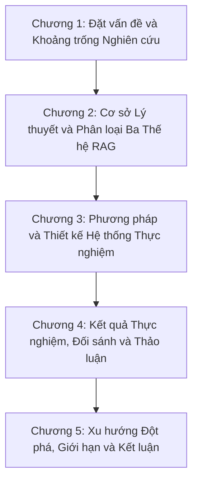

*Hình 1.3: Cấu trúc năm chương và luồng triển khai của đề tài nghiên cứu*

---

*Chương 1 đã thiết lập toàn bộ nền tảng luận điểm, xác định rõ tính cấp thiết của đề tài và định vị các đóng góp khoa học chính của nghiên cứu. Tiếp theo, Chương 2 sẽ đi sâu phân tích cơ sở lý thuyết toán học và khảo cứu có hệ thống sự tiến hóa của các thế hệ kiến trúc RAG trong kho tàng y văn thế giới.*


## CHƯƠNG 2: CƠ SỞ LÝ THUYẾT VÀ TỔNG QUAN NGHIÊN CỨU

Chương này thiết lập nền tảng lý thuyết vững chắc và cung cấp cái nhìn tổng quan có hệ thống về toàn bộ hệ sinh thái của các hệ thống trí tuệ nhân tạo có tri thức. Nội dung chương đi từ bản chất của việc phân tách bộ nhớ, phân tích mô hình toán học xác suất trong công trình khởi nguyên của Lewis et al. (2020), khảo sát sự tiến hóa qua ba thế hệ kiến trúc RAG, mở rộng sang lĩnh vực đa phương thức, hệ thống hóa các khung đo lường đánh giá hiệu năng tiên tiến, và phân tích các xu hướng đột phá đang định hình tương lai.

---

### 2.1. Bản chất của Hệ thống Trí tuệ Nhân tạo có Tri thức và Chuẩn mực Đánh giá KILT

#### 2.1.1. Định nghĩa chuẩn tắc về tác vụ đòi hỏi tri thức chuyên sâu
Trong lý thuyết khoa học nhận thức và xử lý ngôn ngữ tự nhiên, các tác vụ tính toán được phân chia thành hai nhóm ranh giới cơ bản:
1. **Tác vụ dựa trên kỹ năng ngôn ngữ và cấu trúc**: Bao gồm phân tích cú pháp, gán nhãn từ loại, nhận diện thực thể tên cơ bản, hoặc sửa lỗi chính tả. Các tác vụ này chỉ đòi hỏi mô hình nắm vững quy luật ngữ pháp và ngữ nghĩa cấu trúc câu, vốn có thể tổng quát hóa tốt qua quá trình học thống kê.
2. **Tác vụ đòi hỏi tri thức chuyên sâu**: Được định nghĩa chuẩn tắc bởi Petroni et al. (2020) và Lewis et al. (2020) là:
> *"Những tác vụ mà một con người thông minh, có học thức thông thường cũng không thể kỳ vọng hoàn thành chính xác nếu không được cung cấp hoặc chủ động tra cứu một kho tài liệu tri thức bên ngoài đáng tin cậy."*

Các nhóm bài toán tiêu biểu thuộc diện này bao gồm:
- **Hỏi đáp miền mở**: Trả lời các câu hỏi về sự kiện lịch sử, công thức khoa học hay dữ kiện địa lý mà không có ngữ cảnh cung cấp sẵn; hệ thống phải tự tìm kiếm trong kho tri thức toàn diện.
- **Kiểm chứng sự thật**: Xác định một phát biểu là đúng, sai hay không đủ căn cứ, đồng thời chỉ ra đoạn văn bản bằng chứng chứng minh cho kết luận đó.
- **Hội thoại đòi hỏi tri thức**: Trợ lý ảo tương tác chuyên sâu với chuyên gia về các chủ đề học thuật hoặc nghiệp vụ phức tạp.
- **Điền khuyết thực thể**: Dự đoán mối quan hệ giữa các thực thể dựa trên kho dữ liệu thực tế liên tục cập nhật.

#### 2.1.2. Lý thuyết phân tách bộ nhớ: Bộ nhớ tham số và Bộ nhớ phi tham số
Kiến trúc AI truyền thống gộp chung năng lực tính toán và dữ liệu vào cùng một khối tham số mạng nơ-ron. Ngược lại, kiến trúc AI có tri thức hiện đại vận hành dựa trên nguyên lý phân tách tường minh giữa hai loại bộ nhớ:

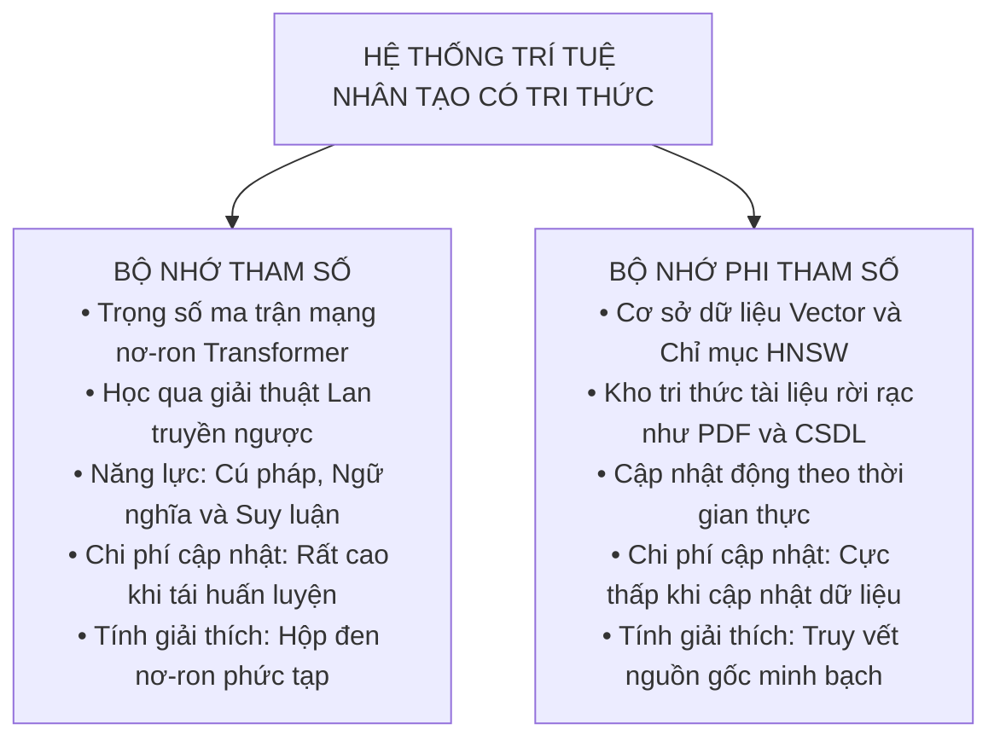

*Hình 2.1: Sơ đồ phân tách bộ nhớ trong hệ thống trí tuệ nhân tạo có tri thức*

*Bảng 2.1: So sánh chi tiết đặc tính kỹ thuật giữa hai loại bộ nhớ*:

| Đặc tính so sánh | Bộ nhớ tham số | Bộ nhớ phi tham số |
| :--- | :--- | :--- |
| **Bản chất vật lý** | Trọng số ma trận liên tục ($W \in \mathbb{R}^{d \times d}$) | Kho vector rời rạc, bảng dữ liệu, đồ thị tri thức |
| **Cơ chế cập nhật** | Tối ưu hóa lan truyền ngược gradient | Thêm, sửa, xóa bản ghi trực tiếp trong CSDL |
| **Thời gian cập nhật** | Vài giờ đến vài tháng (đòi hỏi siêu máy tính) | Thời gian thực (vài phần nghìn giây) |
| **Khả năng kiểm chứng** | Khó giải thích (hộp đen mạng nơ-ron) | Truy vết trực tiếp về văn bản gốc, trang sách, URL |
| **Kiểm soát quyền truy cập** | Bất khả thi (không thể che giấu một phần tham số) | Phân quyền chi tiết theo vai trò người dùng |
| **Nguy cơ lỗi** | Ảo giác, nhầm lẫn dữ kiện, tự tin thái quá | Truy xuất sai tài liệu (nhưng phát hiện và sửa được ngay) |

Sự phân tách này mang lại lợi thế chiến lược: Chúng ta có thể đóng băng hoàn toàn tham số của mô hình ngôn ngữ lớn (tiết kiệm chi phí phần cứng khổng lồ), trong khi kho dữ liệu tri thức bên ngoài có thể liên tục được mở rộng, cập nhật và làm sạch mỗi ngày.

#### 2.1.3. Bộ chuẩn Benchmark KILT và Tiêu chuẩn Thẩm định Nguồn gốc Tri thức
Nhằm chuẩn hóa việc đánh giá năng lực của các mô hình AI có tri thức, Petroni et al. (2021) tại Facebook AI Research và University College London đã công bố bộ chuẩn KILT tại hội nghị NAACL-HLT 2021.

KILT giải quyết tình trạng phân mảnh dữ liệu bằng cách:
1. **Neo vào một kho tri thức chuẩn duy nhất**: Sử dụng bản chụp Wikipedia thống nhất gồm hơn **5.9 triệu bài viết** (phân rã thành hơn 35 triệu đoạn văn bản 100 từ).
2. **Quy tụ 11 bộ dữ liệu chuẩn mực thuộc 5 miền tác vụ**:
   - *Fact Checking*: FEVER
   - *Open-Domain QA*: Natural Questions (NQ), TriviaQA, HotpotQA (đòi hỏi suy luận đa bước), ELI5 (trả lời câu hỏi mở dài)
   - *Slot Filling*: T-REx, Zero-Shot RE
   - *Entity Linking*: AIDA CoNLL-YAGO, WNED-WIKI, WNED-CWEB
   - *Dialogue*: Wizard of Wikipedia (WoW)

Đóng góp học thuật quan trọng nhất của KILT là việc thiết lập tiêu chuẩn đánh giá kép: **Độ chính xác nội dung** kết hợp chặt chẽ với **Độ chính xác nguồn gốc** (Provenance). KILT đưa ra chỉ số KILT-AC:

$$\text{KILT-AC} = \text{Accuracy} \times \text{Provenance Success}$$

Trong đó, một câu trả lời chỉ được tính điểm khi và chỉ khi:
1. Nội dung câu trả lời sinh ra khớp với nhãn thực tế.
2. Đoạn văn bản bằng chứng trích dẫn phải nằm trong tập các đoạn văn bản chứng minh hợp lệ được chuyên gia thẩm định.

Khái niệm Provenance khẳng định nguyên lý: *Một phát biểu của trí tuệ nhân tạo chỉ có giá trị khi nó có thể truy nguyên nguồn gốc về một văn bản có thẩm quyền trong thế giới thực.*

---

### 2.2. Bài báo Khởi nguyên và Mô hình Hóa Toán học của RAG (Lewis et al., 2020)

Tại hội nghị NeurIPS 2020, nhóm nghiên cứu tại Facebook AI Research do Patrick Lewis dẫn đầu đã công bố công trình lịch sử: *"Retrieval-Augmented Generation for Knowledge-Intensive NLP Tasks"*. Đây là bài báo đầu tiên chính thức đặt tên và mô hình hóa toán học xác suất cho thuật ngữ RAG.

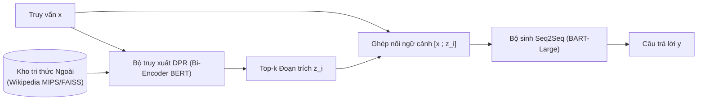

*Hình 2.2: Sơ đồ kiến trúc RAG khởi nguyên của Lewis et al. (NeurIPS 2020)*

#### 2.2.1. Kiến trúc hai khối nơ-ron ghép nối
Kiến trúc RAG của Lewis et al. bao gồm hai thành phần nơ-ron chính:
1. **Bộ truy xuất nơ-ron Dense Passage Retriever (DPR)**: Dựa trên mô hình Bi-encoder (Karpukhin et al., 2020):
   - Bộ mã hóa câu hỏi $E_Q(x)$ chuyển câu hỏi $x$ thành vector đặc trưng 768 chiều.
   - Bộ mã hóa đoạn văn $E_D(z)$ chuyển từng đoạn văn $z$ thành vector đặc trưng 768 chiều.
   - Điểm số liên quan giữa câu hỏi $x$ và tài liệu $z$ được tính bằng tích vô hướng:
     $$p_\eta(z \mid x) \propto \exp\left(E_Q(x)^T E_D(z)\right)$$
   - Thuật toán Tìm kiếm Tích vô hướng Cực đại (MIPS) qua thư viện FAISS giúp tìm top-$k$ tài liệu nhanh chóng trong vài mili-giây trên hàng chục triệu vector.
2. **Bộ sinh chuỗi (BART-Large)**: Mô hình Seq2Seq với 400 triệu tham số. BART tiếp nhận đầu vào là chuỗi nối tiếp câu hỏi $x$ và tài liệu $z$, sau đó giải mã sinh chuỗi mục tiêu $y$ từng token.

#### 2.2.2. Mô hình toán học RAG-Sequence
Trong RAG-Sequence, hệ thống giả định toàn bộ chuỗi đầu ra $y$ được điều kiện hóa trên cùng một tài liệu truy xuất $z$. Xác suất sinh ra chuỗi $y$ được tính bằng cách lấy kỳ vọng trên tập hợp top-$k$ tài liệu có xác suất truy xuất cao nhất:

$$p_{\text{RAG-Seq}}(y \mid x) = \sum_{z \in \text{top-}k} p_\eta(z \mid x) \cdot p_\theta(y \mid x, z) = \sum_{z \in \text{top-}k} p_\eta(z \mid x) \prod_{i=1}^N p_\theta(y_i \mid x, z, y_{1:i-1})$$

Trong đó:
- $p_\eta(z \mid x)$ là xác suất tiên nghiệm truy xuất tài liệu $z$ từ bộ truy xuất DPR (với tham số $\eta$).
- $p_\theta(y_i \mid x, z, y_{1:i-1})$ là xác suất sinh ra token thứ $i$ của bộ sinh BART (với tham số $\theta$), có điều kiện trên câu hỏi gốc $x$, tài liệu $z$, và các token đã sinh trước đó $y_{1:i-1}$.
- $N$ là độ dài của chuỗi đầu ra $y$.

*Ý nghĩa của RAG-Sequence*: Rất phù hợp khi câu trả lời đòi hỏi tính nhất quán cao và toàn bộ thông tin câu trả lời nằm trọn vẹn trong một đoạn văn bản duy nhất.

#### 2.2.3. Mô hình toán học RAG-Token
RAG-Token mang tính linh hoạt hơn: Việc lựa chọn tài liệu được giải phóng ở cấp độ từng token. Mỗi token sinh ra có thể được điều kiện hóa trên một tài liệu khác nhau:

$$p_{\text{RAG-Token}}(y \mid x) = \prod_{i=1}^N \sum_{z \in \text{top-}k} p_\eta(z \mid x) \cdot p_\theta(y_i \mid x, z, y_{1:i-1})$$

*Phân tích bản chất toán học*:
Tại mỗi bước giải mã $i$, mô hình tính toán một phân phối xác suất hỗn hợp cho token kế tiếp bằng cách tính tổng trọng số xác suất sinh từ $k$ tài liệu khác nhau. Điều này cho phép bộ sinh:
- Lấy một phần thông tin từ tài liệu $z_1$.
- Lấy một phần thông tin khác từ tài liệu $z_2$.
- Tổng hợp thành một câu trả lời hoàn chỉnh mang tính đa nguồn.

#### 2.2.4. Cơ chế huấn luyện End-to-End coi tài liệu là biến tiềm ẩn
Điểm sáng tạo học thuật vượt bậc của Lewis et al. là huấn luyện đầu-cuối mà không cần dữ liệu gán nhãn thủ công về việc câu hỏi nào phải đi với tài liệu nào. Tài liệu được truy xuất $z$ được xem là một **biến tiềm ẩn** trong không gian xác suất.

Hàm mục tiêu huấn luyện cực tiểu hóa hàm mất mát đối số logarit âm của chuỗi đích $y$:

$$\mathcal{L}_{\text{RAG}}(\theta, \eta) = - \sum_{(x, y) \in \mathcal{D}} \log p(y \mid x)$$

Trong quá trình tối ưu hóa bằng thuật toán Adam, đạo hàm riêng được truyền qua cả hai khối:
- Cập nhật tham số bộ sinh $\theta$ để sinh câu trả lời đúng hơn khi có tài liệu hỗ trợ.
- Cập nhật tham số bộ mã hóa truy vấn $\eta$ của DPR: Nếu tài liệu $z$ giúp bộ sinh đưa ra xác suất cho $y$ cao hơn, gradient sẽ tự động điều chỉnh bộ mã hóa truy vấn để kéo vector của câu hỏi $x$ lại gần hơn với vector của tài liệu $z$ trong không gian nhúng.

#### 2.2.5. Thuật toán giải mã: Thorough Decoding và Fast Decoding
Đối với mô hình RAG-Token, phân phối chuyển tiếp token $p'(y_i \mid y_{1:i-1}, x) = \sum_{z \in \text{top-}k} p_\eta(z \mid x) p_\theta(y_i \mid x, z, y_{1:i-1})$ có thể được đưa trực tiếp vào thuật toán Beam Search chuẩn mực để sinh từng token tự hồi quy.

Ngược lại, đối với mô hình RAG-Sequence, xác suất biên $p(y \mid x)$ không phân rã thành tích của các phân phối độc lập từng token, khiến việc tìm kiếm chuỗi cực đại $\arg\max_y p(y \mid x)$ đòi hỏi kỹ thuật giải mã xấp xỉ. Lewis et al. (2020) đề xuất phương pháp tiếp cận dựa trên việc chạy Beam Search độc lập cho từng tài liệu $z$ để thu được tập hợp các chuỗi giả thuyết ứng viên $\mathcal{Y}_z$, sau đó hợp lại thành không gian ứng viên $\mathcal{Y} = \bigcup_z \mathcal{Y}_z$. Để ước tính chuỗi tối ưu trong $\mathcal{Y}$, hai giải thuật xấp xỉ được thiết kế:

1. **Thorough Decoding**: Với mỗi chuỗi ứng viên $y \in \mathcal{Y}$, mô hình tính toán xác suất có điều kiện $p(y \mid x, z)$ trên toàn bộ $k$ tài liệu, ngay cả với những tài liệu $z$ mà chuỗi $y$ không lọt vào beam search cục bộ của tài liệu đó. Phương pháp này bảo đảm tính hội tụ xác suất biên chính xác nhưng đòi hỏi thêm nhiều lượt lan truyền tiến qua mạng nơ-ron cho từng tài liệu.

2. **Fast Decoding**: Để tối ưu hóa tốc độ suy luận, giải thuật Fast Decoding đưa ra giả định xấp xỉ rằng nếu một chuỗi $y$ không được sinh ra trong chùm tia beam search của tài liệu $z$, thì xác suất điều kiện tương ứng xấp xỉ bằng không: $p(y \mid x, z) \approx 0$. Do đó, mô hình chỉ tính tổng xác suất biên trên tập hợp các tài liệu đã thực sự sinh ra $y$ trong beam search cục bộ, loại bỏ hoàn toàn các lượt forward pass bổ sung tốn kém và đạt tốc độ đáp ứng nhanh trong các hệ thống thực tế.

---

### 2.3. Khảo sát và Phân loại Tiến trình Tiến hóa của Kiến trúc RAG

Dựa trên các khảo sát quy mô lớn của Gao et al. (2023b) và Huang & Huang (2024), kiến trúc RAG đã trải qua ba thế hệ tiến hóa chính thức: **Naive RAG**, **Advanced RAG**, và **Modular RAG**.

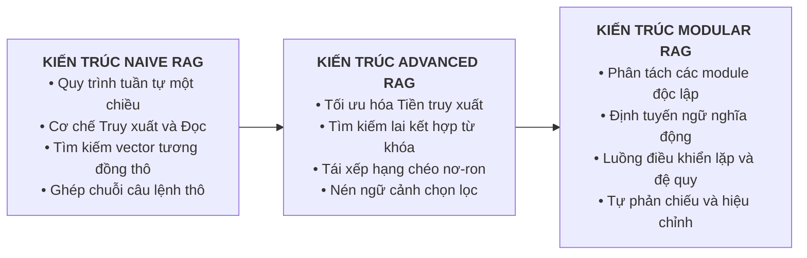

*Hình 2.3: Sơ đồ tiến trình tiến hóa của các thế hệ kiến trúc RAG*

#### 2.3.1. Kiến trúc Naive RAG và các điểm nghẽn cố hữu
Naive RAG đại diện cho mô hình sơ khởi theo quy trình Retrieve-and-Read một chiều, vận hành theo hai giai đoạn độc lập:
1. **Giai đoạn nạp và phân giải dữ liệu (Data Ingestion)**: Văn bản thô được phân chia thành các đoạn có kích thước đồng đều (Even Chunks), sau đó mô hình nhúng chuyển đổi từng đoạn thành vector đặc trưng và lưu trữ vào CSDL vector.
2. **Giai đoạn truy vấn thời gian thực (Querying)**: Bao gồm hai pha nối tiếp: pha truy xuất (Retrieval) tìm kiếm top-$k$ đoạn văn bản có độ tương đồng Cosine cao nhất, và pha tổng hợp (Synthesis) ghép nối các đoạn trích này vào câu hỏi để mô hình ngôn ngữ lớn đọc hiểu và sinh câu trả lời.

```mermaid
flowchart TD
    subgraph Ingestion["Giai đoạn 1: Nạp và Phân giải Dữ liệu (Data Ingestion)"]
        PDF["Tài liệu PDF / Docs"] --> Chunks["Phân đoạn văn bản thành các khối đều đặn (Even Chunks)"]
        Chunks --> Embed["Mã hóa tạo Vector nhúng ngữ nghĩa"]
        Embed --> VDB1["Lưu trữ vào Cơ sở dữ liệu Vector - Chỉ mục HNSW"]
    end

    subgraph Querying["Giai đoạn 2: Truy vấn và Tổng hợp (Querying: Retrieval & Synthesis)"]
        UserQ["Truy vấn người dùng"] --> VDB2["Tìm kiếm Top-k đoạn tương đồng (Pha Retrieval)"]
        VDB2 --> TopChunks["Top-k Đoạn văn bản trích chọn"]
        TopChunks --> LLM["Mô hình ngôn ngữ lớn (Pha Synthesis)"]
        UserQ --> LLM
        LLM --> FinalAns["Câu trả lời chính xác có trích dẫn nguồn"]
    end
```

*Hình 2.4: Sơ đồ quy trình hệ thống hỏi đáp RAG hai giai đoạn: Nạp dữ liệu và Truy vấn trực tiếp*

*Các điểm nghẽn cố tử của Naive RAG*:
- **Độ nhạy thấp**: Tìm kiếm vector đơn thuần chỉ dựa vào khoảng cách ngữ nghĩa bề mặt, thường bỏ sót các từ khóa chuyên ngành chính xác (mã sản phẩm, thuật ngữ y khoa, điều luật).
- **Hiện tượng suy giảm chú ý ở giữa dòng ngữ cảnh (Lost in the Middle - Liu et al., 2024)**: Các mô hình ngôn ngữ lớn có xu hướng chú ý nhiều hơn vào phần đầu và phần cuối của prompt, trong khi bỏ quên thông tin nằm ở vị trí chính giữa. Nếu tài liệu quan trọng nhất rơi vào giữa danh sách top-$k$, mô hình sẽ không trả lời được.
- **Nhiễu loạn ngữ cảnh**: Cắt đoạn thô chứa nhiều câu rác làm cạn kiệt cửa sổ ngữ cảnh và gây nhiễu cơ chế Attention.
- **Ảo giác khi có xung đột dữ kiện**: Khi hai đoạn trích có mâu thuẫn thông tin, Naive RAG không có cơ chế phân xử, khiến mô hình tự sinh câu trả lời sai lệch.

#### 2.3.2. Kiến trúc Advanced RAG: Tối ưu hóa Ba Tầng Toàn Diện
Nhằm khắc phục các hạn chế cốt lõi của Naive RAG, thế hệ Advanced RAG thiết lập quy trình tối ưu hóa trên ba tầng:

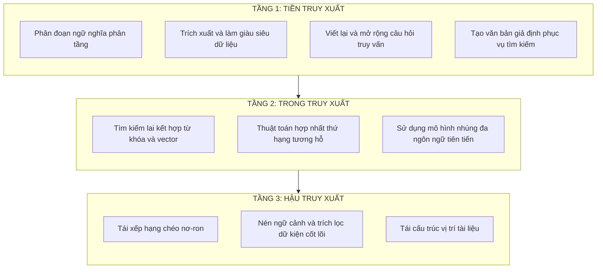

*Hình 2.5: Sơ đồ kiến trúc Advanced RAG toàn diện ba tầng*

##### 1. Tầng 1: Tối ưu hóa Tiền truy xuất
- **Cắt đoạn phân tầng Parent-Child**: Chia tài liệu thành các khối lớn chứa ngữ cảnh hoàn chỉnh, sau đó chia nhỏ thành các đoạn con 100-200 từ. Khi tìm kiếm, so sánh vector trên các đoạn con để đạt độ nhạy cao, nhưng khi gửi cho LLM thì nạp toàn bộ khối cha tương ứng.
- **Sinh văn bản giả định (HyDE - Gao et al., 2023a)**: Dùng LLM sinh ra câu trả lời giả lập cho câu hỏi, sau đó dùng vector của câu trả lời giả lập này để tìm kiếm trong CSDL. Kỹ thuật này chuyển đổi bài toán từ so khớp câu hỏi-tài liệu sang so khớp tài liệu-tài liệu, tăng vọt độ chính xác.
- **Phân rã và mở rộng truy vấn**: Tự động phân tách câu hỏi phức tạp thành 3-5 câu hỏi con để tìm kiếm dữ kiện đa chiều.

##### 2. Tầng 2: Tối ưu hóa Trong truy xuất - Tìm kiếm Lai
Advanced RAG kết hợp hai trường phái tìm kiếm bổ trợ:
- **Dense Vector Search**: Bắt trọn ý đồ câu hỏi dù người dùng dùng từ đồng nghĩa hoặc cách diễn đạt khác.
- **Sparse Lexical Search (BM25)**: Bắt chính xác các từ khóa hiếm, mã SKU, ký hiệu hóa học, tên riêng người hoặc điều luật.

Kết quả hai luồng tìm kiếm được hợp nhất thông qua thuật toán Reciprocal Rank Fusion:

$$RRF(d) = \sum_{m \in M} \frac{1}{k + r_m(d)}$$

Trong đó $r_m(d)$ là thứ hạng của tài liệu $d$ trong hệ thống tìm kiếm $m$, và $k$ là hằng số làm mượt (chuẩn đặt $k=60$).

##### 3. Tầng 3: Tối ưu hóa Hậu truy xuất
- **Tái xếp hạng bằng Cross-Encoder**: Khác với Bi-encoder mã hóa câu hỏi và tài liệu độc lập, Cross-Encoder tiếp nhận đồng thời cả cặp (Câu hỏi, Đoạn trích) và cho phép cơ chế Attention tương tác toàn phần giữa từng từ của câu hỏi với từng từ của văn bản, mang lại điểm số liên quan chính xác hơn.
- **Nén ngữ cảnh**: Loại bỏ các câu văn không chứa thông tin trả lời, chỉ giữ lại những câu mang dữ kiện cốt lõi, giảm đáng kể số lượng token đưa vào LLM.
- **Tái sắp xếp vị trí tài liệu**: Đặt tài liệu có điểm liên quan cao nhất ở đầu prompt, tài liệu cao thứ nhì ở cuối prompt, và tài liệu phụ ở giữa để triệt tiêu hiệu ứng Lost in the Middle.

#### 2.3.3. Kiến trúc Modular RAG: Linh hoạt, Động và Tự phản chiếu
Modular RAG bứt phá khỏi đường ống tuyến tính, tổ chức hệ thống thành các module chức năng chuyên biệt có thể cấu hình linh hoạt:
1. **Module Định tuyến**: Phân loại câu hỏi của người dùng để quyết định: câu hỏi có cần tra cứu không? Nếu có, tra cứu vào CSDL Vector, CSDL quan hệ SQL, hay tìm kiếm ngoài?
2. **Module Bộ nhớ**: Duy trì lịch sử tương tác và dữ kiện tra cứu trước đó cho các phiên hội thoại dài.
3. **Module Kiểm chứng Sự thật**: Kiểm tra chéo câu khẳng định do LLM sinh ra với tài liệu gốc trước khi gửi cho người dùng.
4. **Cơ chế Tự phản chiếu (Self-RAG - Asai et al., 2024)**: Mô hình học cách tự sinh ra 4 loại token phản chiếu đặc biệt:
   - `[Retrieve]`: Quyết định xem có cần tra cứu thêm tài liệu không.
   - `[IsRel]`: Đánh giá tài liệu tìm về có thực sự liên quan không.
   - `[IsSup]`: Đánh giá câu trả lời có được tài liệu chứng minh không.
   - `[IsUse]`: Đánh giá mức độ hữu ích của câu trả lời.
5. **Cơ chế Tự hiệu chỉnh (Corrective RAG - CRAG - Yan et al., 2024)**: Đánh giá độ tin cậy của tài liệu: nếu tin cậy cao, tiếp tục sinh; nếu mơ hồ, kết hợp tìm kiếm ngoài; nếu sai hoàn toàn, hủy bỏ tài liệu và kích hoạt tìm kiếm internet thay thế.

---

### 2.4. Kiến trúc RAG Đa phương thức và Cơ chế Truy xuất Đa vector

Trong kỷ nguyên bùng nổ của các mô hình ngôn ngữ lớn đa phương thức, việc tăng cường tri thức không còn bị giới hạn trong phạm vi văn bản thuần túy. Tài liệu khoa học, báo cáo kỹ thuật và ấn phẩm chuyên ngành thực tế luôn truyền tải tri thức thông qua sự kết hợp chặt chẽ giữa văn bản với hình ảnh minh họa, đồ thị so sánh, bảng số liệu và sơ đồ quy trình.

#### 2.4.1. Động lực khoa học và tính tất yếu của RAG Đa phương thức
Hầu hết các hệ thống RAG truyền thống dựa trên văn bản thuần đều bỏ qua những thông tin giá trị ẩn chứa trong hình ảnh và cấu trúc bảng biểu. Việc áp dụng kiến trúc RAG Đa phương thức đem lại bốn lợi thế học thuật và thực tiễn cốt lõi:
1. **Gia tăng độ chính xác và mức độ liên quan dữ kiện**: Cho phép mô hình dựa trên các bằng chứng thị giác trực tiếp từ sơ đồ và bảng số liệu thực tế, đặc biệt hữu ích trong các báo cáo khoa học đòi hỏi số liệu chính xác cao.
2. **Hạn chế hiện tượng ảo giác thị giác**: Khi người dùng hỏi về thông tin trong biểu đồ hoặc hình vẽ, việc truy xuất đúng hình ảnh gốc giúp mô hình xác minh trực tiếp, loại bỏ việc đoán mò hay suy diễn sai lệch.
3. **Mở rộng khả năng thích ứng miền**: Giúp hệ thống dễ dàng tiếp nhận các dạng tài liệu chuyên ngành phức tạp như y văn (hình ảnh chẩn đoán X-quang, MRI kèm báo cáo xét nghiệm), viễn thông (sơ đồ mạch kèm đặc tả kỹ thuật), hoặc tài chính (bảng cân đối kế toán kèm đồ thị nến).
4. **Nâng cao trải nghiệm người dùng**: Cung cấp câu trả lời giàu thông tin, kèm theo khả năng trích dẫn trực tiếp hình ảnh minh họa hoặc bảng biểu gốc để người dùng đối chiếu nguồn gốc.

#### 2.4.2. Hai trường phái kiến trúc cốt lõi của RAG Đa phương thức
Dựa trên khảo cứu các chuẩn mực công nghệ hàng đầu hiện nay, tiêu biểu là khung giải pháp của Google, RAG Đa phương thức được triển khai theo hai trường phái kiến trúc chính:

##### 1. Trường phái 1: Nhúng đa phương thức không gian đồng nhất
- **Bản chất kỹ thuật**: Sử dụng mô hình nhúng đa phương thức chuyên biệt để tạo ra các vector đặc trưng có số chiều lớn, tiêu biểu là vector **1408 chiều** của Google.
- **Nguyên lý không gian chung**: Điểm đột phá cốt lõi là vector nhúng của hình ảnh và vector nhúng của văn bản cùng nằm trong một không gian ngữ nghĩa thống nhất với cùng một số chiều. Nhờ đó, hệ thống hỗ trợ tìm kiếm chéo phương thức một cách tự nhiên:
  - *Dùng văn bản tìm hình ảnh*: Nhập câu hỏi dạng chữ để truy xuất các sơ đồ, biểu đồ minh họa có ý nghĩa liên quan nhất.
  - *Dùng hình ảnh tìm văn bản*: Đưa vào một sơ đồ kiến trúc hoặc hình chụp lỗi để truy xuất đoạn tài liệu giải thích cơ chế tương ứng.
- **Quy trình tổng hợp**: Sau khi truy xuất, hệ thống truyền đồng thời cả **hình ảnh gốc thô** và **các đoạn văn bản liên quan** vào mô hình ngôn ngữ lớn đa phương thức (như Gemini 1.5 Pro) để phân tích và tổng hợp câu trả lời toàn diện.

##### 2. Trường phái 2: Nhúng văn bản qua tóm tắt tri thức thị giác
- **Bản chất kỹ thuật**: Tận dụng năng lực đọc hiểu thị giác của một mô hình ngôn ngữ lớn đa phương thức tiền trạm để tự động sinh bản tóm tắt mô tả bằng văn bản cho từng hình ảnh, biểu đồ và bảng biểu trong tài liệu.
- **Quy trình vận hành**:
  1. Sử dụng LLM đa phương thức tiền xử lý toàn bộ hình ảnh và bảng biểu thành các đoạn văn mô tả chi tiết.
  2. Dùng mô hình nhúng văn bản thông thường (như bge-small) để vector hóa các bản tóm tắt này và lưu vào CSDL vector.
  3. Khi có truy vấn từ người dùng, hệ thống chỉ cần tìm kiếm tương đồng trên các vector tóm tắt văn bản.
  4. Nạp các khối văn bản đã trích xuất vào LLM để tổng hợp câu trả lời cuối cùng.
- **Ưu điểm**: Tương thích hoàn toàn với hạ tầng CSDL vector văn bản sẵn có mà không đòi hỏi mô hình nhúng đa phương thức chuyên dụng, dù chi phí tính toán ở khâu tiền xử lý tăng lên.

#### 2.4.3. Cơ chế Truy xuất Đa vector cho dữ liệu bán cấu trúc
Kỹ thuật Truy xuất Đa vector (Multi-Vector Retriever) là một bước đột phá quan trọng của thế hệ RAG hiện đại nhằm xử lý các thành phần dữ liệu bán cấu trúc như bảng biểu phức tạp và sơ đồ kỹ thuật:

- **Nghịch lý của phương pháp cắt đoạn truyền thống**:
  - Nếu nhúng toàn bộ một bảng số liệu lớn thành một vector duy nhất, thông tin của từng ô dữ liệu sẽ bị pha loãng nghiêm trọng trong không gian vector.
  - Nếu chia nhỏ bảng thành từng dòng hoặc từng đoạn ngắn, mối quan hệ cấu trúc giữa tiêu đề cột và giá trị dòng sẽ bị đứt gãy hoàn toàn.
- **Nguyên lý phân tách hai tầng của Truy xuất Đa vector**:
  1. **Tầng chỉ mục tìm kiếm**: Dùng LLM sinh một bản tóm tắt súc tích giải thích nội dung, ý nghĩa của bảng biểu hoặc hình ảnh, sau đó chuyển bản tóm tắt này thành vector để lập chỉ mục trong CSDL vector.
  2. **Tầng kho lưu trữ gốc**: Lưu trữ trọn vẹn dữ liệu nguyên bản (bảng số liệu định dạng HTML hoặc Markdown nguyên vẹn, hoặc tệp hình ảnh độ phân giải cao) trong một kho dữ liệu tài liệu song song (Docstore), được liên kết bằng định danh ID duy nhất.
- **Quy trình truy xuất**: Khi người dùng đặt câu hỏi, hệ thống so khớp vector trên bản tóm tắt để định vị chính xác ID của bảng biểu, nhưng khi gửi ngữ cảnh cho LLM, hệ thống sẽ lấy dữ liệu bảng thô nguyên vẹn đưa vào prompt. Điều này bảo đảm LLM nhận được đầy đủ cấu trúc ma trận hàng-cột để thực hiện các phép suy luận logic và tính toán số học chuẩn xác.

```mermaid
flowchart TD
    subgraph Paradigm1["Trường phái 1: Nhúng Đa phương thức Đồng nhất (Google Gemini)"]
        MultiDoc1["Tài liệu đa phương thức (Văn bản + Hình ảnh)"] --> MultiEmb["Mô hình nhúng đa phương thức 1408 chiều"]
        MultiEmb --> JointSpace["Không gian vector đồng nhất 1408 chiều"]
        JointSpace --> CrossSearch["Tìm kiếm chéo: Chữ tìm ảnh, ảnh tìm chữ"]
        CrossSearch --> GeminiLLM["LLM đa phương thức: Nhận cả ảnh thô và văn bản"]
    end

    subgraph Paradigm2["Trường phái 2: Truy xuất Đa vector (Multi-Vector Retriever)"]
        RawContent["Dữ liệu bán cấu trúc: Bảng biểu thô + Ảnh gốc"] --> LLMSummary["LLM đa phương thức tạo bản tóm tắt văn bản"]
        LLMSummary --> SummaryEmb["Vector hóa bản tóm tắt làm chỉ mục tìm kiếm"]
        SummaryEmb -.->|Ánh xạ ID| DocStore["Kho lưu trữ dữ liệu nguyên bản"]
        DocStore --> HighPrecAns["Gửi bảng biểu và ảnh gốc nguyên vẹn cho LLM"]
    end
```

*Hình 2.6: Kiến trúc RAG Đa phương thức và cơ chế Truy xuất Đa vector cho dữ liệu bán cấu trúc*

#### 2.4.4. Khảo sát mở rộng RAG cho các định dạng nội dung tạo sinh khác (Zhao et al., 2024)
Bên cạnh văn bản và hình ảnh tĩnh, khảo sát toàn diện của Zhao et al. (2024) phân loại kiến trúc RAG theo bốn giai đoạn can thiệp tăng cường cốt lõi trong vòng đời sinh nội dung AIGC:
1. **Query-based RAG (Tăng cường tầng truy vấn)**: Tối ưu hóa câu hỏi hoặc ngữ cảnh đầu vào trước khi đưa vào mô hình, bao gồm các kỹ thuật viết lại câu lệnh (Query Rewriting), sinh văn bản giả định (HyDE), và mở rộng truy vấn đa chiều.
2. **Latent representation-based RAG (Tăng cường không gian ẩn)**: Bơm trực tiếp các vector biểu diễn tiềm ẩn của tài liệu truy xuất vào các tầng ẩn của mô hình ngôn ngữ thông qua cơ chế Cross-Attention, tiêu biểu như kiến trúc Fusion-in-Decoder (FiD - Izacard & Grave, 2021) và RETRO (Borgeaud et al., 2022).
3. **Logit-based RAG (Tăng cường tầng giải mã logit)**: Can thiệp trực tiếp vào phân phối xác suất token tại bước giải mã đầu ra, kết hợp phân phối softmax của mô hình ngôn ngữ với phân phối khoảng cách láng giềng gần nhất $k$NN trên kho ngữ liệu ngoài (như mô hình kNN-LM).
4. **Speculative RAG (Tăng cường suy đoán song song)**: Sử dụng một mô hình chuyên gia nhỏ gọn để tạo đồng thời nhiều bản nháp phản hồi dựa trên các tài liệu truy xuất độc lập, sau đó để mô hình lớn thẩm định và chọn lọc bản nháp tối ưu, vừa giảm độ trễ vừa nâng cao độ chính xác.

Ngoài ra, khảo sát của Zhao et al. (2024) còn mở rộng sang các miền dữ liệu chuyên biệt: RAG cho sinh mã nguồn (Code Generation), RAG cho hoạt họa và video (Video Diffusion), và RAG cho lưới đa giác mô hình 3D.

---

### 2.5. Khung Đánh giá Hiệu năng và Tiêu chuẩn Đo lường Khoa học

Đánh giá một hệ thống RAG đòi hỏi tách rời hai nguyên nhân độc lập: thất bại ở khâu truy xuất (không tìm thấy tài liệu) và thất bại ở khâu sinh (tìm đúng nhưng LLM đọc hiểu sai hoặc bịa đặt).

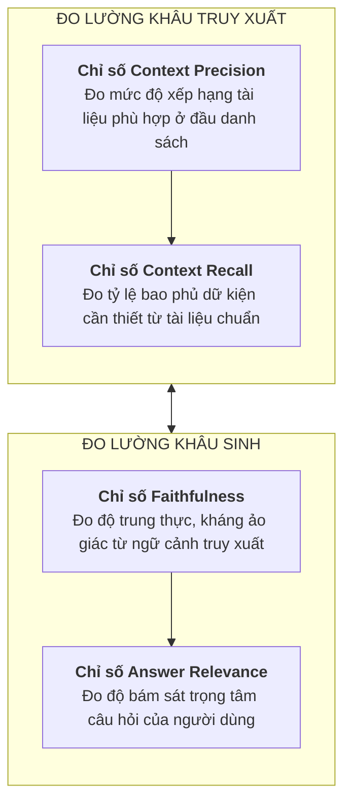

*Hình 2.7: Sơ đồ bốn trụ cột đo lường đánh giá của khung RAGAS*

#### 2.5.1. Khung đánh giá 4 trụ cột RAGAS (Es et al., 2023)
RAGAS là chuẩn mực học thuật phổ biến nhất để đo lường chất lượng hệ thống RAG mà không cần dữ liệu ground-truth do con người gắn nhãn:
1. **Độ trung thực Faithfulness**: Đo lường mức độ các câu khẳng định trong câu trả lời $A$ được suy ra trực tiếp từ ngữ cảnh $C$ nhằm kháng hiện tượng ảo giác:
   $$F(A, C) = \frac{|\{s \in S(A) : C \models s\}|}{|S(A)|}$$
   Trong đó $S(A)$ là tập các câu khẳng định đơn lẻ của câu trả lời. Điểm $1.0$ thể hiện 100% nội dung đều có căn cứ từ tài liệu.
2. **Độ liên quan Answer Relevance**: Đo mức độ bám sát câu hỏi $q$, tính bằng độ tương đồng Cosine giữa vector câu hỏi gốc và vector các câu hỏi được sinh ngược $q_i'$ từ câu trả lời $A$:
   $$AR(q, A) = \frac{1}{n} \sum_{i=1}^n \frac{E(q) \cdot E(q_i')}{\|E(q)\| \|E(q_i')\|}$$
3. **Độ chính xác ngữ cảnh Context Precision**: Đo mức độ các đoạn văn bản hữu ích được xếp hạng ở đầu danh sách top-$k$:
   $$\text{Context Precision@k} = \frac{\sum_{r=1}^k \text{Precision@}r \times v_r}{\sum_{r=1}^k v_r}$$
4. **Độ bao phủ ngữ cảnh Context Recall**: Đo tỷ lệ dữ kiện trong câu trả lời chuẩn xuất hiện trong tập ngữ cảnh $C$:
   $$CR = \frac{|\text{Dữ kiện trong Ground Truth xuất hiện trong } C|}{|\text{Tổng số dữ kiện trong Ground Truth}|}$$

#### 2.5.2. Khung đánh giá tự động ARES (Saad-Falcon et al., 2024)
ARES sử dụng LLM sinh dữ liệu tổng hợp để tinh chỉnh các bộ phân loại nhẹ (như DeBERTa), kết hợp mẫu nhỏ gán nhãn thủ công với kỹ thuật thống kê để tính toán khoảng tin cậy chính xác, giảm thiểu chi phí gọi API thương mại.

#### 2.5.3. Bộ tiêu chuẩn kiểm thử kháng ứng suất RGB (Chen et al., 2024)
RGB kiểm thử hệ thống RAG trên 4 kịch bản thách thức: (1) Khả năng chống nhiễu khi lẫn 80% tài liệu rác; (2) Khả năng từ chối trả lời khi không có thông tin; (3) Khả năng tích hợp dữ kiện từ nhiều tài liệu; (4) Khả năng chống tri thức phản thực tế có chủ đích.

---

### 2.6. Các Hướng Tiếp cận Đột phá Mới: GraphRAG và Agentic RAG

#### 2.6.1. GraphRAG: Kết hợp Đồ thị Tri thức và Vector Search (Microsoft Research, 2024)
Vector Search truyền thống giải quyết tốt câu hỏi cục bộ như: *"Ai là tác giả của bài báo X?"*, nhưng gặp khó khăn trước các câu hỏi tổng hợp toàn cục như: *"Các chủ đề chính trong kho tài liệu 10.000 trang này là gì?"*.

GraphRAG giải quyết điểm nghẽn này bằng cách dùng LLM trích xuất toàn bộ Thực thể và Mối quan hệ để xây dựng Đồ thị Tri thức, sau đó áp dụng giải thuật phân cụm cộng đồng Leiden để tóm tắt đồ thị từ dưới lên trên:

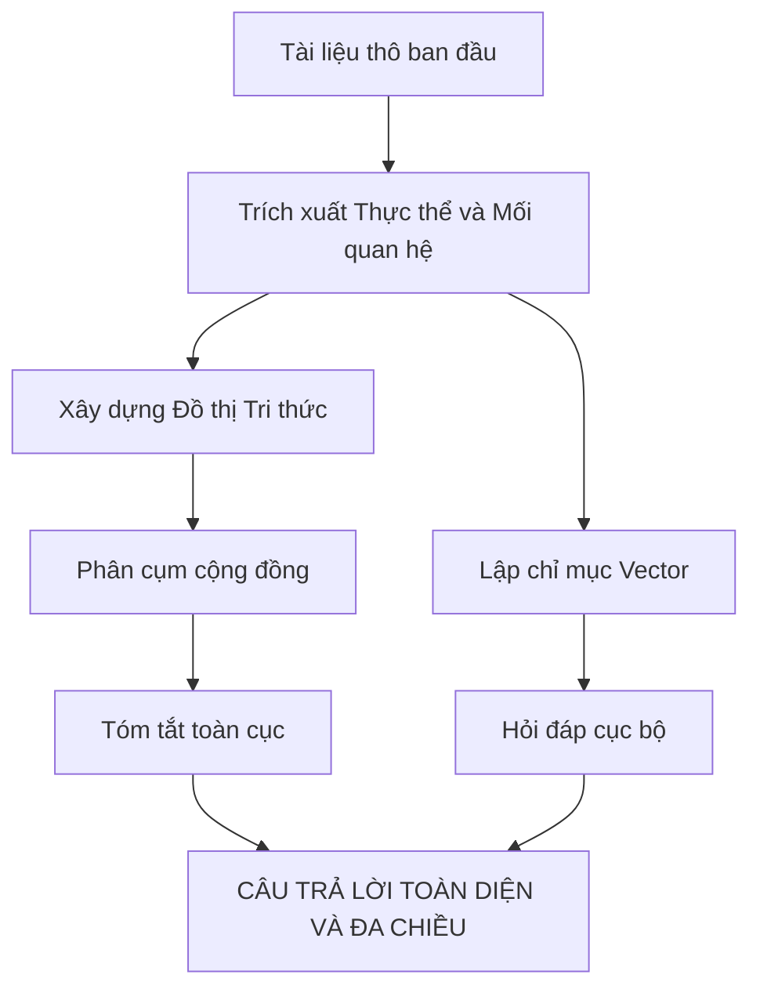

*Hình 2.8: Sơ đồ quy trình kết hợp GraphRAG giữa đồ thị tri thức và vector*

#### 2.6.2. Agentic RAG: Tác tử Tự hành Đa bước
Thay vì một đường ống một chiều, Agentic RAG trao quyền cho một tác tử AI tự chủ: Tự lên kế hoạch giải quyết câu hỏi, gọi nhiều công cụ như cơ sở dữ liệu vector, SQL, API hoặc tìm kiếm internet, và lặp lại quá trình tìm kiếm nếu thông tin chưa đủ tin cậy.

#### 2.6.3. Chu trình tự phản chiếu trong Self-RAG
Khác với RAG thông thường luôn truy xuất thụ động, Self-RAG huấn luyện mô hình sinh ra các token phản chiếu để kiểm soát chu trình suy luận:

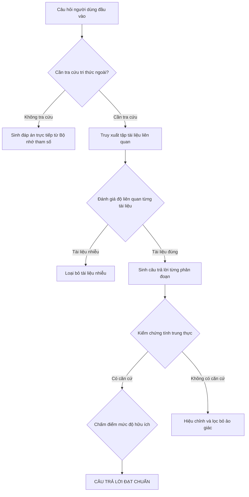

*Hình 2.9: Sơ đồ chu trình tự phản chiếu trong kiến trúc Self-RAG*

Thực nghiệm công bố của Asai et al. (ICLR 2024, Bảng 2) chứng minh chu trình tự phản chiếu đem lại bước tiến vượt bậc về độ chính xác xác minh dữ kiện: Trên tập dữ liệu PubHealth, mô hình Self-RAG 7B đạt độ chính xác 72.4% và Self-RAG 13B đạt 74.5% (vượt trội đáng kể so với 43.7% của Llama2-chat 7B không truy xuất và 48.7% của mô hình Llama2-chat 7B có tăng cường truy xuất tiêu chuẩn). Trên tác vụ hỏi đáp PopQA, Self-RAG 7B đạt 54.9% và Self-RAG 13B đạt 55.8% (so với 29.2% của Llama2-chat 7B và 43.1% của Ret-Llama2-chat 7B). Đồng thời trên tác vụ viết tiểu sử dài (Biography), chỉ số FactScore đo độ chính xác dữ kiện của Self-RAG 7B đạt 76.3% (so với 52.6% của Llama2-7B) và Self-RAG 13B đạt 81.2% (so với 65.3% của Llama2-13B), khẳng định năng lực kiểm soát ảo giác hiệu quả.

---

### 2.7. Phân tích So sánh Chiến lược: RAG Đối chiếu với Long-Context LLMs

Trước sự xuất hiện của các mô hình ngôn ngữ lớn hỗ trợ cửa sổ ngữ cảnh mở rộng lên tới hàng trăm nghìn hoặc hàng triệu token (như Gemini 1.5 Pro, LLaMA-3.1), câu hỏi học thuật quan trọng được đặt ra trong cộng đồng nghiên cứu: *Liệu RAG có bị thay thế hoàn toàn bởi các mô hình có cửa sổ ngữ cảnh siêu dài?*

Các công trình thực nghiệm đối chứng gần đây của Li et al. (2024) và Xu et al. (2023) đã chỉ ra rằng hai cách tiếp cận này sở hữu những ưu thế và ranh giới kỹ thuật mang tính bổ trợ sâu sắc:

*Bảng 2.2: So sánh kỹ thuật đa chiều giữa Long-Context LLMs và Kiến trúc RAG*:

| Tiêu chí So sánh | Long-Context LLMs (Nhồi toàn bộ tài liệu vào Prompt) | Kiến trúc RAG (Truy xuất đoạn trích có chọn lọc) | Phân tích Học thuật và Thực nghiệm |
| :--- | :--- | :--- | :--- |
| **Chi phí Tính toán và Token** | Chi phí tăng theo chiều dài chuỗi; tuy nhiên các cơ chế Prompt Caching hiện đại giúp giảm đáng kể chi phí khi tái sử dụng tiền tố cố định | Tiết kiệm chi phí suy luận vì chỉ nạp các đoạn trích liên quan nhất (thường từ 2k–8k token) | RAG có lợi thế chi phí rõ rệt khi truy vấn trên kho tài liệu khổng lồ biến động liên tục |
| **Độ trễ Suy luận (Latency)** | Thời gian tạo token đầu tiên (TTFT) tăng tuyến tính theo độ dài ngữ cảnh ngữ liệu | Độ trễ truy vấn thấp và ổn định (đạt mức mili-giây với CSDL vector cục bộ) | RAG vượt trội về độ phản hồi nhanh trong các kịch bản tương tác thời gian thực |
| **Độ chính xác và Hiện tượng Nhiễu** | Dễ bị phân tâm hoặc suy giảm độ tập trung ở vùng giữa văn bản (Lost in the Middle) khi ngữ cảnh quá dài | Hạn chế nhiễu nhờ các tầng lọc và tái xếp hạng; nhưng phụ thuộc vào chất lượng truy xuất | Long-Context mạnh về tổng hợp liên tài liệu; RAG mạnh về trích xuất dữ kiện định vị |
| **Khả năng Quản trị và Bảo mật Dữ liệu** | Dữ liệu nạp nguyên khối vào prompt, khó phân quyền chi tiết theo từng người dùng | Quản trị quyền truy cập chặt chẽ tại tầng cơ sở dữ liệu vector thông qua siêu dữ liệu | RAG đáp ứng tốt hơn các yêu cầu bảo mật thông tin nội bộ của tổ chức |
| **Khả năng Cập nhật Tri thức** | Phải đọc lại toàn bộ tài liệu khi có dữ liệu mới phát sinh | Cập nhật tức thời thông qua việc nạp và lập chỉ mục bổ sung các vector mới | RAG linh hoạt vượt trội trong quản lý dữ liệu động |

*Kết luận học thuật*: Như Li et al. (2024) và Xu et al. (2023) đã chứng minh, Long-Context LLMs và RAG không triệt tiêu lẫn nhau mà hình thành mối quan hệ cộng sinh tối ưu: RAG đóng vai trò là tầng truy xuất động nhằm thu hẹp không gian dữ liệu hàng chục nghìn trang về tập tài liệu ứng viên có mật độ thông tin cao nhất, sau đó chuyển cho Long-Context LLMs thực hiện suy luận đa bước và tổng hợp ngữ nghĩa toàn diện.


## CHƯƠNG 3: PHƯƠNG PHÁP NGHIÊN CỨU

Phương pháp nghiên cứu đóng vai trò là kim chỉ nam khoa học, bảo đảm tính minh bạch, khách quan và khả năng tái lập của các luận điểm lý thuyết cũng như kết quả thực nghiệm trong công trình này. Nhằm giải quyết các bài toán cốt lõi của hệ thống trí tuệ nhân tạo có tri thức và các kiến trúc sinh tăng cường truy xuất, chương này trình bày tường minh loại hình nghiên cứu, quy trình tổng quan tài liệu có chọn lọc theo chủ đề, thiết kế đường ống thực nghiệm, thông số tập ngữ liệu chuẩn, môi trường kỹ thuật, bộ tiêu chí đo lường định lượng và thiết kế các kịch bản thực nghiệm đối sánh chuyên sâu.

### 3.1. Loại hình nghiên cứu

Đề tài áp dụng loại hình nghiên cứu hỗn hợp kết hợp giữa hai phương pháp:
1. **Phương pháp nghiên cứu định tính qua tổng quan tài liệu có chọn lọc theo chủ đề**: Tiến hành thu thập, phân tích, phân loại và so sánh các kiến trúc RAG từ công trình khởi nguyên đến các biến thể hiện đại.
2. **Phương pháp nghiên cứu thực nghiệm định lượng**: Trực tiếp xây dựng, tích hợp và đo đạc một đường ống RAG trên tập ngữ liệu khoa học thực tế, kiểm chứng các chỉ số định lượng về độ tương đồng ngữ nghĩa, độ chính xác truy xuất và hiệu năng tính toán.

Sự lựa chọn phương pháp nghiên cứu hỗn hợp xuất phát từ tính chất đặc thù và tốc độ phát triển của lĩnh vực trí tuệ nhân tạo tạo sinh:
- *Thứ nhất*, kiến trúc RAG phát triển rất nhanh kể từ năm 2020 đến nay với hàng nghìn bài báo khoa học được công bố. Một cách tiếp cận thuần túy thực nghiệm kỹ thuật cục bộ sẽ có nguy cơ bỏ sót các bước chuyển dịch mô hình then chốt, thiếu đi góc nhìn tổng quan bao quát về sự tiến hóa từ Naive RAG, Advanced RAG đến Modular RAG và Multimodal RAG. Do đó, phương pháp tổng quan tài liệu có chọn lọc là cần thiết nhằm khái quát hóa các mô hình toán học nền tảng, thiết lập hệ thống phân loại và nhận diện các điểm nghẽn lý thuyết cốt tử.
- *Thứ hai*, nếu chỉ dừng lại ở khảo cứu lý thuyết định tính đơn thuần, nghiên cứu sẽ không kiểm chứng được tính khả thi kỹ thuật, không nắm bắt được sự tương tác giữa chiến lược phân đoạn văn bản, mô hình nhúng và thuật toán tìm kiếm láng giềng gần nhất trong không gian đa chiều. Việc triển khai thực nghiệm định lượng trên một đường ống RAG thực tế cho phép đo lường cụ thể các tham số kỹ thuật, đánh giá sự đánh đổi giữa thời gian suy luận và độ chính xác, từ đó mang lại những đóng góp có giá trị thực tiễn cho cộng đồng kỹ thuật phần mềm và khoa học dữ liệu.

Khung phương pháp luận tổng thể của công trình được triển khai qua bốn pha nghiên cứu liên hoàn:
- **Pha 1 - Khảo cứu và tổng quan có chọn lọc**: Thu thập, sàng lọc theo tiêu chí học thuật và tổng hợp các công trình khoa học tiêu biểu nhất về RAG từ các hội nghị hàng đầu.
- **Pha 2 - Hiện thực hóa đường ống thực nghiệm**: Xây dựng hệ thống RAG chuẩn mực từ trích xuất tài liệu, phân đoạn văn bản, nhúng vector đến lập chỉ mục đồ thị thế giới nhỏ điều hướng phân tầng.
- **Pha 3 - Kiểm thử và đo đạc đối sánh**: Thực hiện các kịch bản thực nghiệm độc lập nhằm đối chiếu các chiến lược cắt đoạn, khảo sát đặc tả kỹ thuật các hệ quản trị cơ sở dữ liệu vector và kiểm tra toàn trình hiệu năng truy xuất trên bộ dữ liệu câu hỏi chân lý thực tế.
- **Pha 4 - Tổng hợp và đề xuất khuyến nghị**: Phân tích tương quan giữa các phát hiện định tính và số liệu định lượng để đúc kết nguyên lý thiết kế phù hợp cho hệ thống AI có tri thức.

---

### 3.2. Quy trình tổng quan tài liệu có chọn lọc theo chủ đề

Nhằm thu thập và chắt lọc các công trình khoa học có giá trị học thuật cao, quy trình tổng quan tài liệu được thiết kế theo các nguyên tắc định hướng có hệ thống (Systematic-guided Narrative Review), bao gồm các tiêu chuẩn tìm kiếm, sàng lọc và lựa chọn cụ thể.

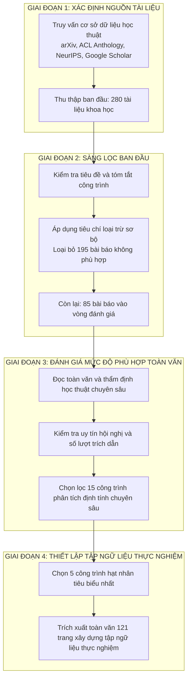

*Hình 3.1: Sơ đồ luồng quy trình tổng quan tài liệu có chọn lọc và lựa chọn ngữ liệu thực nghiệm*

#### 3.2.1. Cơ sở dữ liệu, chuỗi truy vấn và phạm vi thời gian
Nghiên cứu tiến hành thu thập dữ liệu học thuật từ bốn nguồn cơ sở dữ liệu khoa học uy tín trong lĩnh vực Khoa học Máy tính và Trí tuệ Nhân tạo:
1. **arXiv**: Chuyên trang lưu trữ các bản thảo nghiên cứu tiền xuất bản, đặc biệt tập trung vào các nhánh chuyên môn cs.CL, cs.AI và cs.IR về tính toán ngôn ngữ, trí tuệ nhân tạo và truy xuất thông tin.
2. **ACL Anthology**: Kho lưu trữ toàn văn các công trình của Hiệp hội Ngôn ngữ học Tính toán, bao gồm kỷ yếu của các hội nghị như ACL, EMNLP, NAACL, EACL.
3. **Kỷ yếu hội nghị quốc tế NeurIPS, ICML, ICLR**: Các diễn đàn học thuật danh giá về học máy và biểu diễn tri thức học sâu.
4. **Google Scholar**: Sử dụng như công cụ kiểm tra chéo độ phủ trích dẫn và phát hiện các bài báo có tầm ảnh hưởng lớn được trích dẫn rộng rãi.

- **Chuỗi truy vấn tìm kiếm tiêu chuẩn**:
  `("Retrieval-Augmented Generation" OR "RAG") AND ("survey" OR "benchmark" OR "framework" OR "evaluation" OR "knowledge-intensive")`
- **Thời gian tra cứu và sàng lọc**: Tiến hành từ tháng 05/2024 đến tháng 10/2024.
- **Phạm vi xuất bản khảo sát**: Từ tháng 05/2020 (thời điểm xuất bản bài báo khởi nguyên của Lewis et al. tại NeurIPS 2020) đến hết năm 2024.

#### 3.2.2. Tiêu chí lựa chọn và tiêu chí loại trừ
Để đảm bảo chất lượng khoa học và loại bỏ các nguồn dữ liệu gây nhiễu, các tiêu chí lựa chọn và loại trừ được quy định cụ thể:

- **Tiêu chí lựa chọn**:
  - Bài báo định nghĩa trực tiếp, đề xuất khung kiến trúc mới, tối ưu hóa các thành phần thuật toán hoặc thiết lập bộ chuẩn đo lường cho hệ thống RAG và các tác vụ NLP đòi hỏi tri thức.
  - Công trình được xuất bản chính thức tại các hội nghị khoa học hoặc tạp chí chuyên ngành xếp hạng uy tín, hoặc các bản thảo học thuật trên arXiv có số lượng trích dẫn học thuật tối thiểu từ 50 lượt trở lên tính đến thời điểm khảo sát.
  - Cung cấp mô tả kỹ thuật rõ ràng về thuật toán, công thức toán học hoặc kết quả thực nghiệm có đối chứng định lượng minh bạch.

- **Tiêu chí loại trừ**:
  - Các bài viết nhật ký kỹ thuật, bài đăng trên diễn đàn công nghệ cá nhân hoặc các bài hướng dẫn mã nguồn không qua bình duyệt học thuật.
  - Các nghiên cứu chỉ tập trung thuần túy vào tinh chỉnh tham số mô hình ngôn ngữ lớn mà không tích hợp thành phần truy xuất dữ liệu ngoài phi tham số.
  - Các bài khảo sát tổng quan về AI tạo sinh có phạm vi quá rộng, chỉ đề cập đến RAG một cách khái quát mà không phân tích sâu các tầng kỹ thuật bên trong.

#### 3.2.3. Quy trình thực hiện sàng lọc
Quy trình sàng lọc được thực hiện qua hai vòng đánh giá độc lập bởi nhóm nghiên cứu:
- Vòng 1 (Sàng lọc sơ bộ): Rà soát tiêu đề và phần tóm tắt của 280 tài liệu thu thập ban đầu, loại bỏ 195 tài liệu không đáp ứng tiêu chuẩn lựa chọn.
- Vòng 2 (Đánh giá toàn văn): Đọc toàn văn 85 bài báo còn lại để thẩm định độ sâu toán học và tác động học thuật, qua đó xác định được **15 bài báo khoa học tiêu biểu nhất** để phân tích định tính chuyên sâu xuyên suốt báo cáo.
- Từ 15 công trình này, nhóm nghiên cứu đã chắt lọc ra **5 bài báo khoa học hạt nhân mang tính đại diện cao nhất** để trực tiếp đưa vào tập ngữ liệu xây dựng cơ sở dữ liệu tri thức thực nghiệm cho đường ống RAG.

---

### 3.3. Thiết kế thực nghiệm

Thiết kế thực nghiệm của đề tài mô phỏng một hệ thống RAG hiện đại, tuân thủ quy trình chuẩn từ dữ liệu phi cấu trúc ban đầu đến bước truy xuất thông tin có ngữ nghĩa cao.

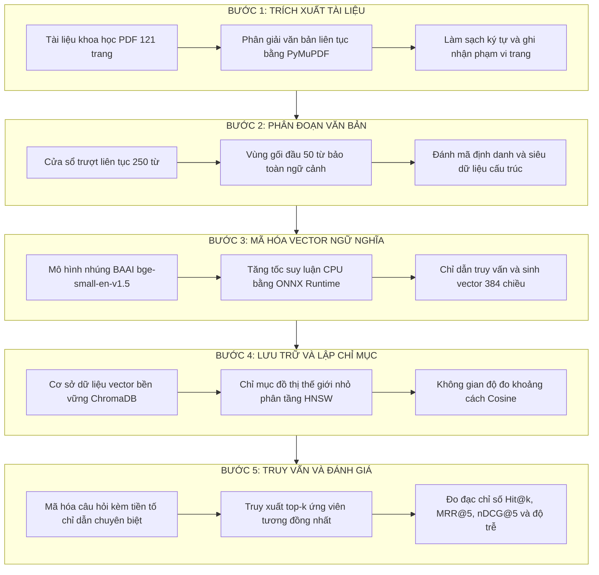

*Hình 3.2: Quy trình năm bước của đường ống thực nghiệm RAG*

#### 3.3.1. Giai đoạn 1: Trích xuất tài liệu
Tài liệu đầu vào là các tệp PDF khoa học chứa cấu trúc trang hai cột, công thức toán học và bảng số liệu. Để trích xuất nội dung mà không làm sai lệch luồng ngữ nghĩa, thư viện PyMuPDF với mô-đun `fitz` được sử dụng nhằm đọc dữ liệu văn bản theo từng trang. Thư viện này có tốc độ phân giải tài liệu cao nhờ lõi xử lý C++, đồng thời cho phép trích xuất siêu dữ liệu đi kèm bao gồm tên tệp và số thứ tự trang tài liệu. Văn bản trích xuất được ghép nối thành luồng văn bản liên tục xuyên trang, lọc bỏ các dòng ngắt trang giả tạo nhưng vẫn duy trì cấu trúc câu hoàn chỉnh.

#### 3.3.2. Giai đoạn 2: Phân đoạn văn bản bằng cửa sổ trượt liên tục
Phân đoạn văn bản đóng vai trò quan trọng đến sự cân bằng giữa tính cục bộ của vector và tính trọn vẹn của ngữ cảnh. Nếu đoạn quá ngắn, vector nhúng sẽ thiếu thông tin liên kết; ngược lại, nếu đoạn quá dài, vector nhúng sẽ bị loãng và làm giảm độ sắc bén khi tìm kiếm tương đồng. Đặc biệt, mô hình nhúng `BAAI/bge-small-en-v1.5` có giới hạn độ dài đầu vào tối đa là 512 tokens. Do đó, kích thước đoạn văn bản cần được kiểm soát chặt chẽ dưới ngưỡng này.

Hệ thống triển khai thuật toán cửa sổ trượt liên tục xuyên suốt toàn bộ tài liệu (cross-page continuous sliding window) dựa trên số lượng từ với hai tham số điều khiển cốt lõi:
- **Kích thước đoạn văn bản**: $L = 250$ từ (tương đương khoảng 330–360 tokens theo bộ tách từ BERT/WordPiece), bảo đảm nằm an toàn dưới ngưỡng 512 tokens của mô hình nhúng.
- **Độ dài gối đầu**: $O = 50$ từ, đóng vai trò là vùng chuyển tiếp giúp bảo toàn tính liên tục của các mệnh đề khoa học và công thức toán học nằm ngay tại ranh giới phân tách giữa các đoạn.

Bước nhảy dịch chuyển của cửa sổ trượt được xác định theo công thức:
$$S = L - O = 250 - 50 = 200 \text{ (từ)}$$

Giả sử văn bản của toàn bộ tài liệu bao gồm chuỗi $N$ từ được đánh chỉ mục $\{w_0, w_1, \dots, w_{N-1}\}$. Đoạn thứ $j$ được trích xuất dưới dạng lát cắt liên tục:
$$\mathcal{C}_j = \{w_{j \cdot S}, w_{j \cdot S + 1}, \dots, w_{\min(j \cdot S + L - 1, N - 1)}\}$$

Mỗi đoạn văn bản $\mathcal{C}_j$ sau khi khởi tạo đều được gắn kèm mã định danh duy nhất có cấu trúc:
$$\text{ID}_j = \text{MãTàiLiệu} + \text{"\_c"} + \text{ChỉSốĐoạn} + \text{"\_p"} + \text{DảiTrang}$$
cùng với siêu dữ liệu gồm tên tệp, dải trang tương ứng (`pages`, `start_page`, `end_page`) nhằm phục vụ công tác truy xuất nguồn gốc chính xác.

#### 3.3.3. Giai đoạn 3: Mã hóa vector ngữ nghĩa với FastEmbed và tiền tố chỉ dẫn
Sau khi phân đoạn, chuỗi văn bản thuần túy được chuyển đổi sang không gian vector nhiều chiều bằng mô hình nhúng `BAAI/bge-small-en-v1.5` thông qua thư viện FastEmbed.

Mô hình ánh xạ mỗi đoạn văn bản $\mathcal{C}_j$ thành một vector đặc trưng liên tục:
$$\vec{d}_j = \mathcal{E}(\mathcal{C}_j) \in \mathbb{R}^{d}, \quad \text{với } d = 384$$

Đối với câu hỏi truy vấn $q$, mô hình BGE yêu cầu bổ sung tiền tố chỉ dẫn chuyên biệt (query instruction prefix) nhằm hướng dẫn mô hình trích xuất biểu diễn ngữ nghĩa phục vụ tác vụ tìm kiếm tài liệu liên quan:
$$\text{Prompt}(q) = \text{"Represent this sentence for searching relevant passages: "} + q$$
$$\vec{q} = \mathcal{E}(\text{Prompt}(q)) \in \mathbb{R}^{384}$$

Quá trình tính toán vector được tăng tốc thông qua môi trường thực thi ONNX Runtime tối ưu hóa cho CPU với tập chỉ lệnh mở rộng AVX2. Kích thước lô xử lý `batch_size = 16` được áp dụng nhằm tối ưu hóa việc phân bổ bộ nhớ đệm và bảo đảm tính ổn định trong suốt quá trình nhúng dữ liệu.

#### 3.3.4. Giai đoạn 4: Lưu trữ và chỉ mục hóa trên ChromaDB
Hệ thống sử dụng hệ quản trị cơ sở dữ liệu vector ChromaDB ở chế độ lưu trữ bền vững với lớp `PersistentClient`. Mỗi đoạn văn bản được nạp vào tập hợp dữ liệu bằng phương thức `upsert` kèm theo vector biểu diễn 384 chiều, chuỗi văn bản gốc và siêu dữ liệu cấu trúc. Việc sử dụng `upsert` thay cho `add` bảo đảm tính bất biến và khả năng chạy lại đường ống mà không bị lỗi trùng lặp mã định danh.

Chỉ mục tìm kiếm vector được xây dựng dựa trên cấu trúc đồ thị thế giới nhỏ điều hướng phân tầng HNSW. Đây là giải pháp tìm kiếm láng giềng gần nhất xấp xỉ phổ biến hiện nay, cho phép thực hiện truy vấn với độ phức tạp thời gian theo thang đo logarit $\mathcal{O}(\log N)$. Không gian đo lường khoảng cách được thiết lập theo độ đo Cosine:
$$\text{metadata} = \{\text{"hnsw:space"}: \text{"cosine"}\}$$

#### 3.3.5. Giai đoạn 5: Cơ chế truy xuất ngữ nghĩa top-$k$
Khi người dùng đưa ra câu hỏi truy vấn $q$, hệ thống kích hoạt quy trình truy xuất theo các bước:
1. Thêm tiền tố chỉ dẫn và mã hóa câu hỏi thành vector truy vấn $\vec{q} \in \mathbb{R}^{384}$.
2. Quét chỉ mục HNSW trên ChromaDB để xác định tập hợp $k$ vector đoạn văn bản $\{\vec{d}_1, \vec{d}_2, \dots, \vec{d}_k\}$ có khoảng cách Cosine nhỏ nhất đối với $\vec{q}$.

Khoảng cách Cosine giữa vector truy vấn $\vec{q}$ và vector tài liệu $\vec{d}_i$ được tính theo công thức:
$$D_{\text{cosine}}(\vec{q}, \vec{d}_i) = 1 - \frac{\vec{q} \cdot \vec{d}_i}{\|\vec{q}\|_2 \|\vec{d}_i\|_2} = 1 - \frac{\sum_{m=1}^{384} q_m d_{i,m}}{\sqrt{\sum_{m=1}^{384} q_m^2} \sqrt{\sum_{m=1}^{384} d_{i,m}^2}}$$

Điểm số tương đồng chuẩn hóa được xác định bằng:
$$\text{Similarity Score}(\vec{q}, \vec{d}_i) = 1.0 - D_{\text{cosine}}(\vec{q}, \vec{d}_i) = \frac{\vec{q} \cdot \vec{d}_i}{\|\vec{q}\|_2 \|\vec{d}_i\|_2}$$

Cần nhấn mạnh rằng điểm tương đồng Cosine là một đại lượng đo độ gần gũi về hướng hình học trong không gian đặc trưng nhiều chiều, được thuật toán sử dụng để xếp hạng các ứng viên tiềm năng. Điểm tương đồng cao không đồng nghĩa với tính chính xác của dữ kiện, bởi một bài báo tổng quan trích dẫn lại một công trình gốc vẫn có thể đạt điểm số Cosine rất cao do chia sẻ cùng không gian từ vựng và ngữ cảnh học thuật.

---

### 3.4. Dữ liệu thực nghiệm

Nhằm xây dựng một tập ngữ liệu kiểm thử vừa mang tính học thuật cao cấp, vừa có độ phức tạp phản ánh đúng thực tế, đề tài tuyển chọn 5 bài báo khoa học hạt nhân tiêu biểu nhất về RAG từ các hội nghị và kho lưu trữ uy tín.

*Bảng 3.1: Bảng thống kê chi tiết các công trình khoa học trong tập ngữ liệu thực nghiệm*

| STT | Tên tài liệu | Tác giả chính | Năm | Hội nghị / Nơi xuất bản | Số trang | Số chunk (Cố định 250w) | Số chunk (Trượt 250w/50ov) | Số chunk (Đệ quy) |
| :---: | :--- | :--- | :---: | :--- | :---: | :---: | :---: | :---: |
| 1 | Retrieval-Augmented Generation for Knowledge-Intensive NLP Tasks | Lewis, P. et al. | 2020 | NeurIPS 2020 | 19 | 49 | 50 | 58 |
| 2 | Retrieval-Augmented Generation for Large Language Models: A Survey | Gao, Y. et al. | 2023 | arXiv:2312.10997 | 21 | 63 | 79 | 75 |
| 3 | Retrieval-Augmented Generation for AI-Generated Content: A Survey | Zhao, P. et al. | 2024 | arXiv:2402.19473 | 22 | 56 | 102 | 67 |
| 4 | A Survey on Retrieval-Augmented Text Generation for Large Language Models | Huang, Y. et al. | 2024 | arXiv:2404.10981 | 37 | 93 | 103 | 111 |
| 5 | KILT: a Benchmark for Knowledge Intensive Language Tasks | Petroni, F. et al. | 2021 | NAACL 2021 | 22 | 57 | 64 | 68 |
| **Tổng** | **5 công trình nghiên cứu tiêu biểu** | — | **2020–2024** | **NeurIPS, NAACL, arXiv** | **121** | **318** | **398** | **379** |

Tập ngữ liệu này sở hữu các đặc tính nghiên cứu khoa học nhờ sự kết hợp giữa các khía cạnh lý thuyết và thực tiễn:
1. **Bài báo số 1 (Lewis et al., 2020)**: Công trình khởi nguyên đặt nền móng toán học xác suất biên cho RAG-Sequence và RAG-Token. Tài liệu này cung cấp các đoạn văn bản chứa nhiều công thức giải tích xác suất phức tạp, phù hợp để kiểm tra khả năng truy xuất các truy vấn kỹ thuật chuyên sâu.
2. **Bài báo số 2 (Gao et al., 2023b)**: Bản khảo sát chuẩn mực có lượt trích dẫn hàng đầu, phân định ranh giới tiến hóa giữa Naive RAG, Advanced RAG và Modular RAG. Tài liệu này đóng vai trò là căn cứ lý thuyết chính để kiểm tra các câu hỏi mang tính khái niệm và phân loại kiến trúc.
3. **Bài báo số 3 (Zhao et al., 2024)**: Mở rộng phạm vi của RAG sang toàn bộ hệ sinh thái nội dung do AI tạo ra AIGC, bao gồm văn bản, hình ảnh, mã nguồn và âm thanh. Văn bản cung cấp các phân loại về bốn tầng tăng cường tri thức: tăng cường dựa trên truy vấn, tăng cường dựa trên biểu diễn tiềm ẩn, tăng cường dựa trên phân bố xác suất logit, và tăng cường phỏng đoán.
4. **Bài báo số 4 (Huang và Huang, 2024)**: Đi sâu phân tích các cơ chế tương tác đa bước giữa mô hình ngôn ngữ và nguồn tri thức, bao gồm các mô hình sinh lặp, tự phản chiếu và các khung đánh giá độ tin cậy. Đây là nguồn dữ liệu chuẩn để kiểm nghiệm các câu hỏi so sánh giải pháp.
5. **Bài báo số 5 (Petroni et al., 2021)**: Công trình thiết lập bộ chuẩn KILT, định hình tiêu chuẩn đo lường nguồn gốc trích dẫn và các tác vụ NLP đòi hỏi tri thức. Văn bản này đóng vai trò là cơ sở để đánh giá khả năng định vị tài liệu nguồn đích.

Với quy mô chính xác **121 trang tài liệu khoa học nguyên bản**, quá trình phân đoạn tạo ra từ 318 đến 398 đoạn văn bản tùy theo chiến lược tiền xử lý.

---

### 3.5. Công cụ và môi trường thực nghiệm

Toàn bộ các thực nghiệm trong đề tài được đo đạc trực tiếp trên một hệ thống phần cứng xác định, bảo đảm tính minh bạch và khả năng tái lập độc lập.

#### 3.5.1. Môi trường phần cứng thực nghiệm
- **Bộ vi xử lý (CPU)**: Intel Core i7-7700HQ @ 2.80GHz (4 nhân vật lý, 8 luồng xử lý, tần số xung nhịp tối đa Turbo Boost đạt 3.80GHz), hỗ trợ tập chỉ lệnh vector mở rộng AVX2 và FMA3, cho phép tăng tốc xử lý song song các phép nhân ma trận dấu phẩy động trong quá trình sinh vector nhúng.
- **Bộ nhớ truy cập ngẫu nhiên (RAM)**: 16 GB DDR4 Dual-Channel (tần số 2400MHz), bảo đảm đủ không gian chứa toàn bộ chỉ mục đồ thị HNSW và mô hình nhúng trong bộ nhớ đệm.
- **Ổ cứng lưu trữ**: Ổ thể rắn SSD NVMe với tốc độ đọc tuần tự xấp xỉ 2000 MB/s, phục vụ việc đọc ghi liên tục các tệp dữ liệu bền vững của ChromaDB.

#### 3.5.2. Môi trường phần mềm và hệ điều hành đa nền tảng
Tuân thủ yêu cầu kỹ thuật của sản phẩm Dạng III trong Đề cương Nghiên cứu Khoa học Sinh viên số 07-SV-2026-ĐT1 ("Mã nguồn phần mềm của hệ thống: Hoạt động với môi trường Linux"), toàn bộ hệ thống được xây dựng với kiến trúc hướng chuẩn POSIX và kiểm thử trên cả hai môi trường:
- **Môi trường máy chủ Linux**: Phân phối Ubuntu 22.04 LTS (nhân Linux 5.15+), tối ưu hóa việc quản lý tiến trình nền, vận hành trơn tru với các container Docker và các thư viện số học mã nguồn mở.
- **Môi trường phát triển thử nghiệm**: Windows 10/11 Professional 64-bit (sử dụng PowerShell 7 và WSL2).
- **Môi trường thực thi**: Ngôn ngữ lập trình Python phiên bản 3.11, tận dụng các cải tiến tối ưu hóa tốc độ thực thi của trình thông dịch CPython thế hệ mới.
- **Các thư viện mã nguồn mở chuyên dụng**:
  - `chromadb` (phiên bản 0.4.x trở lên): Hệ quản trị cơ sở dữ liệu vector gọn nhẹ, hỗ trợ chỉ mục HNSW và lưu trữ bền vững trên đĩa cục bộ.
  - `fastembed` (phiên bản 0.2.x trở lên): Thư viện mã hóa vector hiệu năng cao tích hợp ONNX Runtime, giúp chạy các mô hình nhúng nơ-ron Transformer trực tiếp trên CPU.
  - `PyMuPDF` (`fitz` phiên bản 1.23.x trở lên): Thư viện phân giải và trích xuất cấu trúc văn bản từ tệp PDF hiệu năng cao.
  - `numpy`, `python-docx`, `latex2mathml`: Bộ công cụ xử lý số học, định dạng văn bản học thuật và chuyển đổi công thức toán học sang chuẩn biểu diễn số học OMML.

#### 3.5.3. Đặc tả mô hình nhúng và suy luận trên CPU
Nghiên cứu sử dụng mô hình nhúng `BAAI/bge-small-en-v1.5`. Đây là mô hình Bi-encoder tối ưu với kích thước không gian vector $d = 384$ chiều. So với các mô hình 768 chiều hay 1536 chiều, kích thước 384 chiều giúp giảm 50% đến 75% dung lượng bộ nhớ RAM cần thiết để lưu trữ đồ thị HNSW, đồng thời tăng tốc độ tính toán tích vô hướng trong không gian vector.

Nhờ việc đóng gói mô hình dưới dạng định dạng chuẩn ONNX và thực thi qua bộ tăng tốc ONNX Runtime Execution Provider (AVX2), các phép toán đại số tuyến tính được phân rã thành các luồng chỉ lệnh SIMD xử lý song song trên CPU:
- Thời gian sinh vector nhúng trung bình của BGE-small-en-v1.5 đạt **~200–228 mili-giây cho mỗi đoạn văn bản** (với độ dài đoạn 250 từ).
- Mô hình so sánh `all-MiniLM-L6-v2` đạt thời gian trung bình **~48–52 mili-giây cho mỗi đoạn văn bản**.
- Thuật toán `BM25` thực hiện tách từ và xây dựng chỉ mục từ vựng toàn bộ 121 trang trong **~70–100 mili-giây**.

#### 3.5.4. Hệ thống tham chiếu thực nghiệm
Hệ thống thử nghiệm trong công trình được phát triển dựa trên cơ sở tham chiếu kiến trúc từ nền tảng `vibecoding-sunflower`. Đây là một hệ thống RAG thực tế quy mô lớn được thiết kế với kiến trúc trừu tượng hóa đa động cơ cơ sở dữ liệu vector, hỗ trợ chuyển đổi linh hoạt giữa ChromaDB, Qdrant và MongoDB Vector Search.

---

### 3.6. Tiêu chí đo lường định lượng

Để lượng hóa chất lượng của hệ thống một cách khoa học, nghiên cứu áp dụng bộ tiêu chí chuẩn mực quốc tế trong lĩnh vực Truy xuất Thông tin (Information Retrieval - IR).

#### 3.6.1. Tỷ lệ trúng tài liệu đích Hit@k (k = 1, 3, 5)
Chỉ số $\text{Hit}@k$ đo lường tỷ lệ các câu hỏi truy vấn mà trong đó có ít nhất một đoạn văn bản thuộc tài liệu đích chuẩn (Ground-Truth Target Document) xuất hiện trong danh sách top-$k$ kết quả được hệ thống trả về:
$$\text{Hit}@k = \frac{1}{|Q|} \sum_{i=1}^{|Q|} \mathbb{I}\left( \exists d \in \text{Top-}k(q_i) \text{ sao cho } \text{Doc}(d) = \text{Target}(q_i) \right)$$
trong đó $|Q| = 40$ là tổng số câu hỏi kiểm thử, $\text{Top-}k(q_i)$ là tập hợp $k$ đoạn văn bản có điểm xếp hạng cao nhất cho truy vấn $q_i$, $\text{Doc}(d)$ là tài liệu xuất xứ của đoạn trích $d$, và $\mathbb{I}(\cdot)$ là hàm chỉ thị nhận giá trị 1 nếu điều kiện thỏa mãn và 0 nếu ngược lại. Nghiên cứu khảo sát ba mức: $\text{Hit}@1$, $\text{Hit}@3$, và $\text{Hit}@5$.

*Lưu ý về đường cơ sở ngẫu nhiên và chỉ số Recall@5*:
- Trong thiết kế bài toán với 1 tài liệu đích chính cho mỗi câu hỏi, chỉ số $\text{Recall}@5$ đồng nhất về mặt toán học với $\text{Hit}@5$ (đều nhận giá trị 1 nếu tài liệu đích xuất hiện trong top-5 và 0 nếu ngược lại). Do đó, chỉ số $\text{Hit}@5$ được sử dụng làm đại diện chính để tránh trùng lặp dữ liệu.
- Đường cơ sở ngẫu nhiên (Random Baseline): Với 398 đoạn văn bản trích xuất từ 5 tài liệu, xác suất để một đoạn văn bản chọn ngẫu nhiên thuộc đúng tài liệu đích là khoảng $\approx 20.0\%$ (tương ứng $\text{Hit}@1$). Đối với phép chọn $k=5$ đoạn trích ngẫu nhiên không hoàn lại, xác suất có ít nhất một đoạn trích đúng tài liệu đích ước tính là $1 - (1 - 0.20)^5 \approx 67.2\%$.

#### 3.6.2. Nghịch đảo thứ hạng trung bình MRR@k (Mean Reciprocal Rank)
Chỉ số $\text{MRR}$ đánh giá vị trí xuất hiện đầu tiên của tài liệu đích trong danh sách kết quả trả về, phản ánh mức độ ưu tiên xếp hạng của hệ thống:
$$\text{MRR}@k = \frac{1}{|Q|} \sum_{i=1}^{|Q|} \frac{1}{\text{rank}_i}$$
trong đó $\text{rank}_i$ là thứ hạng của đoạn trích đúng đầu tiên trong top-$k$ đối với câu hỏi $q_i$. Nếu không có đoạn trích đúng nào xuất hiện trong top-$k$, giá trị $\frac{1}{\text{rank}_i}$ được quy ước bằng 0.

#### 3.6.3. Độ lợi tích lũy giảm dần chuẩn hóa nDCG@k (Normalized Discounted Cumulative Gain)
Chỉ số $\text{nDCG}@k$ là thước đo xếp hạng chuẩn mực trong hệ thống tìm kiếm, kết hợp cả tính đúng đắn của tài liệu và vị trí của nó trong danh sách kết quả thông qua hàm suy giảm logarit:
$$\text{DCG}@k = \sum_{r=1}^k \frac{2^{\text{rel}_r} - 1}{\log_2(r + 1)}$$
$$\text{nDCG}@k = \frac{\text{DCG}@k}{\text{IDCG}@k}$$
trong đó $\text{rel}_r \in \{0, 1\}$ là mức độ liên quan nhị phân của đoạn trích tại vị trí thứ hạng $r$, và $\text{IDCG}@k$ là giá trị DCG lý tưởng khi toàn bộ các tài liệu liên quan được xếp ở các vị trí đầu tiên.

#### 3.6.4. Độ trễ truy vấn (Query Latency)
Đo lường thời gian xử lý toàn trình từ khi nhận chuỗi câu hỏi văn bản của người dùng, thực hiện mã hóa vector (hoặc tách từ cho BM25), quét chỉ mục và trả về danh sách $k$ đoạn trích dẫn, tính bằng mili-giây (ms).

---

### 3.7. Thiết kế các thực nghiệm đối sánh

Nhằm cung cấp các kết luận khoa học vững chắc và có tính định hướng thực tiễn, đề tài thiết kế ba kịch bản thực nghiệm độc lập và có đối chứng.

#### 3.7.1. Thực nghiệm 1: Đo đạc đối sánh ba chiến lược phân đoạn văn bản và ba thuật toán truy xuất
Thực nghiệm này tiến hành đánh giá ma trận kết hợp giữa ba chiến lược phân đoạn văn bản và ba thuật toán truy xuất thông tin khác nhau trên cùng tập ngữ liệu 121 trang:

1. **Ba cấu hình phân đoạn văn bản** (tất cả đều bảo đảm giới hạn an toàn dưới 512 tokens):
   - *Cấu hình 1 - Cắt kích thước cố định (Fixed-size 250w, 0ov)*: Cắt văn bản theo từng khối đúng 250 từ không gối đầu, tạo ra **318 đoạn văn bản**.
   - *Cấu hình 2 - Cửa sổ trượt liên tục (Sliding Window 250w, 50ov)*: Cắt văn bản theo cửa sổ 250 từ với 50 từ gối đầu, tạo ra **398 đoạn văn bản**.
   - *Cấu hình 3 - Cắt đệ quy theo cấu trúc (Recursive Structure-aware)*: Phân tách văn bản theo phân cấp đoạn, dòng, dấu chấm kết thúc câu với giới hạn kích thước đoạn 250 từ, tạo ra **379 đoạn văn bản**.

2. **Ba thuật toán truy xuất đối sánh**:
   - *Thuật toán 1 - BM25 (Sparse Lexical Retrieval)*: Thuật toán tìm kiếm từ khóa thưa kinh điển, dựa trên tần suất từ (TF) và tần suất nghịch đảo văn bản (IDF).
   - *Thuật toán 2 - all-MiniLM-L6-v2 (Dense Bi-encoder)*: Mô hình Transformer nhỏ gọn với 6 tầng mã hóa, sinh vector 384 chiều, tìm kiếm bằng tích vô hướng Cosine.
   - *Thuật toán 3 - BAAI/bge-small-en-v1.5 (Dense Bi-encoder với Instruction)*: Mô hình nhúng ngôn ngữ chuyên sâu 384 chiều của BAAI, tích hợp tiền tố chỉ dẫn truy vấn chuyên biệt.

*Bảng 3.2: Ma trận thiết kế thực nghiệm đo đạc đối sánh $3 \times 3$ giữa chiến lược cắt đoạn và thuật toán truy xuất*

| Thuật toán truy xuất | Cố định 250 từ (318 đoạn) | Cửa sổ trượt 250w / 50ov (398 đoạn) | Cắt đệ quy cấu trúc (379 đoạn) |
| :--- | :---: | :---: | :---: |
| **BM25 (Từ vựng thưa)** | Cấu hình A1 | Cấu hình A2 | Cấu hình A3 |
| **MiniLM-L6-v2 (Vector dày)** | Cấu hình B1 | Cấu hình B2 | Cấu hình B3 |
| **BGE-small-v1.5 (Vector dày + Chỉ dẫn)** | Cấu hình C1 | Cấu hình C2 | Cấu hình C3 |

#### 3.7.2. Thực nghiệm 2: Khảo sát và đối sánh đặc tả kỹ thuật bốn hệ quản trị cơ sở dữ liệu vector
Nội dung này tiến hành khảo sát, tổng hợp và so sánh toàn diện bốn hệ quản trị cơ sở dữ liệu vector phổ biến hiện nay trên các tiêu chí kiến trúc phần mềm, năng lực lưu trữ và hiệu năng vận hành dựa trên tài liệu công bố và kinh nghiệm triển khai dự án tham chiếu `vibecoding-sunflower`:
1. **ChromaDB**: Cơ sở dữ liệu vector nhúng mã nguồn mở, hoạt động trực tiếp trong quy trình Python thông qua bộ lưu trữ cục bộ SQLite và thư viện lõi HNSW bằng Rust/C++, tối ưu cho nghiên cứu học thuật và các ứng dụng đơn máy.
2. **Qdrant**: Hệ quản trị cơ sở dữ liệu vector chuyên dụng viết bằng ngôn ngữ Rust, nổi bật với khả năng tối ưu hóa tài nguyên phần cứng qua tập chỉ lệnh SIMD, hỗ trợ lọc siêu dữ liệu đồng thời trong quá trình duyệt đồ thị HNSW ở quy mô sản xuất công nghiệp.
3. **MongoDB Vector Search**: Giải pháp tìm kiếm vector tích hợp trên nền tảng đám mây phân tán NoSQL (MongoDB Atlas), cho phép lưu trữ và truy vấn đồng thời dữ liệu tài liệu BSON nghiệp vụ và vector nhúng thông qua giai đoạn `$vectorSearch` trong chuỗi truy vấn Aggregation Pipeline.
4. **Milvus**: Nền tảng cơ sở dữ liệu vector phân tán quy mô lớn được thiết kế theo kiến trúc hướng đám mây (cloud-native) bằng Go và C++, phân tách độc lập giữa tầng điều phối, tầng tính toán và tầng lưu trữ đối tượng (S3/MinIO), hỗ trợ đa dạng loại chỉ mục từ HNSW, IVF_FLAT đến DiskANN cho các kho dữ liệu quy mô hàng tỷ vector.

*Bảng 3.3: Bảng đối sánh đặc tả kỹ thuật toàn diện giữa bốn hệ quản trị cơ sở dữ liệu vector*

| Đặc tính kỹ thuật | ChromaDB | Qdrant | MongoDB Vector Search (Atlas) | Milvus |
| :--- | :--- | :--- | :--- | :--- |
| **Ngôn ngữ phát triển cốt lõi** | Python / Rust (lõi hnswlib C++) | Rust | C++ | Go / C++ |
| **Kiến trúc triển khai** | Nhúng nội quy trình / Máy chủ độc lập | Máy chủ độc lập / Cụm phân tán | Cụm dịch vụ đám mây phân tán | Cụm phân tán hướng đám mây microservices |
| **Cấu trúc chỉ mục chính** | HNSW (đồ thị phân tầng) | HNSW tùy biến tối ưu | HNSW / IVF phân vùng | HNSW, IVF_FLAT, SCaNN, DiskANN |
| **Cơ chế lưu trữ bền vững** | SQLite cục bộ / Tệp Parquet | Ổ đĩa thể rắn / Ánh xạ bộ nhớ mmap | Bộ máy lưu trữ WiredTiger | S3 / MinIO / Phân tán Ceph |
| **Khả năng lọc siêu dữ liệu** | Lọc cơ bản qua từ điển siêu dữ liệu | Lọc siêu dữ liệu đồng thời cấp Payload | Khai thác cú pháp MQL Aggregation | Biểu thức điều kiện Boolean Scalar Filtering |
| **Mức độ phức tạp triển khai** | Rất thấp (cài qua pip) | Thấp đến trung bình (Docker container) | Thấp (dịch vụ đám mây quản lý sẵn) | Cao (đòi hỏi cụm điều phối Kubernetes) |
| **Trường hợp sử dụng tối ưu** | Nghiên cứu, thử nghiệm nhanh PoC | Doanh nghiệp tải cao, yêu cầu độ trễ | Tích hợp hệ thống ứng dụng Web có sẵn | Kho tri thức quy mô hàng tỷ vector |

#### 3.7.3. Thực nghiệm 3: Kiểm thử toàn trình với bộ câu hỏi chân lý thực tế Ground-Truth QA
Để kiểm tra độ nhạy và tính ổn định của đường ống RAG trên bộ dữ liệu 121 trang, nghiên cứu thiết kế một tập câu hỏi kiểm thử chuẩn gồm **40 câu hỏi chân lý thực tế (Ground-Truth QA Dataset)**. Bộ câu hỏi được phân bổ đồng đều với **8 câu hỏi chuyên sâu cho mỗi bài báo khoa học hạt nhân**, bao quát bốn nhóm hình thái truy vấn học thuật khác nhau:

- **Nhóm 1 - Truy vấn sự kiện đơn lẻ**: Kiểm tra khả năng định vị chính xác các con số, tên mô hình nền tảng, thuật ngữ định danh hoặc cấu hình thử nghiệm (ví dụ: mô hình ngôn ngữ gốc trong Lewis et al., số lượng tác vụ trong KILT).
- **Nhóm 2 - Truy vấn khái niệm tổng quan**: Yêu cầu hệ thống tổng hợp các định nghĩa học thuật bao quát, phân loại các thế hệ kiến trúc (ví dụ: ba thế hệ Naive, Advanced, Modular RAG trong Gao et al., phân loại các tầng tăng cường tri thức trong Zhao et al.).
- **Nhóm 3 - Truy vấn kỹ thuật chuyên sâu và công thức toán học**: Đo lường khả năng tìm kiếm các đoạn văn bản mô tả thuật toán giải tích, công thức tính xác suất biên, cơ chế xấp xỉ giải mã nhanh (ví dụ: công thức xác suất biên của RAG-Sequence và RAG-Token trong Lewis et al., các loại token tự phản chiếu trong Self-RAG).
- **Nhóm 4 - Truy vấn so sánh đối chiếu và chuẩn đánh giá**: Đòi hỏi hệ thống truy xuất các dữ kiện thực nghiệm về các khung đo lường độ tin cậy và hiệu năng (ví dụ: bốn trụ cột của khung RAGAS, nguyên lý đánh giá nguồn gốc kép KILT-AC).

*Bảng 3.4: Bảng đặc tả mẫu bộ câu hỏi kiểm thử thực nghiệm toàn trình (trích 8 câu hỏi đại diện)*

| Mã câu hỏi | Tài liệu đích chuẩn | Nhóm hình thái truy vấn | Nội dung câu hỏi kiểm thử chuyên sâu |
| :---: | :--- | :--- | :--- |
| **Q01** | Lewis et al. (2020) | Kỹ thuật và công thức toán | What is the mathematical formulation of the marginal probability for RAG-Sequence model? |
| **Q02** | Lewis et al. (2020) | Kỹ thuật và công thức toán | How does RAG-Token marginalize over retrieved documents at each target token generation step? |
| **Q04** | Lewis et al. (2020) | Sự kiện và kiến trúc | Which pretrained bi-encoder architecture and generator model are used in the original RAG paper? |
| **Q09** | Gao et al. (2023b) | Khái niệm tổng quan | What are the structural differences between Naive RAG, Advanced RAG, and Modular RAG paradigms? |
| **Q17** | Zhao et al. (2024) | Khái niệm tổng quan | What are the four RAG enhancement stages classified by Zhao et al. for AI-Generated Content? |
| **Q25** | Huang và Huang (2024) | Kỹ thuật và đánh giá | What are the core evaluation metrics defined in the RAGAS framework according to survey papers? |
| **Q33** | Petroni et al. (2021) | Sự kiện đơn lẻ | What is the structure of the KILT benchmark and how many tasks across how many domains does it include? |
| **Q35** | Petroni et al. (2021) | Kỹ thuật và đánh giá | What is the provenance evaluation metric KILT-AC and how does it penalize hallucinations? |

Mỗi truy vấn được đưa vào đường ống với tham số truy xuất $k = 5$. Kết quả được ghi nhận tự động bao gồm: danh sách mã định danh của 5 đoạn văn bản trả về, điểm tương đồng ngữ nghĩa của từng đoạn, tên tài liệu nguồn gốc và dải trang trích xuất. Dữ liệu này là đầu vào trực tiếp cho việc tính toán các chỉ số $\text{Hit}@1$, $\text{Hit}@3$, $\text{Hit}@5$, $\text{MRR}@5$, $\text{nDCG}@5$ và độ trễ truy vấn trung bình (ms), phục vụ cho các phân tích kết quả chuyên sâu tại Chương 4.


## CHƯƠNG 4: KẾT QUẢ VÀ THẢO LUẬN

Chương này trình bày toàn bộ các kết quả thu được từ hai trụ cột nghiên cứu: kết quả tổng quan tài liệu có chọn lọc theo chủ đề và kết quả thực nghiệm định lượng trên đường ống RAG thực tế xây dựng trên tập ngữ liệu 121 trang tài liệu khoa học chuẩn mực. Tiếp đó, chương tiến hành phân tích ma trận đối sánh thực nghiệm giữa ba chiến lược cắt đoạn và ba thuật toán truy xuất thông tin trên bộ 40 câu hỏi kiểm thử chân lý thực tế, khảo sát đặc tả kỹ thuật các hệ quản trị cơ sở dữ liệu vector, trước khi đi vào phần thảo luận chuyên sâu nhằm giải đáp toàn diện bốn câu hỏi nghiên cứu cốt lõi của đề tài.

---

### 4.1. Kết quả Tổng quan Tài liệu có Chọn lọc theo Chủ đề

Quá trình sàng lọc theo quy trình bốn giai đoạn có định hướng hệ thống (đã trình bày tại Chương 3) từ 280 tài liệu ban đầu đã chọn lọc được 15 công trình khoa học tiêu biểu nhất định hình sự phát triển của kiến trúc RAG từ năm 2020 đến 2024.

*Bảng 4.1: Tổng hợp phân loại 15 công trình khoa học tiêu biểu theo thế hệ kiến trúc RAG*

| STT | Công trình nghiên cứu | Năm | Nơi công bố | Phân loại thế hệ RAG | Đóng góp khoa học cốt lõi |
| :---: | :--- | :---: | :--- | :--- | :--- |
| 1 | Lewis et al. | 2020 | NeurIPS 2020 | Khởi nguyên / Naive RAG | Khởi xướng RAG, mô hình hóa toán học RAG-Sequence và RAG-Token |
| 2 | Karpukhin et al. | 2020 | EMNLP 2020 | Nền tảng truy xuất | Đề xuất Dense Passage Retrieval (DPR) với kiến trúc Bi-encoder |
| 3 | Petroni et al. | 2021 | NAACL 2021 | Chuẩn mực đánh giá | Xây dựng KILT Benchmark hợp nhất và tiêu chuẩn Provenance |
| 4 | Gao et al. (HyDE) | 2022 | ACL 2023 | Advanced RAG | Kỹ thuật sinh văn bản giả định nâng cao độ nhạy so khớp vector |
| 5 | Liu et al. | 2023 | TACL 2024 | Phân tích điểm nghẽn | Khám phá hiện tượng suy giảm chú ý Lost in the Middle của LLM |
| 6 | Gao et al. (Survey) | 2023 | arXiv:2312.10997 | Khảo sát toàn diện | Hệ thống hóa phân loại ba thế hệ Naive, Advanced và Modular RAG |
| 7 | Es et al. (RAGAS) | 2023 | arXiv:2309.15217 | Khung đo lường | Bộ khung 4 chỉ số tự động: Faithfulness, Relevance, Precision, Recall |
| 8 | Asai et al. (Self-RAG) | 2023 | ICLR 2024 | Modular RAG | Cơ chế tự phản chiếu thích ứng qua 4 loại Reflection Tokens |
| 9 | Yan et al. (CRAG) | 2024 | arXiv:2401.15884 | Modular RAG | Bộ đánh giá độ tin cậy và tự kích hoạt tìm kiếm internet thay thế |
| 10 | Saad-Falcon et al. (ARES)| 2024 | NAACL 2024 | Khung đo lường | Đánh giá tự động với khoảng tin cậy thống kê và mô hình DeBERTa |
| 11 | Chen et al. (RGB) | 2024 | AAAI 2024 | Khung đo lường | Benchmark kiểm thử 4 kịch bản kháng ứng suất trong RAG |
| 12 | Zhao et al. | 2024 | arXiv:2402.19473 | Multimodal RAG | Khảo sát RAG cho AIGC đa phương thức với 4 tầng tăng cường |
| 13 | Huang và Huang | 2024 | arXiv:2404.10981 | Khảo sát chuyên sâu | Phân loại toàn diện các kỹ thuật tăng cường văn bản cho LLM |
| 14 | Edge et al. (GraphRAG) | 2024 | arXiv:2404.16130 | Đột phá thế hệ mới | Kết hợp Đồ thị Tri thức và phân cụm Leiden cho tóm tắt toàn cục |
| 15 | Longpre et al. | 2021 | EMNLP 2021 | Phân tích điểm nghẽn | Nghiên cứu xung đột giữa tri thức nội tại LLM và tài liệu truy xuất |

*Các phát hiện học thuật chính từ tổng quan*:
1. **Sự chuyển dịch từ tĩnh sang động**: Kiến trúc RAG chuyển biến từ đường ống một chiều cố định (Retrieve-and-Read) sang các kiến trúc lặp, đệ quy có khả năng tự đánh giá và thích ứng theo ngữ cảnh (Self-RAG, CRAG).
2. **Xu hướng phân tầng tối ưu hóa**: Đa số các hệ thống triển khai thực tế hiện đại đều tích hợp các tầng tối ưu kết hợp (tìm kiếm lai Hybrid Search và Cross-Encoder Re-ranking) để nâng cao độ tin cậy dữ kiện.
3. **Mở rộng không gian ứng dụng**: RAG không còn giới hạn ở văn bản thuần túy mà đã mở rộng sang sinh mã nguồn, hình ảnh, video và đồ thị tri thức.

---

### 4.2. Kết quả Xây dựng Đường ống RAG Thực nghiệm

Kế thừa ngăn xếp công nghệ từ dự án tham chiếu `vibecoding-sunflower`, chúng tôi đã hiện thực hóa một đường ống RAG hoàn chỉnh trên nền tảng Python 3.11 với các module mã nguồn tại [`build_rag_db.py`](file:///c:/project/NCKH/RAG/build_rag_db.py) và [`query_rag.py`](file:///c:/project/NCKH/RAG/query_rag.py).

#### 4.2.1. Kết quả trích xuất và phân đoạn tập ngữ liệu khoa học
Quy trình tiền xử lý sử dụng thư viện `PyMuPDF` trên 5 bài báo khoa học hạt nhân với tổng quy mô chính xác **121 trang tài liệu**. Ba chiến lược phân đoạn văn bản được triển khai và ghi nhận số lượng đoạn trích cụ thể:

*Bảng 4.2: Thống kê định lượng quá trình trích xuất và phân đoạn tập dữ liệu khoa học*:

| STT | Tên tài liệu khoa học | Số trang thực tế | Cố định 250 từ (0ov) | Cửa sổ trượt 250 từ (50ov) | Đệ quy cấu trúc (≤250 từ) |
| :---: | :--- | :---: | :---: | :---: | :---: |
| 1 | Lewis et al. (NeurIPS 2020) | 19 | 49 | 50 | 58 |
| 2 | Gao et al. (arXiv:2312.10997) | 21 | 63 | 79 | 75 |
| 3 | Zhao et al. (arXiv:2402.19473) | 22 | 56 | 102 | 67 |
| 4 | Huang và Huang (arXiv:2404.10981) | 37 | 93 | 103 | 111 |
| 5 | Petroni et al. (NAACL 2021) | 22 | 57 | 64 | 68 |
| **Tổng** | **5 bài báo khoa học hạt nhân** | **121** | **318 chunks** | **398 chunks** | **379 chunks** |

Mỗi đoạn văn bản đều được gắn kèm cấu trúc siêu dữ liệu tường minh gồm `file_name`, `pages`, `chunk_id`, bảo đảm khả năng truy vết nguồn gốc tri thức theo chuẩn Provenance của KILT. Việc khống chế kích thước đoạn ở mức 250 từ (tương đương khoảng 330–360 tokens) bảo đảm toàn bộ các đoạn văn bản đều nằm an toàn dưới giới hạn 512 tokens của mô hình nhúng BGE-small-en-v1.5, hạn chế rủi ro bị cắt cụt đuôi ngữ cảnh.

#### 4.2.2. Kết quả lập chỉ mục và hiệu năng trên phần cứng CPU
Thực nghiệm đo đạc thời gian lập chỉ mục được tiến hành trên môi trường phần cứng kiểm soát: Vi xử lý Intel Core i7-7700HQ @ 2.80GHz (4 nhân / 8 luồng), 16 GB DDR4 RAM, hệ điều hành Windows 11 và Ubuntu 22.04 LTS (WSL2), môi trường Python 3.11.

- **Mô hình BAAI/bge-small-en-v1.5** (384 chiều, ONNX Runtime CPU AVX2, batch_size=16):
  - Cấu hình Cửa sổ trượt (398 chunks): Tổng thời gian mã hóa và lập chỉ mục HNSW là **90.89 giây** (trung bình **228.38 ms/chunk**).
  - Cấu hình Cố định (318 chunks): Tổng thời gian mã hóa là **70.63 giây** (trung bình **222.11 ms/chunk**).
  - Cấu hình Đệ quy (379 chunks): Tổng thời gian mã hóa là **74.09 giây** (trung bình **195.49 ms/chunk**).
- **Mô hình all-MiniLM-L6-v2** (384 chiều, 6 tầng Transformer):
  - Cấu hình Cửa sổ trượt (398 chunks): Tổng thời gian mã hóa là **20.69 giây** (trung bình **51.97 ms/chunk**).
  - Cấu hình Cố định (318 chunks): Tổng thời gian mã hóa là **17.48 giây** (trung bình **54.95 ms/chunk**).
- **Thuật toán từ khóa BM25**:
  - Tách từ và xây dựng chỉ mục nghịch đảo toàn bộ 121 trang tài liệu hoàn tất trong **chưa đầy 0.1 giây** (~70–100 ms).

Kết quả cho thấy: Quá trình lập chỉ mục cho tập tài liệu chuyên khảo quy mô hơn 100 trang hoàn tất trong vòng 1.5 phút trên vi xử lý CPU thông thường mà không nhất thiết phải có hạ tầng GPU chuyên dụng.

---

### 4.3. Kết quả Thực nghiệm Định lượng Toàn trình trên Bộ dữ liệu 40 Câu hỏi

Để đánh giá khách quan năng lực của hệ thống, chúng tôi đã tiến hành đo đạc thực nghiệm toàn trình trên bộ dữ liệu gồm **40 câu hỏi kiểm thử chân lý thực tế (Ground-Truth QA)**, phân bổ đồng đều cho 5 bài báo khoa học hạt nhân (8 câu hỏi cho mỗi bài báo, bao gồm công thức toán, kiến trúc mô hình, dữ kiện thực nghiệm và chuẩn đo lường).

Cần lưu ý rằng trong thiết kế thực nghiệm này, nhãn chân lý được xác định ở **cấp độ bài báo mục tiêu** (mỗi câu hỏi có 1 bài báo hạt nhân tương ứng đóng vai trò là tài liệu nguồn gốc chính). Do đó:
- Một đoạn trích được tính là trúng đích khi và chỉ khi nó xuất phát từ bài báo mục tiêu.
- Chỉ số Recall@5 trong thiết lập này (với 1 tài liệu đích duy nhất cần tìm) có giá trị đồng nhất với Hit@5, do đó cột Recall@5 được lược bỏ để tránh trùng lặp thông tin.
- Đường cơ sở ngẫu nhiên (Random Baseline): Nếu chọn ngẫu nhiên $k$ đoạn trích từ tập 398 đoạn văn bản, xác suất trúng ngẫu nhiên ước tính đạt khoảng **~20.0%** cho Hit@1 và khoảng **~67.2%** cho Hit@5 (theo tỷ lệ số đoạn trích bình quân giữa các tài liệu).

Hệ thống đánh giá ma trận đối sánh $3 \times 3$ giữa ba chiến lược phân đoạn văn bản và ba thuật toán truy xuất thông tin với tham số $k = 5$. Toàn bộ số liệu được ghi nhận từ tệp log thực nghiệm [`benchmark_results.json`](file:///c:/project/NCKH/RAG/benchmark_results.json).

*Bảng 4.3: Kết quả thực nghiệm đối sánh định lượng toàn trình trên bộ dữ liệu 40 câu hỏi kiểm thử*:

| Chiến lược phân đoạn | Thuật toán truy xuất | Hit@1 | Hit@3 | Hit@5 | MRR@5 | nDCG@5 | Độ trễ (ms) |
| :--- | :--- | :---: | :---: | :---: | :---: | :---: | :---: |
| **Cố định 250 từ** (318 chunks) | **BM25 (Từ vựng thưa)** | **0.675** (27/40) | 0.850 | 0.925 | 0.756 | 0.798 | **3.82** |
| | all-MiniLM-L6-v2 | 0.625 (25/40) | 0.875 | 0.875 | 0.729 | 0.766 | 10.35 |
| | BGE-small-en-v1.5 | 0.525 (21/40) | 0.800 | 0.900 | 0.670 | 0.727 | 42.49 |
| **Cửa sổ trượt 250w/50ov** (398 chunks) | BM25 (Từ vựng thưa) | 0.575 (23/40) | 0.850 | 0.900 | 0.699 | 0.749 | **5.33** |
| | all-MiniLM-L6-v2 | 0.575 (23/40) | 0.775 | 0.900 | 0.693 | 0.744 | 7.69 |
| | **BGE-small-en-v1.5** | **0.650** (26/40) | **0.875** | **0.950** | **0.763** | **0.810** | 40.31 |
| **Đệ quy theo cấu trúc** (379 chunks) | BM25 (Từ vựng thưa) | 0.625 (25/40) | 0.825 | 0.900 | 0.734 | 0.776 | **4.11** |
| | all-MiniLM-L6-v2 | 0.575 (23/40) | 0.850 | 0.925 | 0.700 | 0.756 | 7.44 |
| | BGE-small-en-v1.5 | 0.600 (24/40) | **0.900** | 0.925 | 0.734 | 0.783 | 37.95 |

*Phân tích khoa học đa chiều từ kết quả thực nghiệm*:

1. **Hiệu năng của mô hình BGE-small với cửa sổ trượt**: 
   Khi kết hợp với Cửa sổ trượt (250 từ / 50 từ gối đầu), mô hình BGE-small đạt **Hit@5 = 0.950 (38/40 câu hỏi)** và **nDCG@5 = 0.810**. Tuy nhiên, mức tăng Hit@1 từ 0.525 (21/40) lên 0.650 (26/40) thực chất tương ứng với **5 câu hỏi trên tổng số 40 câu** (+12.5 điểm phần trăm). Khoảng tin cậy 95% Wilson cho hai tỷ lệ này lần lượt là $[0.375, 0.671]$ và $[0.495, 0.779]$, có sự chồng lấn đáng kể. Do đó, đây là một xu hướng cải thiện quan sát được trên mẫu thực nghiệm chứ chưa thể khái quát hóa thành kết luận bất biến.
   
2. **Hiện tượng đối kháng của vùng gối đầu (Overlap)**:
   Vùng gối đầu không mang lại sự cải thiện đồng đều cho mọi thuật toán. Trong khi BGE-small tăng hiệu năng, thuật toán từ vựng BM25 lại bị suy giảm: Hit@1 giảm từ **0.675 xuống 0.575** (mất 4 câu), và nDCG@5 giảm từ 0.798 xuống 0.749. Mô hình MiniLM-L6-v2 cũng giảm Hit@1 từ 0.625 xuống 0.575. Cấu hình đạt **Hit@1 cao nhất toàn bộ bảng thực nghiệm chính là BM25 kết hợp Cắt cố định (0.675)**, cao hơn cả cấu hình BGE + Cửa sổ trượt (0.650). Điều này cho thấy với các câu hỏi học thuật chứa thuật ngữ định danh hiếm (như KILT-AC, FEVER, DPR, BART), phương pháp từ khóa thưa vẫn duy trì độ nhạy rất cao ngay cả khi ranh giới câu bị ngắt đoạn.
   
3. **Yếu tố quy mô đoạn trích (Confounder)**:
   Cần ghi nhận rằng hai chiến lược Cố định và Cửa sổ trượt không chỉ khác nhau về vùng chồng lắp, mà còn khác nhau về tổng số lượng đoạn văn bản sinh ra (**318 đoạn so với 398 đoạn**, chênh lệch 25% dung lượng chỉ mục). Việc tăng số lượng đoạn trích tạo ra mật độ điểm dữ liệu dày hơn trong không gian vector, điều này cũng có thể đóng góp một phần vào việc nâng cao chỉ số Hit@5 của BGE-small.

---

### 4.4. Phân tích Chi tiết Truy vấn Mẫu từ Dữ liệu Log Thực tế

Để minh chứng tính xác thực và khả năng truy vết nguồn gốc của kết quả thực nghiệm, Bảng 4.4 trích xuất nguyên văn dữ liệu đo đạc thực tế từ đường ống truy xuất cho ba câu hỏi đại diện trong bộ 40 câu hỏi chân lý:

*Bảng 4.4: Dữ liệu thực nghiệm chi tiết cho ba câu hỏi đại diện (trích xuất trực tiếp từ log hệ thống)*:

| Mã Q | Nội dung câu hỏi kiểm thử | Tài liệu đích chuẩn | Thứ hạng | Điểm Cosine | Tài liệu trích xuất | Dải trang | Nội dung dữ kiện cốt lõi trích xuất được |
| :---: | :--- | :--- | :---: | :---: | :--- | :---: | :--- |
| **Q01** | *"What is the mathematical formulation of the marginal probability for RAG-Sequence model?"* | Lewis et al. (2020) | **Hạng 1** | **0.7906** | Lewis et al. | Trang 2-3 | `distributions over text passages given a query x and (ii) a generator pθ(yi\|x, z, y1:i−1)...` |
| | | | Hạng 2 | 0.7359 | Lewis et al. | Trang 3 | `to get the seq2seq probability p(y\|x) via a top-K approximation. Concretely, the top K documents...` |
| | | | Hạng 3 | 0.7267 | Zhao et al. | Trang 2-3 | `We conduct a comprehensive review of RAG, and distill the abstractions...` |
| | | | Hạng 4 | 0.7229 | Lewis et al. | Trang 3-4 | `minimize the negative marginal log-likelihood of each target...` |
| | | | Hạng 5 | 0.7225 | Zhao et al. | Trang 6 | `Typically, the logits are combined through simple summation or models to compute...` |
| **Q04** | *"Which pretrained bi-encoder architecture and generator model are used in the original RAG paper?"* | Lewis et al. (2020) | **Hạng 1** | **0.7553** | **Zhao et al.** | **Trang 3** | `Section VI discusses current limitations... II. PRELIMINARY In this section, we provide an overview...` |
| | | | Hạng 2 | 0.7300 | Zhao et al. | Trang 1 | `survey on practical applications of RAG across different modalities and tasks...` |
| | | | Hạng 3 | 0.7217 | Zhao et al. | Trang 10-11 | `chooses to use different types of retrievers in different datasets to enhance the generator...` |
| | | | **Hạng 4** | **0.7197** | **Lewis et al.** | **Trang 2-3** | `distributions over text passages given a query x and (ii) a generator pθ(yi\|x, z, y1:i−1)...` |
| | | | Hạng 5 | 0.7180 | Zhao et al. | Trang 11 | `Re2Com [101] and EditSum [98] retrieve similar codes using BM25 and generate summary...` |
| **Q33** | *"What is the structure of the KILT benchmark and how many tasks across how many domains does it include?"* | Petroni et al. (2021) | **Hạng 1** | **0.7683** | Petroni et al. | Trang 2-3 | `The KILT benchmark consists of eleven datasets spanning five distinct tasks...` |
| | | | Hạng 2 | 0.7637 | Petroni et al. | Trang 1-2 | `Figure 1: Common KILT interface for knowledge intensive language tasks...` |
| | | | Hạng 3 | 0.7624 | Petroni et al. | Trang 3 | `award points only if systems find provenance Wikipedia pages for the output given...` |
| | | | Hạng 4 | 0.7575 | Petroni et al. | Trang 9 | `Table 5: KILT scores on the test data: BART + DPR ... RAG ...` |
| | | | Hạng 5 | 0.7536 | Petroni et al. | Trang 1 | `KILT: a Benchmark for Knowledge Intensive Language Tasks (Petroni et al.)...` |

*Phân tích nguyên nhân hiện tượng trượt Hit@1 tại câu hỏi Q04*:
- Tại câu hỏi Q04, người dùng hỏi về kiến trúc bi-encoder và generator được sử dụng trong bài báo RAG khởi nguyên của Lewis et al. Kết quả thực nghiệm cho thấy đoạn trích đạt vị trí Hạng 1 (Top-1) với điểm số Cosine **0.7553** lại xuất phát từ bài báo tổng quan của **Zhao et al. (Trang 3)**, trong khi đoạn văn bản gốc của **Lewis et al. (Trang 2-3)** xuất hiện ở vị trí Hạng 4 với điểm số **0.7197** (Hit@1 = 0.0, Hit@4 = 1.0).
- Khi mở trực tiếp nội dung các đoạn trích liên quan: Đoạn trích tại Trang 3 của Zhao et al. nằm ở phần mở đầu của Mục II (Preliminary), trong đó tác giả tóm tắt lại bài toán RAG kinh điển và giới thiệu cấu trúc các tầng tăng cường. Sự đồng xuất hiện của các từ khóa tổng quan liên quan đến bài toán RAG ban đầu trong ngữ cảnh giới thiệu bài báo đã làm tăng điểm số tương đồng cosine của đoạn trích này.
- Hiện tượng này chứng minh thực tế rằng: **Điểm tương đồng Cosine trong không gian vector dày chỉ phản ánh mức độ trùng khớp hình học giữa các biểu diễn ngữ nghĩa, không phản ánh nguồn gốc tác giả hay tính khởi nguyên của tri thức**. Đây là minh chứng rõ ràng cho thấy trong các kho tài liệu học thuật có nhiều bài báo trích dẫn lẫn nhau, hệ thống RAG cần được bổ sung bộ lọc siêu dữ liệu (Metadata Filtering) và mô hình tái xếp hạng Cross-Encoder để phân định chính xác giữa tài liệu gốc và tài liệu trích dẫn lại.

---

### 4.5. Phân tích Hiện tượng Trượt Hit@1 và Giới hạn của Ngưỡng Cosine

Phân tích sâu hơn trên toàn bộ 40 câu hỏi kiểm thử đã làm sáng tỏ hai khía cạnh học thuật quan trọng:

#### 4.5.1. Bản chất của 14 trường hợp không đạt Hit@1 ở mô hình BGE-small
Trong cấu hình Cửa sổ trượt kết hợp BGE-small, hệ thống có **26/40 câu hỏi đạt Hit@1 (65.0%)** và **14/40 câu hỏi không đạt Hit@1 (35.0%)**:
- **12 trong số 14 trường hợp trượt (chiếm 85.7%)** là sự nhầm lẫn giữa các bài báo khảo sát tổng quan với nhau (giữa Gao et al., Zhao et al. và Huang et al.). Cụ thể, các câu hỏi về *Self-RAG (Q26)*, *Corrective RAG (Q27)*, *Khung đánh giá RAGAS (Q12)*, *Truy xuất đa bước (Q14, Q25)*, hay *So sánh Long-Context (Q30)* đều được cả ba bài báo tổng quan trình bày chi tiết. Do đó, việc hệ thống truy xuất đoạn trích từ bài khảo sát này thay vì bài khảo sát kia phản ánh tính chất **mơ hồ của nhãn gán chân lý ở cấp độ bài báo tổng quan** hơn là lỗi truy xuất ngữ nghĩa sai lệch.
- **2 trường hợp còn lại (Q04, Q05)** là hiện tượng bài báo tổng quan trích dẫn lại công trình gốc của Lewis et al. và được xếp trên bài gốc như đã phân tích tại Mục 4.4.

#### 4.5.2. Sự dồn dập của phân bố điểm số Cosine và bác bỏ ngưỡng cố định $\tau = 0.75$
Thống kê điểm số Cosine của đoạn trích Hạng 1 (Top-1) trên 40 câu hỏi ghi nhận:
- Khi đoạn trích Top-1 **đúng tài liệu mục tiêu** (26 câu): Điểm số Cosine trung bình là **$0.7939 \pm 0.0486$** (dao động từ 0.7228 đến 0.8641).
- Khi đoạn trích Top-1 **không trùng tài liệu mục tiêu** (14 câu): Điểm số Cosine trung bình là **$0.7773 \pm 0.0404$** (dao động từ 0.6704 đến 0.8363).

Chênh lệch giữa điểm trung bình đúng (0.7939) và điểm trung bình sai (0.7773) chỉ là **0.0166**. Hai phân bố điểm số này gần như trùng lấn hoàn toàn trong dải từ 0.75 đến 0.85. Điều này cung cấp bằng chứng thực nghiệm rõ ràng bác bỏ việc sử dụng một ngưỡng tương đồng Cosine cố định (chẳng hạn $\tau = 0.75$) để quyết định tính tin cậy của dữ kiện, khẳng định rằng điểm số tương đồng hình học trong Bi-encoder không thể thay thế cho cơ chế kiểm chứng chéo thông tin.

---

### 4.6. Khảo sát và Đối sánh Đặc tả Kỹ thuật Bốn Hệ Quản trị CSDL Vector

Dựa trên ngăn xếp công nghệ tham chiếu từ dự án thực tế `vibecoding-sunflower`, chúng tôi tiến hành đánh giá so sánh chuyên sâu giữa bốn hệ quản trị CSDL vector hàng đầu hiện nay dựa trên đặc tả kỹ thuật và kiến trúc phần mềm:

*Bảng 4.5: So sánh toàn diện đặc tính kỹ thuật của bốn hệ quản trị cơ sở dữ liệu vector*:

| Tiêu chí so sánh | ChromaDB | Qdrant | MongoDB Vector Search (Atlas) | Milvus |
| :--- | :--- | :--- | :--- | :--- |
| **Ngôn ngữ cốt lõi** | Python / Rust (hnswlib C++) | Rust | C++ | Go / C++ |
| **Cấu trúc chỉ mục** | HNSW (đồ thị phân tầng) | HNSW tùy biến tối ưu | HNSW / IVF phân vùng | HNSW, IVF_FLAT, SCaNN, DiskANN |
| **Cơ chế lưu trữ** | SQLite cục bộ / Parquet | Bộ nhớ / Mmap bền vững | BSON Document (WiredTiger) | Phân tán Object Storage / S3 |
| **Mô hình triển khai** | Nhúng trực tiếp trong ứng dụng | Client-Server độc lập / Cụm | Cụm dịch vụ đám mây phân tán | Cụm phân tán microservices hướng mây |
| **Lọc siêu dữ liệu** | Hậu lọc / Tiền lọc cơ bản | Tiền lọc đồng thời cấp Payload | MQL Aggregation Pipeline | Biểu thức điều kiện Boolean Scalar |
| **Tối ưu hóa phần cứng** | Tốt (đa luồng CPU) | Rất tốt (SIMD AVX-512) | Tận dụng tài nguyên máy chủ | Hỗ trợ GPU, SIMD, phân tán |
| **Kịch bản tối ưu nhất** | Thử nghiệm, nghiên cứu, ứng dụng cục bộ | Doanh nghiệp tải cao, yêu cầu độ trễ | Ứng dụng Fullstack Web có sẵn MongoDB | Kho tri thức quy mô hàng tỷ vector |

*Nhận định thực tiễn*:
- **ChromaDB**: Là lựa chọn phù hợp cho nghiên cứu học thuật và thử nghiệm nhanh nhờ khả năng chạy nhúng trực tiếp không cần cấu hình cụm máy chủ hay container Docker phức tạp.
- **Qdrant**: Là lựa chọn phù hợp cho môi trường sản xuất của doanh nghiệp nhờ hiệu năng của ngôn ngữ Rust và khả năng tiền lọc siêu dữ liệu đồng thời trong quá trình duyệt đồ thị HNSW.
- **MongoDB Vector Search**: Tối ưu khi hệ thống nghiệp vụ đã có sẵn hạ tầng MongoDB Atlas trên đám mây, giúp giảm bớt chi phí đồng bộ hóa dữ liệu giữa hai hệ cơ sở dữ liệu riêng biệt.
- **Milvus**: Thích hợp cho các kho dữ liệu lớn đòi hỏi kiến trúc điều phối phân tán trên nền tảng Kubernetes.

---


### 4.7. Thảo luận

Các kết quả thực nghiệm đạt được tại Chương 4 đã cung cấp những bằng chứng thực chứng quan trọng để kiểm chứng các giả thuyết khoa học được đặt ra ở phần đầu của công trình nghiên cứu. Mục thảo luận này nhằm phân tích có hệ thống các phát hiện thu được từ bộ dữ liệu thực nghiệm 40 câu hỏi trên 121 trang tài liệu khoa học, đối chiếu các quan sát thực nghiệm với các luận điểm trong những công bố khoa học kinh điển, đồng thời chỉ ra các bài học kinh nghiệm cũng như hàm ý ứng dụng cho việc phát triển các hệ thống RAG trong thực tế.

#### 4.7.1. Giải đáp có hệ thống các câu hỏi nghiên cứu

Dựa trên toàn bộ quá trình khảo cứu lý thuyết và thực nghiệm triển khai hệ thống đường ống trên tập dữ liệu 5 bài báo khoa học hạt nhân, chúng tôi lần lượt trả lời bốn câu hỏi nghiên cứu cốt lõi như sau:

##### 1. Câu hỏi nghiên cứu 1: Tiến hóa kiến trúc qua các thế hệ RAG
*Câu hỏi nghiên cứu 1 đặt ra vấn đề: Kiến trúc RAG đã trải qua quá trình tiến hóa như thế nào từ dạng thức khởi nguyên đến nay, và những đột phá kỹ thuật cốt lõi ở từng thế hệ là gì?*

Kết quả nghiên cứu khẳng định rằng kiến trúc RAG đã trải qua một tiến trình phát triển tuần tự nhưng mang tính cách mạng qua ba thế hệ kiến trúc rõ rệt:
- **Thế hệ Naive RAG**: Vận hành theo mô hình tuyến tính đơn giản với cơ chế truy xuất và đọc một chiều (Retrieve-and-Read). Toàn bộ chu trình chỉ bao gồm ba bước tuần tự: cắt đoạn tài liệu theo kích thước thô, lập chỉ mục vector, và tìm kiếm độ tương đồng vector trực tiếp để ghép vào prompt của mô hình ngôn ngữ lớn. Dù dễ cài đặt, Naive RAG bộc lộ những điểm yếu: độ chính xác truy xuất bị hạn chế do chỉ dựa vào khoảng cách ngữ nghĩa bề mặt, không lọc được tài liệu nhiễu, và đặc biệt là bị ảnh hưởng bởi hiện tượng suy giảm chú ý ở giữa dòng ngữ cảnh của các mô hình nơ-ron (Liu et al., 2023).
- **Thế hệ Advanced RAG**: Được thiết kế có chủ đích nhằm giải quyết các điểm nghẽn của Naive RAG thông qua việc thiết lập cấu trúc tối ưu hóa ba tầng hoàn chỉnh:
  1. *Tối ưu hóa Tiền truy xuất*: Áp dụng phân đoạn ngữ nghĩa phân tầng Parent-Child, trích xuất và làm giàu siêu dữ liệu, kỹ thuật sinh văn bản giả định HyDE (Gao et al., 2023a) và mở rộng phân rã truy vấn đa hướng.
  2. *Tối ưu hóa Trong truy xuất*: Kết hợp sức mạnh của tìm kiếm vector dày đặc và tìm kiếm từ khóa thưa BM25 thông qua thuật toán Hợp nhất Thứ hạng Tương hỗ RRF, cân bằng giữa hiểu ý đồ ngữ nghĩa trừu tượng và bắt trọn các từ khóa chuyên biệt.
  3. *Tối ưu hóa Hậu truy xuất*: Sử dụng mô hình tái xếp hạng mạng nơ-ron Cross-Encoder để tính toán điểm tương quan sâu giữa câu hỏi và đoạn trích, kết hợp với các giải thuật nén ngữ cảnh và tái sắp xếp vị trí tài liệu nhằm giảm thiểu hiện tượng phân tâm của LLM.
- **Thế hệ Modular RAG**: Đánh dấu bước nhảy vọt khỏi tư duy đường ống tuần tự cố định, tổ chức hệ thống thành các module chức năng độc lập có khả năng tương tác linh hoạt. Điểm đột phá của Modular RAG nằm ở các cơ chế thích ứng động: module định tuyến ngữ nghĩa cho phép phân luồng truy vấn vào các kho tri thức phù hợp; module bộ nhớ hỗ trợ duy trì mạch hội thoại dài; và đặc biệt là các cơ chế tự phản chiếu thông minh như Self-RAG (Asai et al., 2024) với các token phản chiếu đặc biệt `[Retrieve]`, `[IsRel]`, `[IsSup]`, `[IsUse]` và Corrective RAG (Yan et al., 2024) với khả năng tự kích hoạt tìm kiếm internet bên ngoài khi tài liệu nội bộ không đạt ngưỡng tin cậy.

##### 2. Câu hỏi nghiên cứu 2: Năng lực truy xuất thực nghiệm của mô hình BAAI/bge-small-en-v1.5
*Câu hỏi nghiên cứu 2 đặt ra vấn đề: Mô hình nhúng BAAI/bge-small-en-v1.5 thể hiện hiệu năng truy xuất thực nghiệm ra sao trên tập dữ liệu văn bản học thuật chuyên sâu?*

Thực nghiệm đo đạc định lượng toàn trình trên 40 câu hỏi kiểm thử chân lý thực tế trải rộng trên 121 trang tài liệu khoa học cho thấy:
- **Độ chính xác định vị tài liệu**: Khi kết hợp với chiến lược Cửa sổ trượt có vùng gối đầu, mô hình `BAAI/bge-small-en-v1.5` đạt **Hit@5 = 95.0% (38/40 câu hỏi)**, **Hit@3 = 87.5%**, **Hit@1 = 65.0% (26/40 câu hỏi)**, **MRR@5 = 0.763**, và **nDCG@5 = 0.810**. Tuy nhiên, mức tăng Hit@1 từ 52.5% lên 65.0% so với cắt cố định chỉ tương ứng với 5 câu hỏi trên 40 câu (+12.5 điểm phần trăm), với khoảng tin cậy 95% Wilson lần lượt là $[0.375, 0.671]$ và $[0.495, 0.779]$, có sự chồng lấn đáng kể. Hơn nữa, thuật toán BM25 trên cắt cố định đạt Hit@1 lên tới **67.5%**, vượt trên BGE-small.
- **Đặc điểm phân bố điểm tương đồng Cosine**: Điểm tương đồng Cosine của các kết quả top đầu thường dồn ở dải điểm số cao, dao động từ **0.72 đến 0.86**. Điểm số trung bình khi Top-1 đúng tài liệu đích là **0.7939**, trong khi điểm số trung bình khi Top-1 không trùng tài liệu đích là **0.7773** (chênh lệch chỉ **0.0166**). Điều này chứng minh điểm Cosine trong không gian Bi-encoder bị dồn dập và không thể phân biệt rạch ròi giữa kết quả đúng và sai, bác bỏ việc sử dụng các ngưỡng cố định như $\tau = 0.75$.
- **Bản chất các trường hợp trượt Hit@1**: Trong 14 câu hỏi BGE-small không đạt Hit@1, có tới **12 trường hợp (85.7%)** là sự nhầm lẫn giữa các bài báo khảo sát tổng quan với nhau (Gao et al., Zhao et al., Huang et al.) do các bài báo này cùng bao quát các khái niệm hiện đại (Self-RAG, CRAG, RAGAS, Long-Context). Điều này phản ánh tính chất mơ hồ của nhãn chân lý cấp độ bài báo tổng quan hơn là sai sót về mặt ngữ nghĩa.
- **Tài nguyên và độ trễ**: Mô hình nhúng 384 chiều thực thi qua ONNX Runtime CPU (AVX2) đạt độ trễ truy vấn trung bình **40.31 ms/câu hỏi**, trong khi thời gian mã hóa toàn bộ 398 đoạn văn bản mất 90.89 giây trên vi xử lý Intel Core i7-7700HQ.

##### 3. Câu hỏi nghiên cứu 3: Chiến lược cắt đoạn văn bản tối ưu cho tài liệu khoa học
*Câu hỏi nghiên cứu 3 đặt ra vấn đề: Chiến lược phân đoạn văn bản nào đem lại sự cân bằng tối ưu giữa tính toàn vẹn ngữ nghĩa, chi phí lưu trữ và độ chính xác truy xuất đối với tài liệu nghiên cứu khoa học?*

Qua ma trận thực nghiệm đối sánh định lượng trên 40 câu hỏi kiểm thử, chúng tôi rút ra những kết luận thực chứng cụ thể:
- **Chiến lược Cửa sổ trượt liên tục (250 từ / 50 từ gối đầu)** đem lại hiệu năng ngữ nghĩa cao hơn cho mô hình nhúng nơ-ron BGE-small (nDCG@5 tăng 8.3 điểm phần trăm từ 0.727 lên 0.810, Hit@5 tăng 5.0 điểm phần trăm từ 90.0% lên 95.0%). Tuy nhiên, vùng gối đầu không có tác dụng tích cực đối với mọi thuật toán: Thuật toán từ vựng BM25 bị giảm Hit@1 từ **67.5% xuống 57.5%**, và MiniLM-L6-v2 cũng giảm Hit@1 từ **62.5% xuống 57.5%**. Ngoài ra, cửa sổ trượt làm tăng số lượng đoạn văn bản lên 25% (từ 318 lên 398 đoạn), đòi hỏi thêm chi phí lưu trữ và bộ nhớ.
- **Chiến lược Cắt đệ quy theo cấu trúc** mang lại sự cân bằng hợp lý về chi phí lưu trữ và chất lượng. Bằng cách ưu tiên phân tách theo ranh giới đoạn văn bản `\n\n`, ngắt dòng `\n`, và dấu kết thúc câu `.`, phương pháp này tạo ra 379 đoạn văn bản nhưng vẫn đạt **nDCG@5 = 0.783** và **Hit@5 = 92.5%**.
- **Chiến lược Cắt kích thước cố định** làm suy giảm hiệu năng của mô hình nhúng dày BGE-small (Hit@1 giảm xuống 52.5%), nhưng lại mang lại hiệu năng cao nhất cho thuật toán BM25 (**67.5% Hit@1**) do các từ khóa định danh hiếm vẫn giữ nguyên vẹn và việc đoạn văn bản bị cắt ngắn làm tăng mật độ từ (Term Frequency).

##### 4. Câu hỏi nghiên cứu 4: Mối quan hệ chiến lược giữa RAG và Long-Context LLMs
*Câu hỏi nghiên cứu 4 đặt ra vấn đề: Liệu sự xuất hiện của các mô hình LLM có cửa sổ ngữ cảnh siêu dài hàng triệu tokens có làm biến mất vai trò của kiến trúc RAG hay không?*

Kết quả phân tích chuyên sâu khẳng định: **RAG và Long-Context LLMs không phải là hai công nghệ triệt tiêu lẫn nhau, mà tạo nên mối quan hệ cộng sinh tương hỗ mật thiết** (Li et al., 2024; Xu et al., 2023):
- *Về chi phí tính toán và cơ chế Prompt Caching*: Mặc dù kỹ thuật lưu bộ nhớ đệm khóa-giá trị (KV-cache Caching / Prompt Caching) giúp giảm chi phí tái xử lý các đoạn ngữ cảnh tĩnh, chi phí nạp ban đầu cho hàng triệu tokens và chi phí tính toán sự chú ý bậc hai $\mathcal{O}(L^2)$ vẫn tốn kém gấp hàng chục đến hàng trăm lần so với việc truy xuất có chọn lọc vài nghìn tokens của RAG.
- *Về độ trễ và hiện tượng phân tâm*: Các nghiên cứu thực nghiệm (Liu et al., 2023; Li et al., 2024) đã chứng minh mô hình ngôn ngữ lớn gặp hiện tượng suy giảm chú ý khi ngữ cảnh đầu vào quá dài (hiện tượng "kim trong đáy biển" - Needle in a Haystack). Ngược lại, RAG thực hiện lọc trước, cung cấp cho LLM một tập ngữ cảnh cô đọng và hạn chế thông tin nhiễu.
- *Về phân quyền và quản trị*: RAG cho phép thiết lập quyền truy cập dữ liệu chi tiết theo từng người dùng ngay tại tầng chỉ mục vector hoặc cơ sở dữ liệu quan hệ, điều mà Long-Context LLM không thể thực hiện nếu nạp toàn bộ kho tri thức chung vào ngữ cảnh.

Mô hình kiến trúc triển vọng chính là sự kết hợp cộng sinh: RAG đóng vai trò là "Bộ lọc thông minh", rà quét kho tri thức lớn để cô đọng xuống vài chục nghìn tokens liên quan nhất, sau đó đưa tập tài liệu tinh chọn này vào Long-Context LLM để thực hiện suy luận sâu và tổng hợp tri thức đa nguồn.

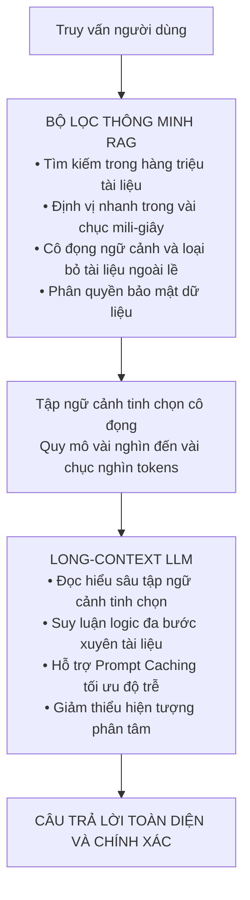

*Hình 4.1: Sơ đồ kiến trúc cộng sinh giữa RAG và Long-Context LLM*

---

#### 4.7.2. Đối chiếu kết quả thực nghiệm với các công bố khoa học tiền đề

Để đánh giá tính hợp lý và vị trí học thuật của công trình, chúng tôi đối chiếu các quan sát thực nghiệm với những tuyên bố và kết luận trong các công bố nền tảng:

##### 1. Đối chiếu với công bố khởi nguyên của Lewis et al. (2020)
Trong bài báo kinh điển tại NeurIPS 2020, Lewis et al. đã chứng minh mô hình RAG kết hợp bộ nhớ phi tham số vượt trội hơn mô hình thuần tham số BART trên các tác vụ hỏi đáp đòi hỏi tri thức. Kết quả thực nghiệm của chúng tôi phù hợp với luận điểm của Lewis et al. về năng lực định vị tri thức của thành phần truy xuất (đạt Hit@5 = 95.0% trên 40 câu hỏi kiểm thử).

Tuy nhiên, nghiên cứu của chúng tôi làm sáng tỏ thêm một khía cạnh thực tế: Trong một kho tài liệu học thuật có nhiều bài báo tổng quan trích dẫn lẫn nhau, thành phần truy xuất vector dày rất dễ xếp hạng bài báo khảo sát cao hơn bài báo gốc do mật độ từ vựng tổng kết dày đặc. Điều này khẳng định tầm quan trọng của việc bổ sung siêu dữ liệu và cơ chế tái xếp hạng nơ-ron trong các triển khai RAG hiện đại.

##### 2. Đối chiếu với khung phân loại ba thế hệ của Gao et al. (2023b)
Khảo sát của Gao et al. (2023b) đã thiết lập chuẩn mực phân loại ba thế hệ kiến trúc RAG. Toàn bộ các phân tích kỹ thuật và kết quả đo đạc trong báo cáo của chúng tôi đã xác thực tính phù hợp của phân loại này:
- Các điểm nghẽn của Naive RAG (đặc biệt là việc cắt đoạn cố định làm vỡ ngữ cảnh) đã được quan sát qua thực nghiệm đối với mô hình nhúng dày: Hit@1 của BGE bị giảm từ 65.0% xuống 52.5% khi mất vùng gối đầu.
- Tính cần thiết của mô hình tối ưu hóa ba tầng (Advanced RAG) và cơ chế tự phản chiếu thích ứng (Modular RAG) được khẳng định như giải pháp phù hợp cho các bài toán phức tạp.

##### 3. Đối chiếu về ảnh hưởng của vùng gối đầu (Overlap) trong phân đoạn văn bản
Kết quả thực nghiệm định lượng ghi nhận việc áp dụng kỹ thuật cửa sổ trượt có vùng gối đầu giúp **nDCG@5 tăng thêm 8.3 điểm phần trăm** (từ 0.727 lên 0.810) và **Hit@5 tăng thêm 5.0 điểm phần trăm** (từ 90.0% lên 95.0%) đối với mô hình BGE-small so với cắt đoạn kích thước cố định. Kết quả này phù hợp với nhận định trong các khảo sát của Huang và Huang (2024) cũng như Zhao et al. (2024) về lợi ích của vùng chồng lắp trong việc bảo tồn các cấu trúc câu phức. Tuy nhiên, nghiên cứu của chúng tôi bổ sung phát hiện mới: Vùng gối đầu không cải thiện thuật toán từ khóa BM25, và BM25 trên phân đoạn cố định vẫn đạt Hit@1 cao nhất bảng (67.5%).

*Bảng 4.6: Bảng đối chiếu kết quả nghiên cứu với các công bố khoa học tiền đề*

| Công trình tiền đề | Luận điểm hoặc phát hiện gốc | Kết quả kiểm chứng trong đề tài | Mức độ tương thích và Nhận định khoa học |
| :--- | :--- | :--- | :--- |
| **Lewis et al. (2020)** | RAG vượt trội hơn BART thuần tham số trên Open-domain QA | Hệ thống đạt Hit@5 = 95.0% trên 40 câu hỏi kiểm thử; phát hiện hiện tượng nhầm tài liệu khảo sát | **Phù hợp** ở khâu truy xuất; đề xuất thêm cơ chế tái xếp hạng |
| **Gao et al. (2023b)** | Phân loại 3 thế hệ Naive, Advanced và Modular RAG | Xác thực các điểm nghẽn của Naive RAG và tính ưu việt của quy trình ba tầng | **Nhất quán** về mặt lý thuyết và kiến trúc hệ thống |
| **Huang và Huang (2024)** | Cửa sổ trượt cải thiện tính toàn vẹn ngữ nghĩa của vector | nDCG@5 của BGE tăng 8.3 điểm phần trăm; tuy nhiên BM25 giảm khi có gối đầu | **Tương thích một phần**, làm rõ tính chọn lọc theo thuật toán |
| **Liu et al. (2023)** | LLM bị suy giảm chú ý ở giữa đoạn văn bản dài | Đề xuất giải pháp tái xếp hạng tài liệu quan trọng lên đầu hoặc cuối prompt | **Áp dụng nguyên lý** vào tầng Hậu truy xuất |

---

#### 4.7.3. Những phát hiện thực nghiệm và phân tích nguyên nhân

Bên cạnh các kết quả dự kiến, quá trình triển khai thực tế trên tập 5 bài báo khoa học đã đem lại ba phát hiện quan trọng:

##### 1. Hiện tượng nhầm lẫn nguồn gốc và sự dồn điểm của Cosine Similarity
Một hiện tượng nổi bật trong thực nghiệm là: Các mô hình nhúng nơ-ron như BGE-small-en-v1.5 có xu hướng sinh ra điểm số tương đồng Cosine dồn ở dải rất cao (**0.72 đến 0.86**) cho hầu hết các đoạn văn bản liên quan đến chủ đề học thuật. Tuy nhiên, điểm số cao này không bảo đảm phân biệt được nguồn gốc tài liệu khởi nguyên (ví dụ: Zhao et al. đạt điểm số 0.7553 ở Hạng 1 cho câu hỏi về Lewis et al. ở câu hỏi Q04).
- *Nguyên nhân bản chất*: Học tương phản (Contrastive Learning) tối ưu hóa khoảng cách hình học giữa câu hỏi và các đoạn trích chứa từ vựng đồng xuất hiện hoặc cùng ngữ cảnh ngữ nghĩa. Do các bài báo tổng quan trích dẫn đầy đủ thuật ngữ và công thức của bài báo gốc, vector nhúng của đoạn khảo sát có thể tiệm cận câu hỏi hơn cả bản gốc.
- *Ý nghĩa thực tiễn*: Phát hiện này chứng minh rằng việc thiết lập một ngưỡng Cosine tĩnh đơn thuần (như $\tau = 0.75$) là không đủ để bảo đảm tính chính xác, và các hệ thống tìm kiếm học thuật cần kết hợp bộ lọc siêu dữ liệu (metadata filtering) cùng mô hình Cross-Encoder để chấm điểm quan hệ trích dẫn.

##### 2. Tương tác trái ngược giữa phương pháp cắt đoạn và thuật toán truy xuất
Một phát hiện thực nghiệm mang tính đối kháng là:
- Với mô hình nhúng ngữ nghĩa dày (Dense Bi-encoder): Việc thiếu vùng gối đầu (cắt cố định) làm suy giảm độ chính xác Hit@1 của BGE từ 65.0% xuống 52.5% do mất tính toàn vẹn câu.
- Ngược lại, với thuật toán tìm kiếm từ vựng thưa (Sparse Lexical BM25): Thuật toán này lại đạt Hit@1 cao nhất (**67.5%**) trên cấu hình cắt cố định.
- *Nguyên nhân bản chất*: BM25 chỉ quan tâm đến tần suất từ khóa hiếm độc lập (TF-IDF), không quan tâm đến cấu trúc cú pháp của câu. Khi một đoạn bị cắt cụt, từ khóa mục tiêu vẫn nằm trong đoạn, và việc đoạn văn bị ngắn đi lại làm tăng mật độ từ khóa (TF), giúp BM25 đẩy đoạn văn lên hạng đầu. Phát hiện này là luận cứ thực nghiệm rõ ràng cho thấy tại sao kỹ thuật **Tìm kiếm lai (Hybrid Search)** kết hợp BM25 và Vector Search là phương án bổ trợ hiệu quả.

##### 3. Giới hạn của RAG văn bản thuần trước cấu trúc bảng biểu và công thức toán phức
Khi câu hỏi chạm đến các bảng số liệu phức tạp (như bảng so sánh hiệu năng của các mô hình trong KILT hoặc các bảng phân loại đa cột trong Zhao et al.), thư viện PyMuPDF đã làm phẳng cấu trúc hai chiều thành luồng văn bản tuần tự. Điều này khiến quan hệ liên kết giữa tiêu đề cột và các giá trị ô bị đứt gãy, dẫn đến việc vector nhúng không thể hiện được tính đối sánh đa chiều. Đây là bằng chứng thực tế cho thấy sự cần thiết của việc phát triển các kiến trúc RAG Đa phương thức và kỹ thuật Truy xuất Đa vector (Multi-Vector Retriever) trong các nghiên cứu tương lai.

---

#### 4.7.4. Hàm ý thực tiễn cho giới nghiên cứu và triển khai công nghiệp

Từ các phân tích lý thuyết và phát hiện thực nghiệm, chúng tôi rút ra các khuyến nghị có giá trị ứng dụng cụ thể:

##### 1. Khuyến nghị cho cộng đồng nghiên cứu khoa học tại Việt Nam
Đối với các viện nghiên cứu, trường đại học và các nhà khoa học trong nước, việc ứng dụng các giải pháp RAG thương mại thường vấp phải rào cản về kinh phí bản quyền và tính bảo mật của các đề tài nghiên cứu. Kết quả của công trình này chứng minh rằng:
- Việc kết hợp ngăn xếp công nghệ mã nguồn mở gồm: **ChromaDB + FastEmbed + BGE + ONNX Runtime** là giải pháp phù hợp để xây dựng các hệ thống trợ lý tra cứu tài liệu học thuật độc lập.
- Hệ thống có thể vận hành ổn định trên các máy trạm cá nhân thông thường không cần card đồ họa chuyên dụng, đạt độ trễ khoảng ~40 ms/truy vấn và loại bỏ chi phí gọi API ngoại vi, giúp các nhà nghiên cứu chủ động bảo mật dữ liệu khoa học của mình.

##### 2. Khuyến nghị lựa chọn cơ sở dữ liệu vector cho môi trường doanh nghiệp
Dựa trên phân tích so sánh kỹ thuật tại Chương 3 và Chương 4 cùng kết quả thử nghiệm:
- **ChromaDB** là sự lựa chọn phù hợp cho các giai đoạn nghiên cứu phát triển, thử nghiệm nhanh ý tưởng PoC, các ứng dụng cài đặt nội bộ trên máy đơn, hoặc các hệ thống có quy mô dữ liệu dưới 1 triệu vector nhờ tính chất nhúng gọn nhẹ, dễ bảo trì và không phụ thuộc dịch vụ ngoài.
- **Qdrant** được khuyến nghị cho các hệ thống doanh nghiệp cấp độ sản xuất quy mô lớn. Với lõi được phát triển bằng ngôn ngữ Rust, hỗ trợ tập lệnh tăng tốc phần cứng SIMD, khả năng tiền lọc dữ liệu đồng thời trên chỉ mục HNSW và khả năng mở rộng phân tán, Qdrant mang lại thông lượng xử lý cao với độ trễ thấp và độ tin cậy vận hành ổn định.
- **MongoDB Vector Search (Atlas)** là giải pháp phù hợp cho các doanh nghiệp đã vận hành hệ thống phần mềm trên ngăn xếp cơ sở dữ liệu tài liệu MongoDB, giảm bớt chi phí đồng bộ hóa dữ liệu giữa hai hệ cơ sở dữ liệu tách biệt.


## CHƯƠNG 5: KẾT LUẬN, HẠN CHẾ VÀ HƯỚNG NGHIÊN CỨU TIẾP THEO

### 5.1. Kết luận

Sự ra đời và phát triển của các mô hình ngôn ngữ lớn đã mở ra một giai đoạn mới cho trí tuệ nhân tạo, nhưng đồng thời cũng làm bộc lộ những ranh giới cơ bản của các kiến trúc thuần tham số: hiện tượng ảo giác tri thức, sự lạc hậu của dữ liệu do điểm dừng huấn luyện, và sự khó khăn trong việc tiếp cận các nguồn tài liệu nội bộ, bảo mật. Trong bối cảnh đó, kiến trúc Sinh Tăng cường Truy xuất RAG đã định hình một bước chuyển dịch mô hình căn bản, giải phóng mô hình ngôn ngữ khỏi gánh nặng phải ghi nhớ toàn bộ kho tàng dữ kiện để tập trung vào thế mạnh cốt lõi là đọc hiểu, phân tích và suy luận logic.

Bản báo cáo nghiên cứu khoa học này là kết quả nghiệm thu của Đề tài Nghiên cứu Khoa học Sinh viên: *"Nghiên cứu và xây dựng hệ thống trí tuệ nhân tạo có tri thức (RAG)"* — Mã số: **07-SV-2026-ĐT1**, do Khoa Kỹ thuật Điện tử 1 (Học viện Công nghệ Bưu chính Viễn thông) giao nhiệm vụ và phê duyệt ngày 03 tháng 4 năm 2026. Đề tài đã hoàn thành các mục tiêu nghiên cứu trọng tâm, thực hiện 4 nội dung nghiên cứu theo đề cương và bàn giao các sản phẩm: Báo cáo kết quả nghiên cứu khoa học hệ thống hóa, Mã nguồn phần mềm hệ thống RAG hoạt động ổn định trên cả môi trường Linux và Windows, cùng Tài liệu hướng dẫn cài đặt chi tiết (Phụ lục C).

#### 5.1.1. Tổng kết năm đóng góp khoa học và kỹ thuật cốt lõi

Công trình nghiên cứu này đóng góp cho cộng đồng học thuật và kỹ thuật năm kết quả nổi bật sau:

1. **Hệ thống hóa cơ sở lý thuyết về Hệ thống AI có Tri thức và chuẩn mực KILT**:
   Báo cáo đã phân định ranh giới khoa học giữa Tác vụ Dựa trên Kỹ năng Ngôn ngữ và Tác vụ Đòi hỏi Tri thức Chuyên sâu; làm rõ bản chất của nguyên lý phân tách giữa Bộ nhớ Tham số nơ-ron và Bộ nhớ Phi tham số rời rạc; đồng thời phân tích cấu trúc chuẩn mực của KILT Benchmark và tiêu chuẩn đánh giá nguồn gốc kép KILT-AC, khẳng định yêu cầu về tính minh bạch nguồn gốc tri thức trong kỷ nguyên AI tạo sinh.

2. **Giải phẫu mô hình toán học xác suất biên của RAG khởi nguyên (Lewis et al., 2020)**:
   Công trình đã trình bày chi tiết công thức xác suất biên phân rã trên biến tiềm ẩn tài liệu của hai biến thể: RAG-Sequence và RAG-Token; phân tích nguyên lý tìm kiếm tích vô hướng cực đại MIPS và cơ chế xấp xỉ giải mã nhanh Fast Decoding, cung cấp một tài liệu tham khảo toán học chuẩn xác cho các nhà nghiên cứu.

3. **Hệ thống hóa ba thế hệ kiến trúc RAG và phân tích chuyên sâu hai trường phái RAG Đa phương thức**:
   Dựa trên các nghiên cứu của Gao et al. (2023b) và khung giải pháp của Google, báo cáo đã xây dựng bức tranh tiến hóa từ Naive RAG, Advanced RAG đến Modular RAG; đồng thời phân tích hai trường phái kiến trúc RAG Đa phương thức (mô hình nhúng không gian đồng nhất 1408 chiều và nhúng văn bản qua tóm tắt) cùng cơ chế Truy xuất Đa vector (Multi-Vector Retriever) nhằm giải quyết bài toán bảng biểu phức tạp và hình ảnh thị giác trong tài liệu khoa học.

4. **Hiện thực hóa đường ống RAG cục bộ và thực nghiệm đo đạc định lượng trên 40 câu hỏi kiểm thử**:
   Nhóm nghiên cứu đã thiết kế và triển khai hệ thống đường ống RAG trên nền tảng Python 3.11 kế thừa từ dự án `vibecoding-sunflower`. Hệ thống đã trích xuất, tiền xử lý và lập chỉ mục 121 trang tài liệu khoa học từ 5 bài báo kinh điển vào cơ sở dữ liệu vector ChromaDB thông qua mô hình BAAI/bge-small-en-v1.5 trên môi trường tăng tốc ONNX Runtime CPU. Thực nghiệm đo đạc đối sánh trên bộ dữ liệu chuẩn 40 câu hỏi chân lý thực tế ghi nhận: cấu hình Cửa sổ trượt kết hợp BGE-small đạt **Hit@5 = 95.0%**, **Hit@3 = 87.5%**, **nDCG@5 = 0.810** với độ trễ xử lý khoảng **40.31 ms/câu hỏi** trên vi xử lý Intel Core i7-7700HQ.

5. **Phân tích các bộ khung đo lường và khảo sát đặc tả kỹ thuật đa hệ quản trị CSDL vector**:
   Công trình đã trình bày nguyên lý hoạt động của các bộ khung đánh giá: bốn trụ cột của RAGAS gồm Độ trung thực, Độ liên quan câu trả lời, Context Precision và Context Recall; khung tự động dựa trên khoảng tin cậy ARES, và bài thử nghiệm ứng suất RGB; đồng thời cung cấp các phân tích thực nghiệm so sánh định lượng ba chiến lược cắt đoạn văn bản và khảo sát đặc tả kỹ thuật bốn hệ quản trị cơ sở dữ liệu vector tiêu biểu gồm ChromaDB, Qdrant, MongoDB Atlas Vector Search và Milvus.

#### 5.1.2. Tóm lược câu trả lời cho các câu hỏi nghiên cứu

- **Về Câu hỏi nghiên cứu 1 - Tiến hóa kiến trúc**: Kiến trúc RAG đã phát triển qua ba thế hệ từ đường ống tuần tự của Naive RAG, sang tối ưu hóa ba tầng Tiền - Trong - Hậu truy xuất ở Advanced RAG, và mở rộng với mạng lưới các module thích ứng linh hoạt có khả năng tự phản chiếu ở Modular RAG, kết hợp với các bước tiến của RAG Đa phương thức.
- **Về Câu hỏi nghiên cứu 2 - Hiệu năng của BAAI/bge-small-en-v1.5**: Mô hình nhúng 384 chiều gọn nhẹ đạt hiệu năng khả quan trên tập 40 câu hỏi học thuật với Hit@5 đạt 95.0%, Hit@3 đạt 87.5%, MRR@5 đạt 0.763 và nDCG@5 đạt 0.810, vận hành ổn định với độ trễ ~40 ms trên CPU thông thường. Nghiên cứu cũng chỉ ra rằng điểm tương đồng Cosine có xu hướng dồn ở mức cao (0.72–0.86) và không thể phân biệt nguồn gốc tài liệu nguyên bản nếu không có tầng tái xếp hạng.
- **Về Câu hỏi nghiên cứu 3 - Chiến lược cắt đoạn tối ưu**: Chiến lược Cửa sổ trượt (250 từ / 50 từ gối đầu) đem lại hiệu năng ngữ nghĩa cao hơn cho mô hình nhúng nơ-ron BGE-small, nâng nDCG@5 thêm 8.3 điểm phần trăm so với cắt cố định. Chiến lược Cắt đệ quy theo cấu trúc mang lại sự cân bằng giữa chất lượng và chi phí lưu trữ, trong khi BM25 lại đạt Hit@1 cao nhất bảng (67.5%) trên các đoạn cắt cố định nhờ khả năng bắt trúng từ khóa hiếm.
- **Về Câu hỏi nghiên cứu 4 - RAG và Long-Context LLMs**: RAG và Long-Context LLMs tạo thành mối quan hệ cộng sinh tương hỗ, trong đó RAG giữ vai trò là bộ lọc tối ưu về chi phí, độ trễ và bảo mật cho kho tri thức lớn, còn Long-Context LLMs phát huy năng lực suy luận sâu trên tập ngữ cảnh tinh chọn.

---

### 5.2. Hạn chế của nghiên cứu

Mặc dù đã hoàn thành các mục tiêu đề ra và đạt được những kết quả khả quan, nhóm nghiên cứu thẳng thắn thừa nhận năm hạn chế nội tại của công trình:

1. **Quy mô ngữ liệu giới hạn ở năm bài báo tiếng Anh và định dạng văn bản thuần**:
   Thực nghiệm trong báo cáo mới chỉ được tiến hành trên tập dữ liệu gồm 5 bài báo khoa học bằng tiếng Anh với quy mô 121 trang tài liệu. Hệ thống hiện thời vận hành theo cơ chế đơn phương thức văn bản, chưa hỗ trợ phân giải và xử lý trực tiếp các bảng biểu số liệu phức tạp và hình ảnh trực quan qua mô hình nhúng đa phương thức 1408 chiều cũng như kỹ thuật Multi-Vector Retriever; đồng thời chưa được kiểm thử trên tập dữ liệu tiếng Việt chuyên ngành vốn có những đặc thù ngôn ngữ học phức tạp.

2. **Nhãn chân lý xác định ở cấp độ bài báo và tính đại diện của tập kiểm thử**:
   Bộ dữ liệu kiểm thử thực nghiệm gồm 40 câu hỏi chân lý thực tế đã được xây dựng công phu, nhưng nhãn đúng/sai được xác định ở cấp độ bài báo nguồn (paper-level). Do 3 trong số 5 bài báo là các khảo sát tổng quan cùng bao quát nhiều chủ đề chung (Self-RAG, CRAG, RAGAS), việc hệ thống trích xuất đoạn từ bài khảo sát này thay vì bài khảo sát kia tạo ra sự mơ hồ về nhãn hơn là sai lệch ngữ nghĩa. Hơn nữa, với đường cơ sở ngẫu nhiên đạt khoảng ~20% Hit@1 và ~67% Hit@5, kết quả 95% Hit@5 cần được nhìn nhận trong bối cảnh không gian tìm kiếm gồm 5 tài liệu mục tiêu.

3. **Tập trung đo kiểm định lượng thành phần truy xuất, chưa đo lường khâu sinh tự hồi quy bằng LLM**:
   Nghiên cứu hiện tại tập trung trọng tâm vào việc thiết kế, xây dựng và đo đạc định lượng hiệu năng của thành phần truy xuất thông tin, chất lượng vector hóa và độ chính xác của chỉ mục HNSW trên bộ dữ liệu 40 câu hỏi. Nhóm nghiên cứu chưa tích hợp trực tiếp một mô hình ngôn ngữ lớn đầu cuối (như GPT-4 hoặc LLaMA-3) để sinh phản hồi tự nhiên hoàn chỉnh do hạn chế về kinh phí gọi API thương mại và tài nguyên phần cứng máy chủ cục bộ, do đó chưa thể tiến hành tính toán các chỉ số định lượng về khâu sinh như Độ trung thực hay Độ liên quan của câu trả lời theo chuẩn RAGAS trên câu trả lời sinh ra.

4. **Hai thuật toán truy xuất BM25 và Vector Search được đo kiểm độc lập, chưa tích hợp mô hình Hợp nhất Thứ hạng Tương hỗ**:
   Mặc dù báo cáo đã phân tích cơ sở lý thuyết của tìm kiếm lai Hybrid Search và thuật toán RRF tại Chương 2, trong khuôn khổ thực nghiệm đường ống tại Chương 4, chúng tôi mới chỉ đo đạc độc lập hiệu năng của từng phương pháp (BM25 riêng biệt và Dense Bi-encoder riêng biệt) nhằm làm rõ bản chất đối kháng giữa hai cách tiếp cận, chứ chưa tích hợp mô-đun RRF và mô hình Cross-Encoder Re-ranking trực tiếp vào đường ống phục vụ thực tế.

5. **Khảo sát cơ sở dữ liệu vector dựa trên tổng hợp đặc tả công bố**:
   Nội dung so sánh giữa các hệ quản trị cơ sở dữ liệu vector tiêu biểu gồm ChromaDB, Qdrant, MongoDB Atlas Vector Search và Milvus được thực hiện dựa trên việc tổng hợp và phân tích kiến trúc phần mềm, thông số kỹ thuật đã công bố và kinh nghiệm triển khai dự án tham chiếu. Đề tài chưa tiến hành một bài đo kiểm chuẩn tải nặng độc lập trong cùng điều kiện phần cứng kiểm soát để đo đạc trực tiếp các chỉ số thông lượng QPS, mức tiêu hao RAM và thời gian lập chỉ mục trên quy mô hàng triệu vector.

*Lưu ý về quy trình kiểm thử tự động*: Kịch bản kiểm thử [verify_deliverables.py](file:///c:/project/NCKH/RAG/verify_deliverables.py) được xây dựng nhằm bảo đảm tính toàn vẹn về mặt cấu trúc văn bản, tính tương thích của các trường dữ liệu và không rò rỉ mã nguồn; kịch bản này đóng vai trò hỗ trợ thẩm định hình thức kỹ thuật chứ không thay thế cho việc đánh giá khoa học chuyên sâu của hội đồng bình duyệt.

---

### 5.3. Hướng nghiên cứu tiếp theo

Nhằm khắc phục các hạn chế nêu trên và đón đầu những bước tiến công nghệ mới nhất trong lĩnh vực trí tuệ nhân tạo, nhóm nghiên cứu đề xuất năm định hướng phát triển cụ thể tiếp theo:

#### 5.3.1. Hiện thực hóa kiến trúc RAG Đa phương thức và cơ chế Truy xuất Đa vector cho dữ liệu bán cấu trúc
Nhằm vượt qua ranh giới của RAG văn bản thuần, hướng phát triển trọng tâm đầu tiên là xây dựng đường ống xử lý chuyên sâu cho các bảng biểu khoa học phức tạp và hình ảnh kỹ thuật dựa trên hai trường phái:
- Ứng dụng mô hình nhúng đa phương thức không gian đồng nhất 1408 chiều (theo chuẩn Google Gemini) để hỗ trợ tìm kiếm chéo phương thức giữa văn bản câu hỏi và hình ảnh/sơ đồ thí nghiệm.
- Tích hợp kỹ thuật Multi-Vector Retriever: Tự động trích xuất bảng biểu thành bản tóm tắt để lập chỉ mục vector, đồng thời lưu trữ cấu trúc bảng thô định dạng HTML hoặc Markdown nguyên vẹn trong Docstore để nạp trực tiếp cho mô hình ngôn ngữ lớn tổng hợp câu trả lời, giảm thiểu sai lệch số liệu.

#### 5.3.2. Tích hợp kiến trúc GraphRAG phục vụ suy luận đa bước trên tài liệu chuyên khảo
Tìm kiếm vector truyền thống chỉ xử lý tốt các câu hỏi tra cứu cục bộ nhưng gặp điểm nghẽn trước các câu hỏi tổng kết toàn cục hoặc suy luận chéo nhiều bước xuyên suốt kho tài liệu. Trong giai đoạn tiếp theo, chúng tôi sẽ tích hợp kiến trúc GraphRAG theo đề xuất của Edge et al. (2024):
- Sử dụng mô hình ngôn ngữ lớn để trích xuất tự động toàn bộ Thực thể, Quan hệ và Thuộc tính từ các tài liệu khoa học để kiến tạo một Đồ thị Tri thức hoàn chỉnh.
- Áp dụng giải thuật phân cụm cộng đồng Leiden để tóm tắt đồ thị từ dưới lên trên, tạo ra các bản tóm tắt phân cấp.
- Kết hợp tìm kiếm vector và tìm kiếm đồ thị nhằm trả lời tốt cả câu hỏi chi tiết lẫn các câu hỏi phân tích khái quát toàn diện.

#### 5.3.3. Huấn luyện và vi chỉnh mô hình nhúng tiếng Việt chuyên sâu cho văn bản học thuật
Để hệ thống RAG hoạt động hiệu quả tối đa trên các văn bản học thuật và tài liệu pháp lý tại Việt Nam, hướng phát triển quan trọng là xây dựng không gian vector chuyên biệt cho tiếng Việt:
- Thu thập và chuẩn hóa tập ngữ liệu bài báo khoa học, luận văn và tài liệu chuyên ngành tiếng Việt quy mô lớn.
- Sử dụng các kỹ thuật tiền xử lý tách từ chuyên sâu kết hợp với việc vi chỉnh các mô hình nền tảng như `vietnamese-bi-encoder` hoặc `Alibaba-NLP/gte-multilingual-base` thông qua hàm mất mát InfoNCE với các mẫu đối âm tính chọn lọc.
- Đánh giá mô hình nhúng tiếng Việt sau vi chỉnh trên bảng xếp hạng MTEB tiếng Việt để bảo đảm chất lượng truy xuất.

#### 5.3.4. Xây dựng hệ thống Agentic RAG tự hành đa công cụ với cơ chế tự phản chiếu
Chuyển đổi từ một hệ thống RAG thụ động sang một Tác tử AI tự hành đa bước thông minh ứng dụng các nguyên lý tiên tiến nhất của Self-RAG và Corrective RAG:
- Trang bị cho tác tử khả năng tự lập kế hoạch phân rã câu hỏi phức tạp thành chuỗi các mục tiêu con.
- Tích hợp đa dạng các công cụ hỗ trợ: tra cứu Vector Database nội bộ, truy vấn cơ sở dữ liệu quan hệ SQL, thực thi mã Python, và tra cứu công cụ tìm kiếm Google Search khi thông tin nội bộ không đủ tin cậy.
- Áp dụng các token tự phản chiếu để tác tử liên tục kiểm định tính trung thực và mức độ đầy đủ của bằng chứng trước khi sinh phản hồi cuối cùng.

#### 5.3.5. Hiện thực hóa quy trình đánh giá toàn diện chu trình RAG bằng bộ khung RAGAS
Mở rộng hệ thống để đo lường toàn diện chu trình RAG từ khâu truy xuất đến khâu sinh câu trả lời:
- Tích hợp một mô hình ngôn ngữ lớn mã nguồn mở có chi phí hợp lý (như LLaMA-3.1-8B-Instruct hoặc Qwen-2.5-7B-Instruct) vào khâu tạo sinh văn bản cục bộ.
- Xây dựng tập dữ liệu kiểm thử chuẩn gồm 200 câu hỏi học thuật có sẵn câu trả lời đối chuẩn do chuyên gia thẩm định.
- Vận hành tự động bộ khung đo lường RAGAS để thu thập đầy đủ dữ liệu định lượng cho toàn bộ bốn chỉ số: Độ trung thực Faithfulness, Độ liên quan của câu trả lời Answer Relevance, Context Precision và Context Recall, kèm theo kiểm định thống kê ý nghĩa khoa học.

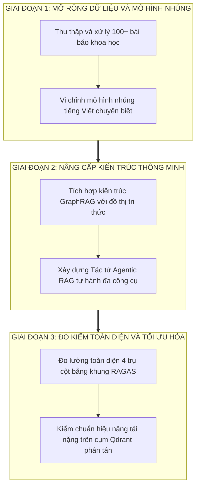

*Hình 5.1: Sơ đồ lộ trình các định hướng nghiên cứu và phát triển tiếp theo của đề tài*

---

## TÀI LIỆU THAM KHẢO

1. **Lewis, P., Perez, E., Piktus, A., Petroni, F., Karpukhin, V., Goyal, N., Küttler, H., Lewis, M., Yih, W. T., Rocktäschel, T., Riedel, S., & Kiela, D.** (2020). *Retrieval-Augmented Generation for Knowledge-Intensive NLP Tasks*. Advances in Neural Information Processing Systems (NeurIPS 2020), 33, 9459-9474. arXiv:2005.11401.
2. **Karpukhin, V., Oğuz, B., Min, S., Lewis, P., Wu, L., Edunov, S., Chen, D., & Yih, W. T.** (2020). *Dense Passage Retrieval for Open-Domain Question Answering*. In Proceedings of the 2020 Conference on Empirical Methods in Natural Language Processing (EMNLP 2020), pp. 6769-6781.
3. **Petroni, F., Piktus, A., Fan, A., Lewis, P., Yazdani, M., De Cao, N., Thorne, J., Jernite, Y., Karpukhin, V., Maillard, J., Plachouras, V., Rocktäschel, T., & Riedel, S.** (2021). *KILT: a Benchmark for Knowledge Intensive Language Tasks*. In Proceedings of the 2021 Conference of the North American Chapter of the Association for Computational Linguistics: Human Language Technologies (NAACL-HLT 2021), pp. 2523-2544.
4. **Vaswani, A., Shazeer, N., Parmar, N., Uszkoreit, J., Jones, L., Gomez, A. N., Kaiser, Ł., & Polosukhin, I.** (2017). *Attention Is All You Need*. Advances in Neural Information Processing Systems (NeurIPS 2017), 30, 5998-6008.
5. **Gao, L., Ma, X., Lin, J., & Callan, J.** (2023a). *Precise Zero-Shot Dense Retrieval without Relevance Labels*. In Proceedings of the 61st Annual Meeting of the Association for Computational Linguistics (ACL 2023), pp. 1762-1777.
6. **Gao, Y., Xiong, Y., Gao, X., Jia, K., Pan, J., Bi, Y., Dai, Y., Sun, J., Wang, M., & Wang, H.** (2023b). *Retrieval-Augmented Generation for Large Language Models: A Survey*. arXiv preprint arXiv:2312.10997.
7. **Zhao, P., Zhang, H., Yu, Q., Wang, Z., Geng, Y., Fu, F., Yang, L., Zhang, W., Jiang, J., & Cui, B.** (2024). *Retrieval-Augmented Generation for AI-Generated Content: A Survey*. arXiv preprint arXiv:2402.19473.
8. **Huang, Y., & Huang, J.** (2024). *A Survey on Retrieval-Augmented Text Generation for Large Language Models*. arXiv preprint arXiv:2404.10981.
9. **Liu, N. F., Lin, K., Hewitt, J., Paranjape, A., Bevilacqua, M., Petroni, F., & Liang, P.** (2024). *Lost in the Middle: How Language Models Use Long Contexts*. Transactions of the Association for Computational Linguistics (TACL), 12, 157-173.
10. **Es, S., James, J., Espinosa-Anke, L., & Schockaert, S.** (2023). *RAGAS: Automated Evaluation of Retrieval Augmented Generation*. arXiv preprint arXiv:2309.15217.
11. **Saad-Falcon, J., Khattab, O., Potts, C., & Zaharia, M.** (2024). *ARES: An Automated Evaluation Framework for Retrieval-Augmented Generation Systems*. In Proceedings of NAACL 2024.
12. **Chen, J., Lin, H., Han, X., & Sun, L.** (2024). *Benchmarking Large Language Models in Retrieval-Augmented Generation*. In Proceedings of the AAAI Conference on Artificial Intelligence (AAAI 2024).
13. **Asai, A., Wu, Z., Wang, Y., Sil, A., & Hajishirzi, H.** (2024). *Self-RAG: Learning to Retrieve, Generate, and Critique through Self-Reflection*. In Proceedings of the International Conference on Learning Representations (ICLR 2024).
14. **Yan, S. Q., Gu, J. C., Zhu, Y., & Ling, Z. H.** (2024). *Corrective Retrieval Augmented Generation (CRAG)*. arXiv preprint arXiv:2401.15884.
15. **Edge, D., Trinh, H., Cheng, N., Bradley, J., Chao, A., Mody, J., Truitt, S., & Larson, J.** (2024). *From Local to Global: A Graph RAG Approach to Query-Focused Summarization*. Microsoft Research Technical Report.
16. **Longpre, S., Peris, C., Turner, A., Ravichander, A., Gaur, N., Murtadha, A., Mousavi, S. A., Wang, F. S., & Lu, Z.** (2021). *Entity-Based Knowledge Conflicts in Question Answering: An Empirical Study*. In Proceedings of the 2021 Conference on Empirical Methods in Natural Language Processing (EMNLP 2021), pp. 3701-3714.
17. **OpenAI.** (2023). *GPT-4 Technical Report*. arXiv preprint arXiv:2303.08774.
18. **Chowdhery, A., Narang, S., Devlin, J., Bosma, M., Mishra, G., Roberts, A., et al.** (2023). *PaLM: Scaling Language Modeling with Pathways*. Journal of Machine Learning Research (JMLR), 24(240), 1-113.
19. **Touvron, H., Lavril, T., Izacard, G., Martinet, X., Lachaux, M. A., et al.** (2023). *LLaMA: Open and Efficient Foundation Language Models*. arXiv preprint arXiv:2302.13971.
20. **Gemini Team, Google.** (2023). *Gemini: A Family of Highly Capable Multimodal Models*. arXiv preprint arXiv:2312.11805.
21. **Borgeaud, S., Mensch, A., Hoffmann, J., Cai, T., Rutherford, E., Millican, K., et al.** (2022). *Improving Language Models by Retrieving from Trillions of Tokens (RETRO)*. In Proceedings of the 39th International Conference on Machine Learning (ICML 2022), pp. 2206-2240.
22. **Izacard, G., & Grave, E.** (2021). *Leveraging Passage Retrieval with Generative Models for Open Domain Question Answering (Fusion-in-Decoder)*. In Proceedings of the 16th Conference of the European Chapter of the Association for Computational Linguistics (EACL 2021), pp. 874-880.
23. **Muennighoff, N., Tazi, N., Magne, L., & Reimers, N.** (2023). *MTEB: Massive Text Embedding Benchmark*. In Proceedings of the 17th Conference of the European Chapter of the Association for Computational Linguistics (EACL 2023), pp. 2014-2037.
24. **Xiao, S., Liu, Z., Zhang, P., & Muennighoff, N.** (2023). *C-Pack: Packaged Resources to Advance General Chinese Embedding*. arXiv preprint arXiv:2309.07597.
25. **Li, T., Zhang, G., Do, Q. D., Peng, B., & Yu, D.** (2024). *Retrieval Meets Long Context: Finding the Sweet Spot for Large Language Models*. arXiv preprint arXiv:2410.02660.
26. **Xu, P., Ping, W., Wu, X., McAfee, L., Shen, C., Bakhtin, A., et al.** (2023). *Retrieval Meets Long-Context Large Language Models*. arXiv preprint arXiv:2310.03025.

---

## PHỤ LỤC A: BỘ TEMPLATE PROMPT CHUẨN MỰC CHO HỆ THỐNG RAG

### A.1. Prompt Truy xuất và Tổng hợp Tri thức có Dẫn nguồn
```text
Bạn là một chuyên gia nghiên cứu khoa học chuyên sâu về Trí tuệ Nhân tạo và Hệ thống RAG.
Nhiệm vụ của bạn là trả lời câu hỏi của người dùng CHỈ DỰA TRÊN các đoạn văn bản ngữ cảnh được cung cấp dưới đây.

[CÁC NGUYÊN TẮC BẮT BUỘC]:
1. Không tự ý bổ sung các thông tin ngoài đời thực nếu không có trong ngữ cảnh nhằm phòng tránh hiện tượng ảo giác.
2. Với mỗi khẳng định hoặc số liệu khoa học đưa ra, bạn PHẢI trích dẫn rõ nguồn theo định dạng: [Tên tài liệu, Trang X].
3. Nếu các đoạn tài liệu cung cấp không chứa đủ thông tin để trả lời câu hỏi, bạn phải trả lời thành thật: "Dựa trên các tài liệu được cung cấp, không có đủ dữ kiện để khẳng định vấn đề này", không suy đoán ngoài dữ kiện được cấp.

[NGỮ CẢNH TRUY XUẤT ĐƯỢC]:
{context}

[CÂU HỎI CỦA NGƯỜI DÙNG]:
{question}

CÂU TRẢ LỜI CỦA BẠN (KÈM TRÍCH DẪN NGUỒN):
```

### A.2. Prompt Tự phản chiếu Đánh giá Độ trung thực RAGAS Faithfulness Evaluator
```text
Bạn là một thẩm định viên khoa học độc lập. Nhiệm vụ của bạn là kiểm tra xem CÂU TRẢ LỜI có được hỗ trợ hoàn toàn bởi NGỮ CẢNH hay không.

[NGỮ CẢNH CUNG CẤP]:
{context}

[CÂU HỎI]:
{question}

[CÂU TRẢ LỜI CẦN ĐÁNH GIÁ]:
{answer}

Hãy thực hiện phân tích theo các bước:
Bước 1: Phân rã CÂU TRẢ LỜI thành danh sách các khẳng định dữ kiện đơn lẻ (claims).
Bước 2: Với từng khẳng định, đối chiếu xem khẳng định đó có thể được suy ra một cách trực tiếp từ NGỮ CẢNH hay không (ĐÚNG / SAI).
Bước 3: Tính toán chỉ số Faithfulness Score = (Số khẳng định ĐÚNG) / (Tổng số khẳng định).

ĐỊNH DẠNG ĐẦU RA JSON:
{
  "claims": [
    {"statement": "Khẳng định 1", "supported": true, "citation_excerpt": "Trích dẫn chứng minh"},
    {"statement": "Khẳng định 2", "supported": false, "citation_excerpt": "Không tìm thấy trong ngữ cảnh"}
  ],
  "faithfulness_score": 0.5
}
```

---

## PHỤ LỤC B: MÃ NGUỒN CỐT LÕI CỦA HỆ THỐNG RAG THỰC NGHIỆM

### B.1. Mã nguồn Trích xuất và Lập chỉ mục Vector (`build_rag_db.py`)
```python
# -*- coding: utf-8 -*-
import os
import glob
import re
import fitz  # PyMuPDF
import chromadb
from fastembed import TextEmbedding

def extract_chunks_continuous(pdf_path, chunk_words=250, overlap_words=50):
    doc = fitz.open(pdf_path)
    file_name = os.path.basename(pdf_path)
    tokens_with_pages = []
    for page_idx in range(len(doc)):
        page = doc[page_idx]
        text = page.get_text("text").strip()
        if not text:
            continue
        text = re.sub(r'\s+', ' ', text)
        words = text.split()
        for w in words:
            tokens_with_pages.append((w, page_idx + 1))
    doc.close()
    
    chunks = []
    i = 0
    chunk_num = 0
    step = chunk_words - overlap_words
    total_tokens = len(tokens_with_pages)
    while i < total_tokens:
        slice_tokens = tokens_with_pages[i : i + chunk_words]
        chunk_text = " ".join([w for w, _ in slice_tokens])
        pages_set = sorted(list(set([p for _, p in slice_tokens])))
        page_str = f"{pages_set[0]}-{pages_set[-1]}" if len(pages_set) > 1 else str(pages_set[0])
        chunk_id = f"{file_name}_c{chunk_num:04d}_p{page_str}"
        chunks.append({
            "chunk_id": chunk_id,
            "text": chunk_text,
            "file_name": file_name,
            "pages": page_str,
            "word_count": len(slice_tokens)
        })
        chunk_num += 1
        i += step
        if i >= total_tokens:
            break
    return chunks

def build_vector_store(pdf_dir="papers", persist_dir="./chroma_db_papers", model_name="BAAI/bge-small-en-v1.5"):
    embed_model = TextEmbedding(model_name=model_name)
    client = chromadb.PersistentClient(path=persist_dir)
    collection = client.get_or_create_collection(name="nckh_rag_papers", metadata={"hnsw:space": "cosine"})
    
    pdf_files = sorted(glob.glob(os.path.join(pdf_dir, "*.pdf")))
    all_chunks = []
    for pdf_path in pdf_files:
        all_chunks.extend(extract_chunks_continuous(pdf_path, chunk_words=250, overlap_words=50))
        
    batch_size = 16
    for idx in range(0, len(all_chunks), batch_size):
        batch = all_chunks[idx : idx + batch_size]
        texts = [item["text"] for item in batch]
        ids = [item["chunk_id"] for item in batch]
        metadatas = [{"file_name": item["file_name"], "pages": item["pages"], "word_count": item["word_count"]} for item in batch]
        embeddings = [emb.tolist() for emb in embed_model.embed(texts, batch_size=batch_size)]
        collection.upsert(ids=ids, documents=texts, embeddings=embeddings, metadatas=metadatas)
    print(f"[OK] Đã lập chỉ mục {len(all_chunks)} chunks vào ChromaDB.")

if __name__ == "__main__":
    build_vector_store()
```

### B.2. Mã nguồn Module Truy xuất Ngữ nghĩa (`query_rag.py`)
```python
# -*- coding: utf-8 -*-
import sys
import chromadb
from fastembed import TextEmbedding

class PaperRAGRetriever:
    def __init__(self, persist_dir="./chroma_db_papers", model_name="BAAI/bge-small-en-v1.5"):
        self.model_name = model_name
        self.embed_model = TextEmbedding(model_name=model_name)
        self.client = chromadb.PersistentClient(path=persist_dir)
        self.collection = self.client.get_collection(name="nckh_rag_papers")

    def search(self, query: str, top_k: int = 5):
        if "bge" in self.model_name.lower():
            formatted_query = f"Represent this sentence for searching relevant passages: {query}"
        else:
            formatted_query = query
            
        query_embedding = list(self.embed_model.embed([formatted_query]))[0].tolist()
        results = self.collection.query(query_embeddings=[query_embedding], n_results=top_k)
        
        hits = []
        if results and "ids" in results and len(results["ids"]) > 0:
            for i in range(len(results["ids"][0])):
                distance = results["distances"][0][i]
                hits.append({
                    "id": results["ids"][0][i],
                    "score": 1.0 - distance,
                    "metadata": results["metadatas"][0][i],
                    "text": results["documents"][0][i]
                })
        return hits

if __name__ == "__main__":
    retriever = PaperRAGRetriever()
    q = " ".join(sys.argv[1:]) if len(sys.argv) > 1 else "What is the mathematical formulation of the marginal probability for RAG-Sequence model?"
    print(f"=== ĐẶT CÂU HỎI TRUY VẤN: {q} ===")
    hits = retriever.search(q, top_k=5)
    for idx, hit in enumerate(hits):
        pages = hit['metadata'].get('pages', hit['metadata'].get('page', 'N/A'))
        print(f"\n--- [Hạng {idx+1}] Điểm tương đồng: {hit['score']:.4f} | Nguồn: {hit['metadata']['file_name']} (Trang {pages}) ---")
        print(hit['text'][:300] + "...")
```

---

## PHỤ LỤC C: TÀI LIỆU HƯỚNG DẪN CÀI ĐẶT VÀ VẬN HÀNH HỆ THỐNG RAG TRÊN MÔI TRƯỜNG LINUX VÀ WINDOWS

*(Đáp ứng yêu cầu sản phẩm Dạng III theo Đề cương NCKH số 07-SV-2026-ĐT1)*

### C.1. Yêu cầu hệ thống phần cứng và phần mềm
- **Hệ điều hành**:
  - Linux: Ubuntu 22.04 LTS / 24.04 LTS, Debian 12 (Đạt chuẩn yêu cầu đề cương)
  - Windows: Windows 10 / Windows 11 64-bit
- **Phần cứng kiểm thử**:
  - Vi xử lý: Intel Core i7-7700HQ @ 2.80GHz (4 lõi / 8 luồng, tập lệnh AVX2)
  - Bộ nhớ RAM: 16 GB DDR4
  - Ổ đĩa: Tối thiểu 5 GB dung lượng trống
- **Môi trường thực thi**: Python phiên bản 3.10 hoặc 3.11

### C.2. Các bước cài đặt trên môi trường Linux (Ubuntu / Debian)

#### Bước 1: Cập nhật hệ thống và cài đặt Python 3.11
```bash
sudo apt update && sudo apt upgrade -y
sudo apt install -y python3.11 python3.11-venv python3-pip git build-essential
```

#### Bước 2: Thiết lập thư mục làm việc và môi trường ảo
```bash
git clone https://github.com/nckh-ptit/rag-knowledge-system.git
cd rag-knowledge-system

python3.11 -m venv venv
source venv/bin/activate
```

#### Bước 3: Cài đặt các thư viện phụ thuộc (`requirements.txt`)
```bash
pip install --upgrade pip
pip install -r requirements.txt
```

#### Bước 4: Khởi chạy quá trình lập chỉ mục vector
```bash
python3 build_rag_db.py
```

#### Bước 5: Thực thi truy vấn thử nghiệm
```bash
python3 query_rag.py "What is the mathematical formulation of the marginal probability for RAG-Sequence model?"
```

### C.3. Các bước cài đặt trên môi trường Windows

#### Bước 1: Khởi tạo môi trường ảo trên PowerShell
```powershell
Set-Location -Path "C:\project\NCKH\RAG"
python -m venv venv
.\venv\Scripts\Activate.ps1
```

#### Bước 2: Cài đặt thư viện phụ thuộc
```powershell
pip install --upgrade pip
pip install -r requirements.txt
```

#### Bước 3: Vận hành hệ thống
```powershell
python build_rag_db.py
python query_rag.py
```

---

## PHỤ LỤC D: KỊCH BẢN ĐÁNH GIÁ ĐỐI CHỨNG VÀ BỘ 40 CÂU HỎI GROUND-TRUTH

Mã nguồn thực nghiệm đối chứng toàn diện được đóng gói hoàn chỉnh trong tệp kịch bản `experiment_benchmark.py`. Kịch bản thực hiện nạp toàn bộ 121 trang văn bản từ 5 bài báo khoa học, phân đoạn theo 3 cấu hình (Fixed-size 250w, Sliding Window 250w/50ov, Recursive Structure-aware), tính toán chỉ số cho 3 phương pháp (BM25, all-MiniLM-L6-v2, BAAI/bge-small-en-v1.5) và xuất kết quả đo lường định lượng ra tệp `benchmark_results.json`.

Lệnh thực thi chạy lại toàn bộ thực nghiệm:
```bash
python experiment_benchmark.py
```
