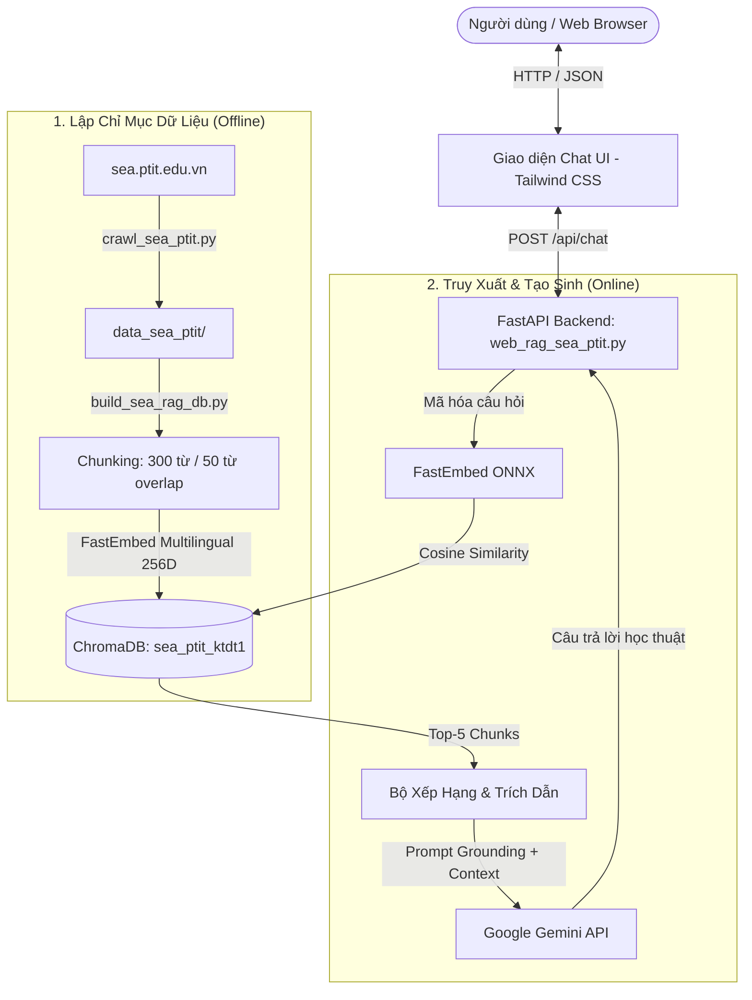

# 🤖 RAG Chatbot - Khoa Kỹ thuật Điện tử 1 (SEA - PTIT)

Hệ thống Hỏi - Đáp tăng cường truy xuất tri thức (**Retrieval-Augmented Generation - RAG**) thông minh, phục vụ tra cứu thông tin đào tạo, nghiên cứu khoa học, giảng viên và hoạt động của Khoa Kỹ thuật Điện tử 1 - Học viện Công nghệ Bưu chính Viễn thông ([sea.ptit.edu.vn](https://sea.ptit.edu.vn)).

Dự án tích hợp mô hình nhúng đa ngôn ngữ cục bộ (**FastEmbed / ChromaDB**) cùng mô hình tạo sinh ngôn ngữ lớn (**Google Gemini API**) nhằm đưa ra câu trả lời tự nhiên, chuẩn xác và trích dẫn trực tiếp liên kết nguồn gốc.

---

## 🌟 Tính Năng Nổi Bật

- ⚡ **Truy xuất vector tốc độ cao**: Sử dụng mô hình nhúng ONNX `minishlab/potion-multilingual-128M` (256 chiều), độ trễ truy xuất chỉ **3 - 8 ms** trên CPU thông thường.
- 📚 **Cơ sở tri thức toàn diện**: Đã thu thập và lập chỉ mục **248 tài liệu** (172 bài viết, 76 trang tĩnh), chia thành **722 chunks** (cửa sổ trượt 300 từ, gối đầu 50 từ).
- 🧠 **Tạo sinh thông minh với Gemini API**: Hỗ trợ các thế hệ mô hình `gemini-3.1-flash-lite`, `gemini-3.8-flash`, `gemini-1.5-flash` với cơ chế chống ảo tưởng (grounding prompt) nghiêm ngặt.
- 🔗 **Minh bạch trích dẫn (Fact-checking)**: Tự động đính kèm thẻ liên kết bài viết gốc từ `sea.ptit.edu.vn` và hỗ trợ xem trực tiếp các đoạn trích thô trong CSDL vector.
- 🎨 **Giao diện Web trực quan**: Xây dựng trên nền **FastAPI + Tailwind CSS + Vanilla JS**, hỗ trợ phím tắt, gợi ý câu hỏi một chạm và giao diện tương thích đa thiết bị.
- 📑 **Nghiên cứu khoa học đi kèm**: Bao gồm toàn bộ báo cáo nghiên cứu khoa học chuyên sâu về RAG và RAG đa phương thức (`BAO_CAO_NGHIEN_CUU_KHOA_HOC_RAG.docx` và file `.md`).

---

## 🏗️ Kiến Trúc Hệ Thống



---

## 📁 Cấu Trúc Thư Mục

```text
RAG_chatbot/
├── data_sea_ptit/             # Dữ liệu 248 tài liệu Markdown đã crawl từ sea.ptit.edu.vn
│   ├── documents/             # Các bài viết và trang tĩnh
│   └── summary.json           # Danh mục tổng hợp siêu dữ liệu
├── chroma_db_sea_ptit/        # CSDL vector ChromaDB đã lập chỉ mục (722 chunks)
├── templates/
│   └── index.html             # Giao diện Web Chatbot (Tailwind CSS, Marked.js)
├── crawl_sea_ptit.py          # Script cào dữ liệu tự động từ WordPress REST API
├── build_sea_rag_db.py        # Script chia đoạn và nạp dữ liệu vào ChromaDB
├── query_sea_rag.py           # Module truy vấn & benchmark CSDL vector CLI
├── web_rag_sea_ptit.py        # Ứng dụng Web FastAPI tích hợp RAG + Gemini API
├── run_web_rag.bat            # File chạy nhanh ứng dụng Web trên Windows (1 click)
├── requirements.txt           # Danh mục thư viện phụ thuộc
├── .env.example               # Mẫu cấu hình biến môi trường
├── BAO_CAO_NGHIEN_CUU_KHOA_HOC_RAG.md   # Báo cáo NCKH toàn văn (Markdown)
└── BAO_CAO_NGHIEN_CUU_KHOA_HOC_RAG.docx # Báo cáo NCKH định dạng Word chuẩn
```

---

## 🚀 Hướng Dẫn Cài Đặt & Sử Dụng

### 1. Yêu cầu môi trường
- Python 3.10 trở lên
- Git

### 2. Cài đặt các thư viện phụ thuộc
```bash
git clone https://github.com/dwduong74/RAG_chatbot.git
cd RAG_chatbot

python -m venv venv
# Trên Windows:
venv\Scripts\activate
# Trên Linux/macOS:
source venv/bin/activate

pip install -r requirements.txt
```

### 3. Cấu hình khóa bí mật (API Key)
Sao chép file `.env.example` thành `.env` và điền Gemini API Key của bạn:
```bash
cp .env.example .env
```
Nội dung file `.env`:
```env
GEMINI_API_KEY=your_actual_gemini_api_key_here
```

### 4. Khởi chạy ứng dụng Web Chat

#### Cách 1: Chạy bằng file Batch (Windows)
Nháy đúp chuột vào file **`run_web_rag.bat`**. Ứng dụng sẽ tự động khởi động máy chủ và mở trình duyệt tại `http://127.0.0.1:8000`.

#### Cách 2: Chạy bằng lệnh Terminal
```bash
python -m uvicorn web_rag_sea_ptit:app --host 127.0.0.1 --port 8000
```
Sau đó mở trình duyệt và truy cập: **`http://127.0.0.1:8000`**.

---

## 🛠️ Tùy Biến & Mở Rộng

- **Cập nhật dữ liệu từ Khoa KTĐT1**:
  ```bash
  python crawl_sea_ptit.py
  ```
- **Xây dựng lại CSDL vector ChromaDB**:
  ```bash
  python build_sea_rag_db.py
  ```
- **Kiểm thử truy vấn dòng lệnh**:
  ```bash
  python query_sea_rag.py --test
  ```

---

## 📄 Bản Quyền & Giấy Phép
Dự án được thực hiện phục vụ mục đích nghiên cứu khoa học và hỗ trợ thông tin sinh viên tại Khoa Kỹ thuật Điện tử 1 - Học viện Công nghệ Bưu chính Viễn thông.
